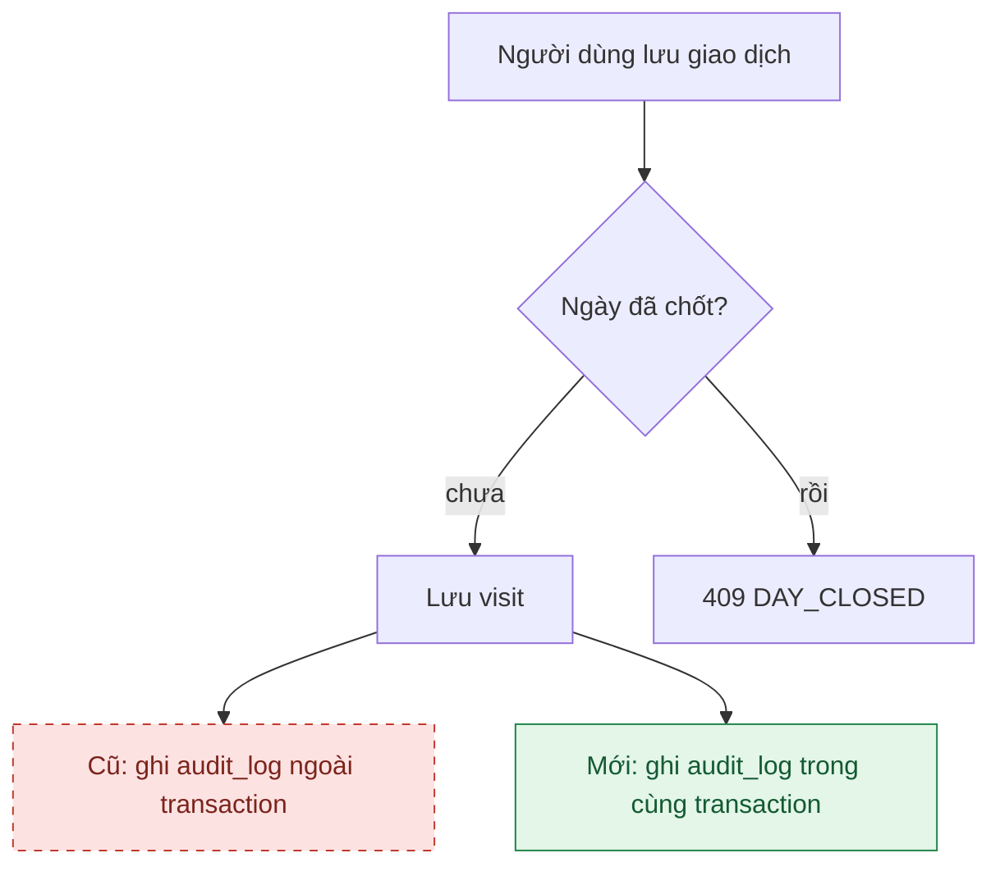

# /fix-bug — prove first, fix second

Never fix what you have not proven. Every statement in the report is either **Verified** (with evidence) or
**Hypothesis** (with how to verify it). No "probably" without a label.

## Phase 1: investigate (no code changes)

0. **Branch** `fix/<card-code>-<short-desc>` per `.agents/rules/builder.md` ("Branch") before writing the red test. A
   bug in a released version (`hotfix/*`): do not create a branch; stop and ask (`CONTRIBUTING.md` section 6).
1. **Describe** in three lines: steps, expected (cite FR/BR), actual. Missing steps → ask; never invent them.
2. **Reproduce with a red test**, the smallest that shows the bug: service logic → Mockito unit test; DB, trigger,
   transaction, API → `@IntegrationTest`; UI → Vitest. Run only that test and **paste the red output**. This test is
   the only new file in phase 1. Cannot reproduce → stop, list what you tried, ask for more information.
3. **Root cause.** Read the feature's flow file first (given, or found in `docs/design/flows/<module>/` by endpoint or
   class). Follow the call path from where the bug shows to where it starts. Use `git log -p -- <file>` and `git blame`
   to see which card changed the line and why. Name the **file:line** and explain the mechanism.
4. **Blast radius.** Same pattern elsewhere (grep)? Wrong data already stored? Wrong data on a closed day is fixed only
   by adjustment entries (ADR-0003), never by direct edits.

## Phase 2: propose (still no code changes)

Write this report and **stop for approval**:

```markdown
# Bug: <one line>

## Symptom
Steps / Expected / Actual

## Evidence (verified)
- Red test: `<path>`, output: <short excerpt>
- Cause: `<file>:<line>` <explanation>
- Since: commit <hash> (<card>)

## Remaining hypotheses
- <hypothesis> → verify by: <...>

## Flow (only for feature-flow bugs)
<one Mermaid flowchart, see below>

## Proposed fix
- Files and exact changes; why this way; alternatives considered
- Impact: API, data, migration

## Tests after the fix
- The red test turns green and stays as a regression test
- Other suites to run
```

## Diagram for flow bugs

One `flowchart` holding both flows: removed or wrong steps use class `old` (red, dashed) with labels starting "Cũ:";
new or changed steps use class `new` (green) with labels starting "Mới:"; unchanged steps are plain.



## Phase 3: fix (after approval)

1. Fix exactly the approved scope. Other bugs you notice go in the report, not in this fix.
2. The red test goes green; run the full suite of every affected part.
3. Update the flow file to the new flow (keep only the "Mới:" side), add the regression test to "Hành vi và test" and a
   history line `<dd/MM/yyyy> | <user name> (Antigravity) | <card> | Sửa lỗi: <summary>`. No flow file yet → create one
   from `docs/design/flows/README.md`.
4. Report with the template in `.agents/rules/builder.md`; suggested commit `fix(<scope>): <english description>`. The
   user types `/pre-pr-check` when ready.
