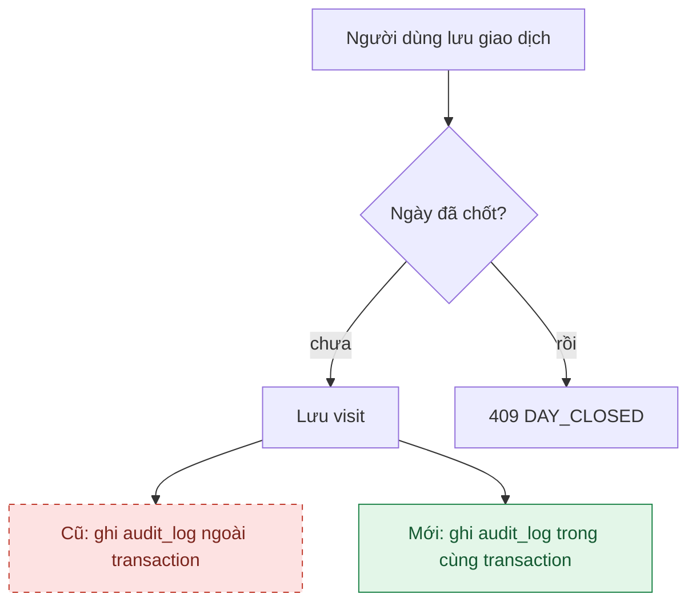

# /fix-bug: chứng minh trước, sửa sau

Nguyên tắc: **không sửa điều mình chưa chứng minh được.** Mọi câu trong báo cáo phải thuộc một trong hai loại:
"Đã xác minh" (kèm bằng chứng) hoặc "Giả thuyết" (kèm cách kiểm chứng). Không dùng "có lẽ", "chắc là" mà không
ghi nhãn.

## Giai đoạn 1: điều tra (không sửa code)

1. **Mô tả lỗi** bằng ba dòng: các bước làm, kết quả mong đợi (trích FR/BR nếu có), kết quả thực tế. Thiếu bước
   tái hiện thì hỏi người dùng, đừng tự bịa.
2. **Tái hiện bằng test đỏ.** Viết test nhỏ nhất cho thấy lỗi:
   - Lỗi logic ở service: test đơn vị (Mockito) cạnh lớp đó.
   - Lỗi liên quan DB, trigger, transaction, API: test `@IntegrationTest` (Testcontainers, cần Docker).
   - Lỗi giao diện: Vitest (component, hook) hoặc Playwright cho luồng nhiều trang.
     Chạy riêng test đó (lệnh ở `AGENTS.md` mục 3) và **dán đoạn output đỏ**. Test đỏ này là file mới duy nhất
     được tạo trong giai đoạn 1.
     Nếu không tái hiện được: dừng, báo những gì đã thử, hỏi thêm thông tin. Không sửa "phòng hờ".
3. **Truy nguyên nhân.** Đi theo luồng gọi từ chỗ lỗi lộ ra tới chỗ sinh lỗi. Dùng `git log -p -- <file>` và
   `git blame` để biết dòng đó đổi từ card nào, vì sao. Chỉ ra **file:dòng** gây lỗi và giải thích cơ chế.
4. **Đánh giá phạm vi.** Lỗi này còn ảnh hưởng chỗ nào khác (tìm cùng mẫu code bằng grep)? Có làm sai dữ liệu đã
   lưu không? Nếu dữ liệu ngày đã chốt bị sai: chỉ sửa bằng bút toán điều chỉnh (ADR-0003), không viết code sửa thẳng.

## Giai đoạn 2: đề xuất (vẫn không sửa code)

Viết báo cáo theo mẫu, rồi **dừng chờ duyệt**:

```markdown
# Lỗi: <tóm tắt một dòng>

## Hiện tượng

Bước làm / Mong đợi / Thực tế

## Bằng chứng (đã xác minh)

- Test đỏ: `<đường dẫn test>`, output: <đoạn ngắn>
- Nguyên nhân: `<file>:<dòng>` <giải thích>
- Từ khi nào: commit <hash> (<card>)

## Giả thuyết còn lại (nếu có)

- <giả thuyết> → cách kiểm chứng: <...>

## Luồng (chỉ khi là lỗi luồng tính năng)

<một sơ đồ Mermaid, xem quy tắc bên dưới>

## Cách sửa đề xuất

- File sẽ sửa và thay đổi cụ thể
- Vì sao chọn cách này; cách khác đã cân nhắc
- Ảnh hưởng: API, dữ liệu, migration (nếu có)

## Test sau khi sửa

- Test đỏ ở trên chuyển xanh và giữ lại làm test chống lỗi tái phát
- Các test khác cần chạy
```

## Sơ đồ cho lỗi luồng tính năng

Vẽ **một** `flowchart` chứa cả luồng cũ và luồng mới để người đọc so sánh ngay:

- Bước bị bỏ hoặc sai: lớp `cu` (đỏ, nét đứt), nhãn bắt đầu bằng "Cũ:".
- Bước mới hoặc sửa: lớp `moi` (xanh), nhãn bắt đầu bằng "Mới:".
- Bước giữ nguyên: không tô.



## Giai đoạn 3: sửa (sau khi được duyệt)

1. Sửa đúng phạm vi đã duyệt. Thấy thêm lỗi khác thì ghi lại để báo, không sửa lẫn vào.
2. Chạy test đỏ: phải xanh. Chạy toàn bộ test của phần bị ảnh hưởng (backend, frontend hoặc cả hai).
3. Báo cáo: file đã sửa, test trước/sau, cách thử tay, câu commit gợi ý `fix(<phạm vi>): <mô tả>`.
