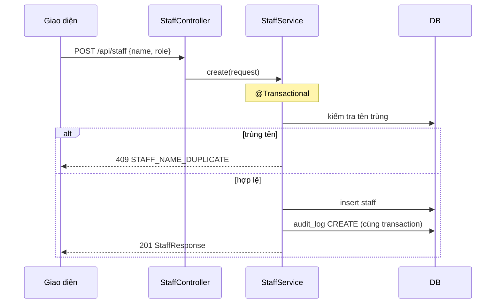

# /plan-task <card> — design before code

The output is a **flow file** in the repo: someone reads it in 5 minutes and knows how the feature works, what it
touches and what is tested; `/implement` builds exactly that. **Do not edit code files in this skill.** Đình's cards
are designed by Claude (`/plan-feature`), not here.

## Steps

1. **Card.** Take the card code from the argument, the branch name, or the user. Read its row in
   `docs/backlog/sprint-*.md`.
2. **Branch** per `.agents/rules/builder.md` ("Branch") before writing anything.
3. **Requirements.** The card's FR section in `docs/srs/03-functional-requirements.md`, related BRs in
   `docs/srs/04-business-rules.md`, OQs in `docs/srs/07-open-questions.md`. Money or closing → also the docs in
   `AGENTS.md` section 2. UI card → `docs/design/ux-guidelines.md` and a full "Màn hình" section.
4. **Existing code and flows.** The closest module to copy (`module/staff` simple catalog, `module/catalog` priced),
   migrations if tables are needed, `git log` of similar cards, files in `docs/design/flows/<module>/`. A feature that
   already has a flow file gets that file updated, not a new one.
5. **Impact** (write into "Ảnh hưởng", plus a "Dữ liệu mẫu dev" line per `backend/AGENTS.md` "Dev seed data"):
   - Endpoint behavior changes: grep the URL in `frontend/src`, `backend/src/test`, `docs/postman`.
   - New state constraint: list every method that moves records into or out of that state.
   - Referenced records: consider both directions of a state change.
6. **Write the flow file** with the template in `docs/design/flows/README.md` (Vietnamese). Status
   `thiết kế (chờ duyệt)`; first history line `<dd/MM/yyyy> | <git user.name> (Antigravity) | <card> | Thiết kế`.
   - Unclear requirements go to "Câu hỏi mở", each with a `Đề xuất:` line. A needed library not in the "Libraries" tables
     goes there too, with the four points of `AGENTS.md` section 3.
   - "Bảo mật" per part A of `docs/security/security-checklist.md`; part C probes go into the test table.
   - Every rule in "Quy tắc nghiệp vụ" has at least one test in "Hành vi và test"; behaviors that transform data before
     saving have a re-read-from-DB case.
   - Large card → "Các phần" per "Chia phần" in `docs/design/flows/README.md`: one user-visible function per part,
     foundation and heaviest first.
   - Main code estimated over ~400 lines → add a "Câu hỏi mở" proposing a split at the next planning, or one PR with
     parts and a reason. Do not split on your own.
7. **Backlog**: card to `Đang làm`.
8. **Stop.** Give the path, a short summary, the open questions, and ask: "Bạn duyệt thiết kế này chứ? Có gì cần đổi?"
   When approved: record the answers (business decisions become new OQs), delete "Câu hỏi mở", set
   `thiết kế (đã duyệt)`. Next step: `/implement <flow file>` (with ` part 1` if it has parts).

## Diagrams

- `sequenceDiagram` with participants `Người dùng`, `Giao diện`, `Controller`, `Service`, `DB`; mark where the
  transaction opens, where `audit_log` is written, where the closed day is checked.
- `flowchart TD` for branching; every error branch ends with the returned code (for example `409 DAY_CLOSED`).
- Short Vietnamese labels (the flow file is a doc).

