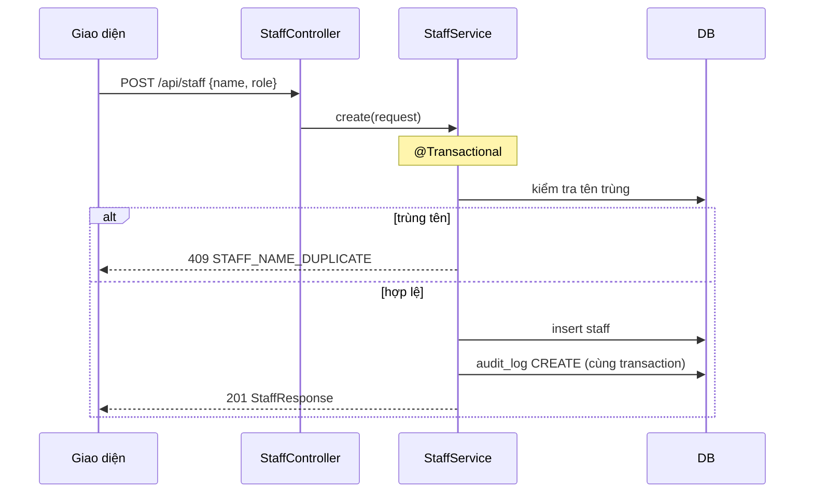

# /plan-task <tên task>: thiết kế trước khi code

Kết quả là **file luồng** trong repo, không phải Implementation Plan: người dùng đọc trong 5 phút là biết tính năng
chạy thế nào, đụng chỗ nào, test gì; `/implement` code theo đúng file đó. **Không sửa file code nào trong skill này.**

Luồng của Đình dùng Claude `/plan-feature` thay cho skill này; Đình đưa thẳng file luồng cho `/implement`.

## Các bước

1. **Xác định card.** Lấy mã card hoặc tên task từ tham số (`/plan-task S2-06`, `/plan-task "quản lý nhóm dịch
   vụ"`); không có thì lấy từ tên nhánh hoặc câu của người dùng. Đọc dòng của card trong `docs/backlog/sprint-*.md`.
2. **Tạo nhánh** theo mục "Nhánh" của `.agents/rules/writer-role.md`, trước khi ghi file nào.
3. **Đọc yêu cầu.** Đúng mục FR trong `docs/srs/03-functional-requirements.md`, BR liên quan trong
   `docs/srs/04-business-rules.md`, OQ trong `docs/srs/07-open-questions.md`. Đụng tiền hay chốt sổ thì đọc thêm
   theo bảng ở `AGENTS.md` mục 2.
4. **Đọc code và file luồng hiện có.** Module gần giống nhất để làm theo (`module/staff` cho danh mục đơn giản,
   `module/catalog` cho danh mục có giá); migration nếu cần bảng; `git log` để xem card trước làm thế nào; các file
   trong `docs/design/flows/<module>/`. Tính năng đã có file luồng thì sửa file đó, không tạo file mới.
5. **Soát chỗ bị ảnh hưởng** (`AGENTS.md` mục 7), ghi vào mục "Ảnh hưởng" của file luồng:
   - Endpoint đổi hành vi: grep URL trong `frontend/src`, `backend/src/test`, `docs/postman`.
   - Thêm ràng buộc trạng thái (ngừng dùng, đã chốt...): liệt kê mọi method đưa bản ghi vào, ra khỏi trạng thái đó.
   - Bản ghi bị bản ghi khác tham chiếu: xét cả hai chiều đổi trạng thái.
6. **Viết file luồng** `docs/design/flows/<module>/<tính-năng>.md` theo khung ở `docs/design/flows/README.md`. Trạng
   thái `thiết kế (chờ duyệt)`; dòng lịch sử đầu `<dd/MM/yyyy> | <tên người dùng> (Antigravity) | <card> | Thiết kế`
   (tên lấy từ `git config --get user.name`). Chỗ SRS chưa rõ đưa vào "Câu hỏi mở", mỗi câu có **Đề xuất:**.
7. **Chuyển card sang "Đang làm"** trong file backlog.
8. **Dừng lại**, báo đường dẫn file, tóm tắt vài dòng, các câu hỏi mở, rồi hỏi: "Bạn duyệt thiết kế này chứ? Có gì
   cần đổi?" Khi được duyệt: ghi câu trả lời vào file (câu thành quyết định nghiệp vụ thì thêm OQ), xóa "Câu hỏi mở",
   đổi trạng thái thành `thiết kế (đã duyệt)`. Bước tiếp theo là `/implement <đường dẫn file luồng>`.

## Một card, một PR

Card và PR là một (CONTRIBUTING.md mục 2). Ước lượng code chính (không tính test, Postman, tài liệu) quá khoảng 400
dòng thì ghi vào "Câu hỏi mở": đề xuất tách card ở lần lập sprint sau, hoặc giữ một PR và ghi lý do. Không tự tách.

## Quy tắc vẽ sơ đồ

- `sequenceDiagram` với các bên: `Người dùng`, `Giao diện`, `Controller`, `Service`, `DB`. Ghi rõ chỗ mở
  transaction, chỗ ghi `audit_log`, chỗ kiểm tra ngày đã chốt.
- `flowchart TD` cho rẽ nhánh: mỗi nhánh lỗi kết thúc bằng mã lỗi trả về (ví dụ `409 DAY_CLOSED`).
- Nhãn tiếng Việt, ngắn. Ví dụ:

