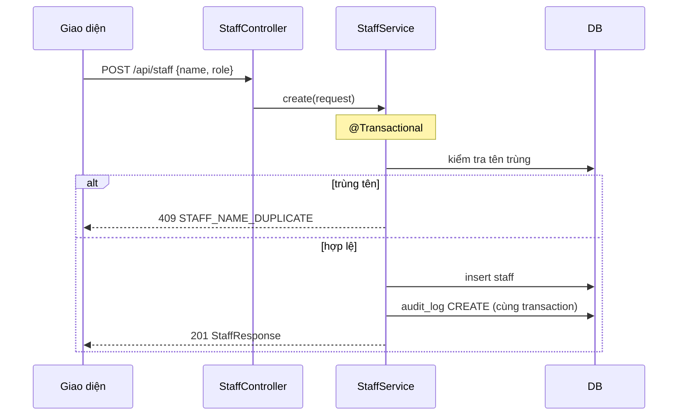

# /plan: kế hoạch trước khi code

Mục tiêu: người dùng đọc kế hoạch trong 5 phút là biết bạn sẽ làm gì, theo luồng nào, đụng file nào, test gì.
**Không sửa file code nào trong skill này.**

## Các bước

1. **Xác định card.** Lấy mã card từ lời người dùng hoặc tên nhánh (`git branch --show-current`, ví dụ
   `feature/S2-06-service-group`). Đọc dòng của card trong `docs/backlog/sprint-*.md`.
2. **Đọc yêu cầu.** Mở đúng mục FR trong `docs/srs/03-functional-requirements.md`, các BR liên quan trong
   `docs/srs/04-business-rules.md`, OQ trong `docs/srs/07-open-questions.md`. Đụng tiền hay chốt sổ thì đọc thêm
   theo bảng ở `AGENTS.md` mục 2.
3. **Đọc code hiện có.** Tìm module gần giống nhất để làm theo (ví dụ `module/staff` cho danh mục đơn giản,
   `module/catalog` cho danh mục có giá). Đọc migration hiện có nếu cần bảng. Dùng `git log` để xem các card trước
   đã làm thế nào.
4. **Viết kế hoạch** theo mẫu bên dưới, dưới dạng Implementation Plan của Antigravity.
5. **Chuyển card sang "Đang làm"** trong file backlog là việc của bước `/implement`; ở đây chỉ ghi vào kế hoạch.
6. **Dừng lại**, hỏi: "Bạn duyệt kế hoạch này chứ? Có gì cần đổi?" Chỉ khi người dùng duyệt mới chuyển sang
   `/implement`.

## Mẫu kế hoạch

```markdown
# Kế hoạch: <mã card> <tên card>

## 1. Mục tiêu

<1 đến 3 câu: người dùng cuối làm được gì sau card này.>
Yêu cầu: FR-..., BR-..., OQ-... (đã chốt / còn mở)

## 2. Ý tưởng

<Cách giải quyết chọn, và vì sao. Nếu có 2 cách, nêu cách bỏ và lý do.>

## 3. Luồng xử lý

<Sơ đồ Mermaid. Thường cần một sequenceDiagram cho API chính, và flowchart nếu có rẽ nhánh nghiệp vụ.>

## 4. Thay đổi

| Phần     | Thay đổi                                                        |
| -------- | --------------------------------------------------------------- |
| DB       | Migration V{n}__... : bảng, cột, index, trigger (hoặc "Không")  |
| API      | `POST /api/...` body, mã trạng thái, mã lỗi mới trong ErrorCode |
| Backend  | file sẽ thêm/sửa theo khuôn module trong backend/AGENTS.md      |
| Frontend | feature, page, component, schema Zod, query key                 |
| Tài liệu | Postman, backlog, ERD, SRS, AGENTS (nếu đổi quy ước)            |

## 5. Quy tắc nghiệp vụ phải giữ

<Liệt kê cụ thể cho card này: tiền long, ngày đã chốt, audit_log cùng transaction, không xóa cứng, Clock...>

## 6. Test sẽ viết

- Đơn vị (Mockito / Vitest): <tên test và trường hợp>
- Tích hợp (@IntegrationTest): <trường hợp chính và trường hợp lỗi>
- Thử tay bằng Postman / giao diện: <bước và kết quả mong đợi>

## 7. Rủi ro và câu hỏi

<Điều chưa rõ trong SRS (ghi mã OQ), giả định tạm, phần dễ đụng file của người kia.>
```

## Quy tắc vẽ sơ đồ

- Dùng Mermaid để GitHub hiển thị được khi dán vào PR. Nhãn tiếng Việt, ngắn.
- `sequenceDiagram` với các bên: `Người dùng`, `Giao diện`, `Controller`, `Service`, `DB`. Ghi rõ chỗ mở
  transaction, chỗ ghi `audit_log`, chỗ kiểm tra ngày đã chốt.
- `flowchart TD` cho rẽ nhánh: mỗi nhánh lỗi kết thúc bằng mã lỗi trả về (ví dụ `409 DAY_CLOSED`).
- Ví dụ:


