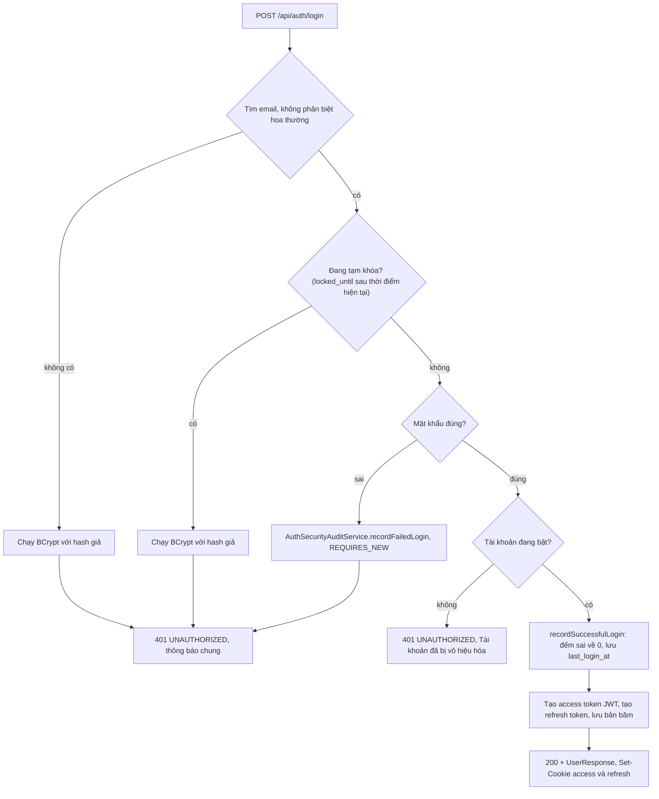
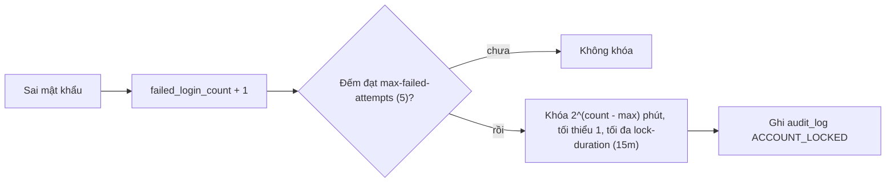
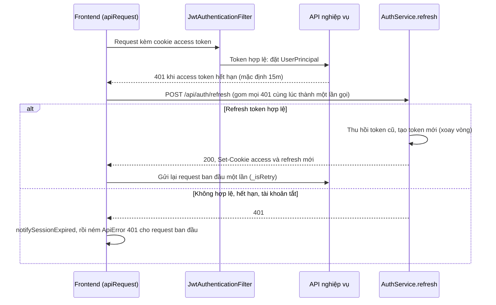
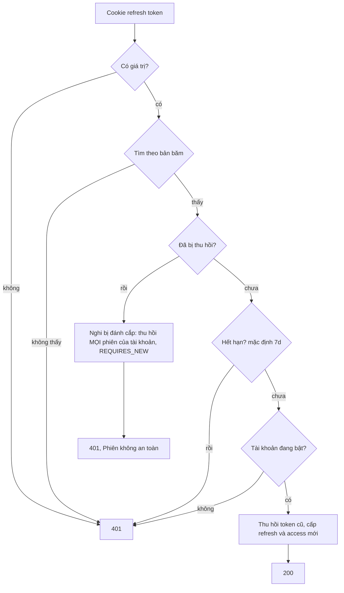
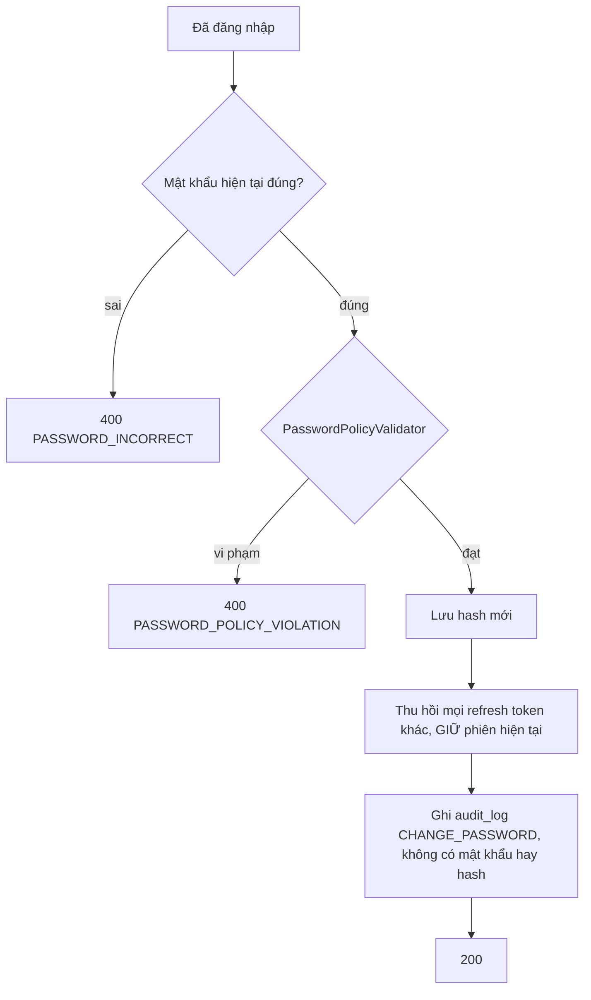
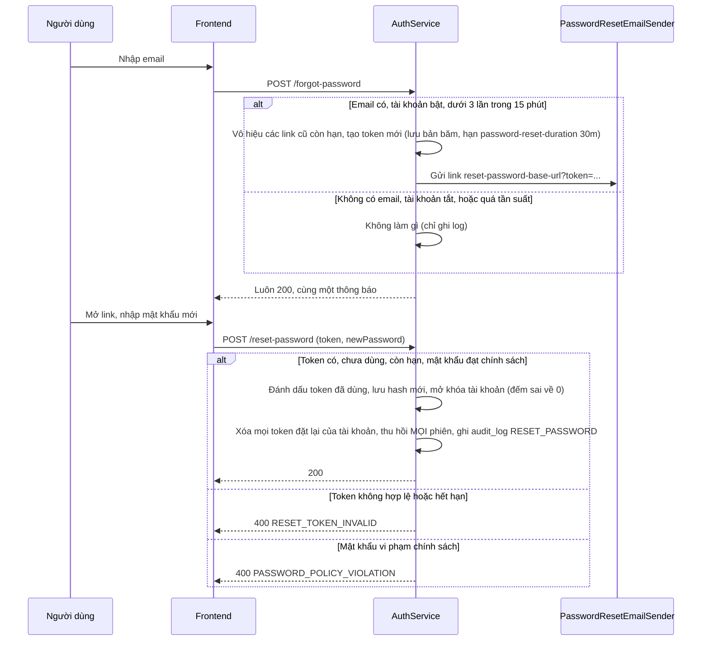

# Luồng xử lý: auth

Module `backend/.../module/auth`, `security/`; frontend `features/auth`, `shared/api/client.ts`. Yêu cầu:
FR-AUTH-01 đến FR-AUTH-05, NFR-SEC-02, NFR-SEC-03. Cấu hình ở `application.yml`, nhóm `xile.security.jwt` và
`xile.security.auth` (thời hạn token, số lần sai, thời hạn link đặt lại); số trong sơ đồ là giá trị mặc định.

Chung cho mọi luồng:

- Access token (JWT) và refresh token nằm trong cookie `HttpOnly`, `SameSite=Strict`; frontend không đọc được.
- Refresh token và token đặt lại mật khẩu chỉ lưu **bản băm** SHA-256 (`TokenHasher`); chuỗi gốc chỉ nằm trong
  cookie hoặc trong link email.
- Endpoint công khai: `login`, `refresh`, `logout`, `forgot-password`, `reset-password` (`SecurityConfig`). Mọi
  endpoint khác cần access token hợp lệ, thiếu thì `401 UNAUTHORIZED`.

## Đăng nhập (FR-AUTH-01, FR-AUTH-05)

Điểm vào: `POST /api/auth/login` → `AuthController.login` → `AuthService.login`. Frontend: `LoginPage`,
`useLogin`.

Khóa tạm thời (`AppUser.recordFailedLogin`):

Quy tắc giữ trong luồng:

- Ba nhánh "không có email", "đang khóa", "sai mật khẩu" trả **cùng một thông báo** và đều chạy BCrypt, để không
  lộ email có tồn tại hay không qua nội dung hoặc thời gian phản hồi (NFR-SEC-02).
- Kiểm tra khóa **trước** mật khẩu: đang khóa thì không đếm thêm lần sai.
- Bộ đếm sai được ghi trong transaction riêng (`REQUIRES_NEW`), nên không bị rollback khi ném 401.
- Bộ đếm chỉ về 0 khi đăng nhập đúng hoặc khi đặt lại mật khẩu; hết hạn khóa thì bỏ `locked_until` nhưng giữ bộ
  đếm, nên lần sai tiếp theo khóa lâu hơn.

Lỗi trả về: `401 UNAUTHORIZED` (sai thông tin, đang khóa, tài khoản tắt), `400 VALIDATION_FAILED` (thiếu email,
mật khẩu).

## Duy trì phiên và làm mới token (FR-AUTH-02)

Điểm vào: mọi request qua `JwtAuthenticationFilter`; `POST /api/auth/refresh` → `AuthService.refresh`. Frontend:
`shared/api/client.ts` (`apiRequest`, `tryRefreshSession`).

Khi refresh thất bại, `notifySessionExpired` hiện **chưa có component nào đăng ký** (`onSessionExpired`), nên trang
đang mở chỉ hiện lỗi 401 của request đó. Người dùng được đưa về `/login` khi `ProtectedRoute` thấy query
`authKeys.me` lỗi, tức là khi query này chạy lại (hết `staleTime` 5 phút, hoặc tải lại trang).

Kiểm tra trong `AuthService.refresh`, theo thứ tự:

Quy tắc giữ trong luồng:

- Mỗi refresh token chỉ dùng được một lần. Dùng lại token đã thu hồi là dấu hiệu bị đánh cắp, nên thu hồi toàn bộ
  phiên, và việc thu hồi phải commit ngay dù request trả lỗi (`AuthSecurityAuditService`, `REQUIRES_NEW`).
- Frontend gom các 401 đồng thời vào một promise refresh; nếu không, hai request cùng lúc sẽ dùng cùng một refresh
  token và lần thứ hai bị coi là dùng lại, làm mất phiên.
- Frontend không tự refresh cho chính `login`, `refresh`, `logout` (`isAuthBypassPath`).

## Đăng xuất (FR-AUTH-02)

Điểm vào: `POST /api/auth/logout` → `AuthService.logout`.

- Có refresh token trong cookie thì thu hồi đúng token đó; không có hoặc không tìm thấy thì bỏ qua.
- Luôn trả `204` và xóa cả hai cookie, kể cả khi token không hợp lệ.

## Đổi mật khẩu (FR-AUTH-04, NFR-SEC-03)

Điểm vào: `POST /api/auth/change-password` (cần đăng nhập) → `AuthService.changePassword`. Frontend:
`ChangePasswordModal`.

Chính sách mật khẩu (`PasswordPolicyValidator`): tối thiểu 10 ký tự, tối đa 72 byte (giới hạn của BCrypt), không
nằm trong danh sách mật khẩu phổ biến, không trùng mật khẩu cũ.

## Quên và đặt lại mật khẩu (FR-AUTH-03)

Điểm vào: `POST /api/auth/forgot-password` → `AuthService.forgotPassword`; `POST /api/auth/reset-password` →
`AuthService.resetPassword`. Frontend: `ForgotPasswordPage`, `ResetPasswordPage` (đọc `?token=` trên URL).

Quy tắc giữ trong luồng:

- `forgot-password` luôn trả `200` với cùng thông báo, kể cả khi email không tồn tại hay bị chặn tần suất, để không
  lộ email nào có tài khoản.
- Link chỉ dùng một lần và chỉ link mới nhất còn hiệu lực.
- Đặt lại thành công thì mở khóa tài khoản và đăng xuất mọi thiết bị (khác với đổi mật khẩu, giữ phiên hiện tại).
