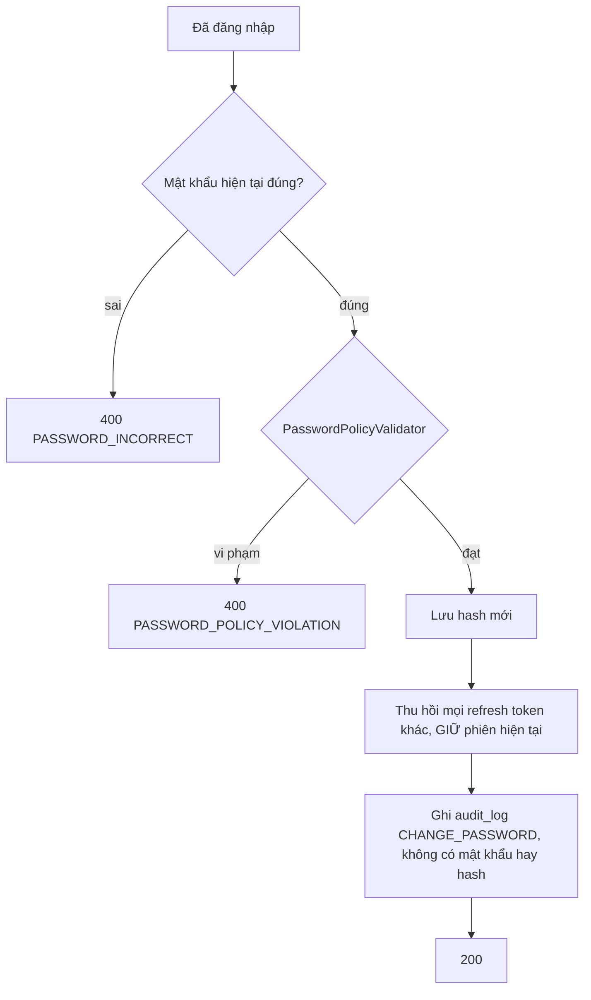

# Đổi mật khẩu

Trạng thái: khớp code · Card: S2-01 · Yêu cầu: FR-AUTH-04, NFR-SEC-03

| Ngày       | Người         | Card / PR            | Thay đổi                                                     |
| ---------- | ------------- | -------------------- | ------------------------------------------------------------ |
| 23/10/2026 | Đình (Claude) | chore/agent-workflow | Tách từ `auth.md` (vẽ theo code, commit 56aca20), nội dung không đổi |

Phần chung của module (cookie, bản băm token, endpoint công khai, cấu hình): `README.md` cùng thư mục.

Điểm vào: `POST /api/auth/change-password` (cần đăng nhập) → `AuthService.changePassword`. Frontend:
`ChangePasswordModal`.

Chính sách mật khẩu (`PasswordPolicyValidator`): tối thiểu 10 ký tự, tối đa 72 byte (giới hạn của BCrypt), không
nằm trong danh sách mật khẩu phổ biến, không trùng mật khẩu cũ.
