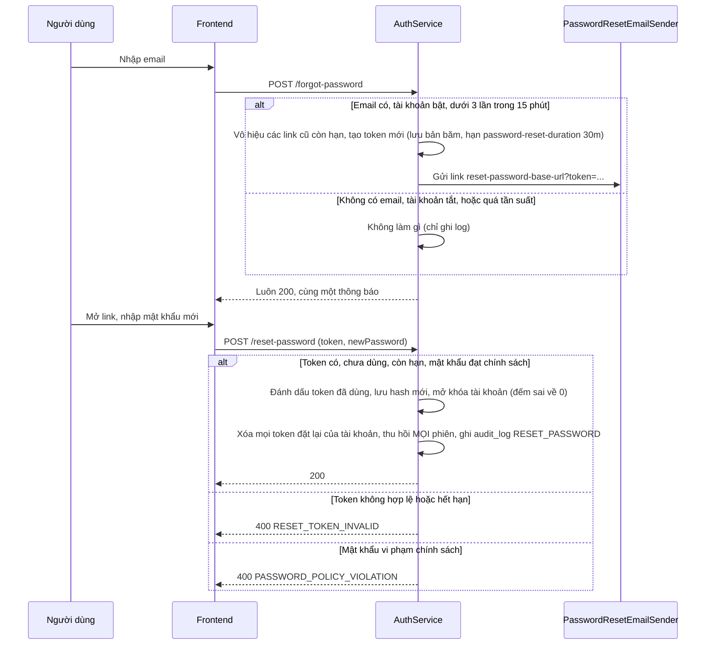

# Quên và đặt lại mật khẩu

Trạng thái: khớp code · Card: S2-02 · Yêu cầu: FR-AUTH-03

| Ngày       | Người         | Card / PR            | Thay đổi                                                     |
| ---------- | ------------- | -------------------- | ------------------------------------------------------------ |
| 23/10/2026 | Đình (Claude) | chore/agent-workflow | Tách từ `auth.md` (vẽ theo code, commit 56aca20), nội dung không đổi |

Phần chung của module (cookie, bản băm token, endpoint công khai, cấu hình): `README.md` cùng thư mục.

Điểm vào: `POST /api/auth/forgot-password` → `AuthService.forgotPassword`; `POST /api/auth/reset-password` →
`AuthService.resetPassword`. Frontend: `ForgotPasswordPage`, `ResetPasswordPage` (đọc `?token=` trên URL).

Quy tắc giữ trong luồng:

- `forgot-password` luôn trả `200` với cùng thông báo, kể cả khi email không tồn tại hay bị chặn tần suất, để không
  lộ email nào có tài khoản.
- Link chỉ dùng một lần và chỉ link mới nhất còn hiệu lực.
- Đặt lại thành công thì mở khóa tài khoản và đăng xuất mọi thiết bị (khác với đổi mật khẩu, giữ phiên hiện tại).
