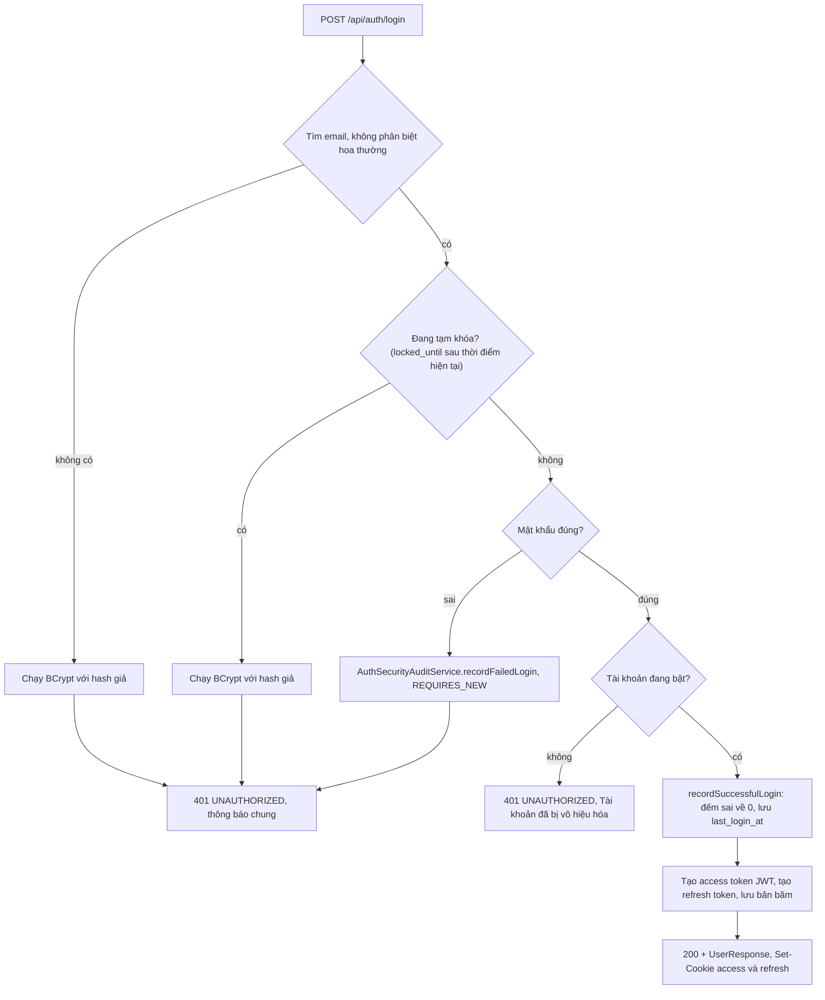
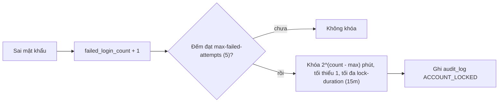

# Đăng nhập

Trạng thái: khớp code · Card: S1-01, S2-03 · Yêu cầu: FR-AUTH-01, FR-AUTH-05, NFR-SEC-02

| Ngày       | Người         | Card / PR            | Thay đổi                                                     |
| ---------- | ------------- | -------------------- | ------------------------------------------------------------ |
| 23/10/2026 | Đình (Claude) | chore/agent-workflow | Tách từ `auth.md` (vẽ theo code, commit 56aca20), nội dung không đổi |

Phần chung của module (cookie, bản băm token, endpoint công khai, cấu hình): `README.md` cùng thư mục.

Điểm vào: `POST /api/auth/login` → `AuthController.login` → `AuthService.login`. Frontend: `LoginPage`,
`useLogin`.

Khóa tạm thời (`AppUser.recordFailedLogin`):

Quy tắc giữ trong luồng:

- Ba nhánh "không có email", "đang khóa", "sai mật khẩu" trả **cùng một thông báo** và đều chạy BCrypt, để không
  lộ email có tồn tại hay không qua nội dung hoặc thời gian phản hồi (NFR-SEC-02).
- Kiểm tra khóa **trước** mật khẩu: đang khóa thì không đếm thêm lần sai.
- Bộ đếm sai được ghi trong transaction riêng (`REQUIRES_NEW`), nên không bị rollback khi ném 401.
- Bộ đếm chỉ về 0 khi đăng nhập đúng hoặc khi đặt lại mật khẩu; hết hạn khóa thì bỏ `locked_until` nhưng giữ bộ
  đếm, nên lần sai tiếp theo khóa lâu hơn.

Lỗi trả về: `401 UNAUTHORIZED` (sai thông tin, đang khóa, tài khoản tắt), `400 VALIDATION_FAILED` (thiếu email,
mật khẩu).
