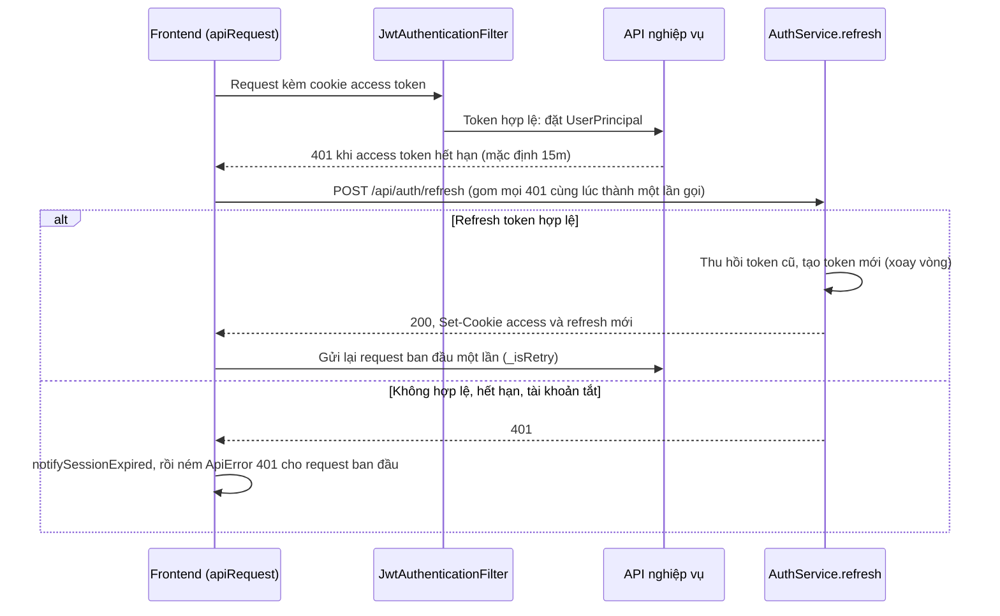
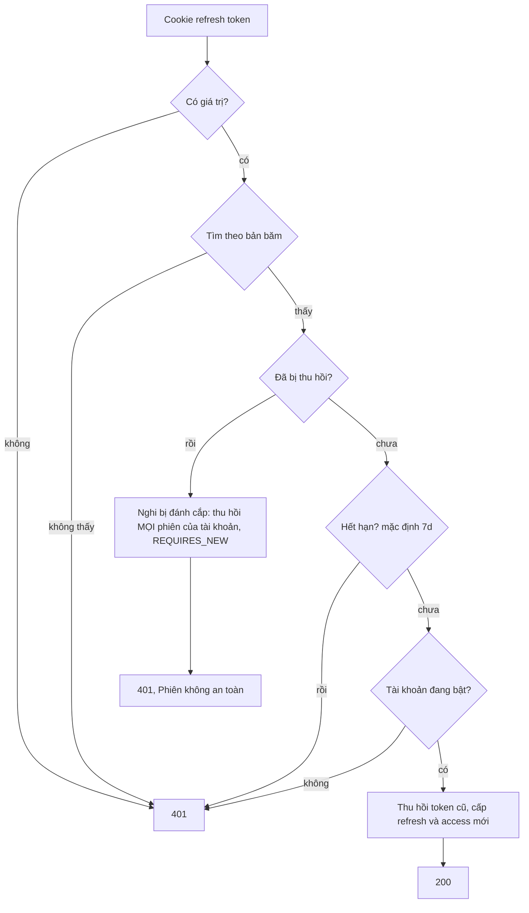

# Duy trì phiên và làm mới token

Trạng thái: khớp code · Card: S1-01, S2-04 · Yêu cầu: FR-AUTH-02

| Ngày       | Người         | Card / PR            | Thay đổi                                                     |
| ---------- | ------------- | -------------------- | ------------------------------------------------------------ |
| 23/10/2026 | Đình (Claude) | chore/agent-workflow | Tách từ `auth.md` (vẽ theo code, commit 56aca20), nội dung không đổi |

Phần chung của module (cookie, bản băm token, endpoint công khai, cấu hình): `README.md` cùng thư mục.

Điểm vào: mọi request qua `JwtAuthenticationFilter`; `POST /api/auth/refresh` → `AuthService.refresh`. Frontend:
`shared/api/client.ts` (`apiRequest`, `tryRefreshSession`).

Khi refresh thất bại, `notifySessionExpired` hiện **chưa có component nào đăng ký** (`onSessionExpired`), nên trang
đang mở chỉ hiện lỗi 401 của request đó. Người dùng được đưa về `/login` khi `ProtectedRoute` thấy query
`authKeys.me` lỗi, tức là khi query này chạy lại (hết `staleTime` 5 phút, hoặc tải lại trang). Sửa ở thẻ S3-07
(`docs/backlog/sprint-2-3.md`); sửa xong thì cập nhật đoạn này theo luồng mới.

Kiểm tra trong `AuthService.refresh`, theo thứ tự:

Quy tắc giữ trong luồng:

- Mỗi refresh token chỉ dùng được một lần. Dùng lại token đã thu hồi là dấu hiệu bị đánh cắp, nên thu hồi toàn bộ
  phiên, và việc thu hồi phải commit ngay dù request trả lỗi (`AuthSecurityAuditService`, `REQUIRES_NEW`).
- Frontend gom các 401 đồng thời vào một promise refresh; nếu không, hai request cùng lúc sẽ dùng cùng một refresh
  token và lần thứ hai bị coi là dùng lại, làm mất phiên.
- Frontend không tự refresh cho chính `login`, `refresh`, `logout` (`isAuthBypassPath`).
