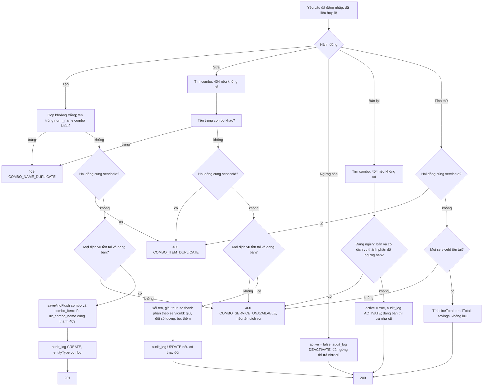
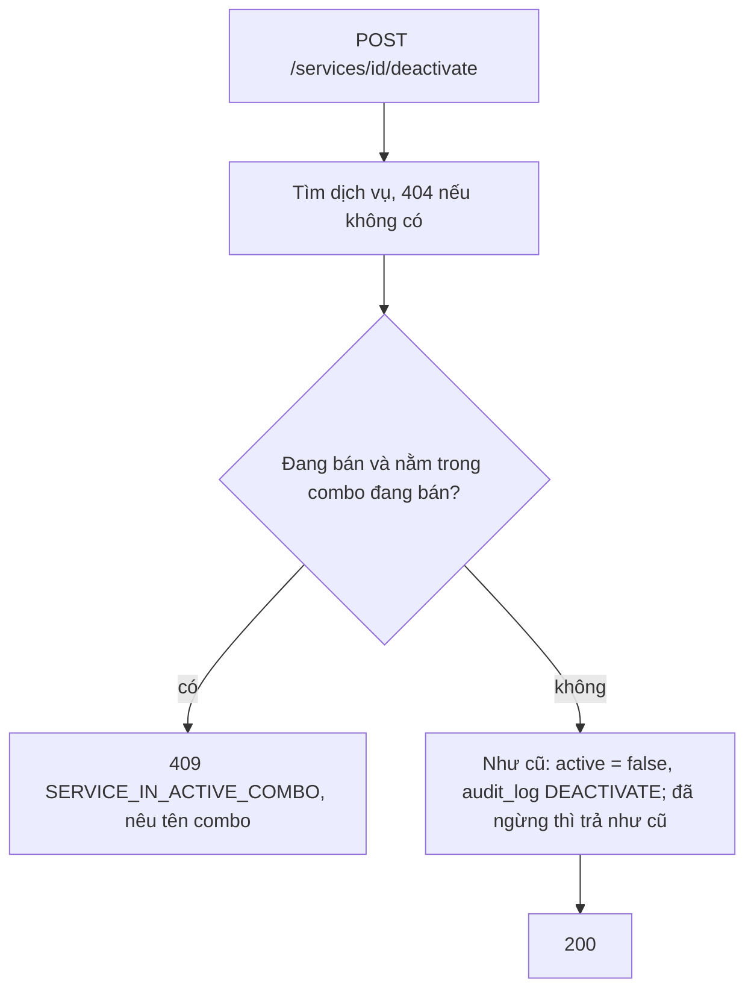
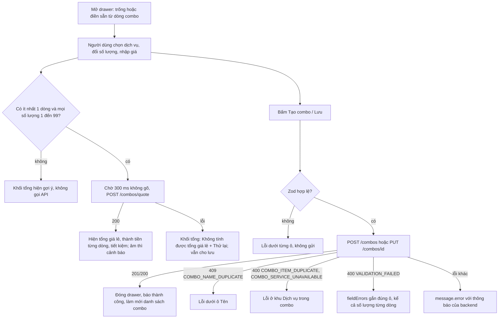

# Combo

Trạng thái: khớp code (backend, S2-07) · thiết kế (đã duyệt) (giao diện, S2-08) · Card: S2-07, S2-08 · Yêu cầu: FR-CMB-01 đến FR-CMB-05, BR-01, BR-03, BR-13, BR-18, BR-19, OQ-06, OQ-22

**Chia phần** (mục cuối "Các phần"): backend phần 1 đến 4 (S2-07, đã xong), giao diện phần 5 đến 7 (S2-08). Mỗi lần
`/implement docs/design/flows/catalog/combo.md phần <N>` làm một phần rồi dừng.

| Ngày       | Người         | Card / PR | Thay đổi                                                                                   |
| ---------- | ------------- | --------- | ------------------------------------------------------------------------------------------ |
| 25/10/2026 | Đình (Claude) | S2-07     | Thiết kế backend                                                                           |
| 25/10/2026 | Đình (Claude) | S2-07     | Đình duyệt: OQ-22 (chặn ngừng bán dịch vụ trong combo đang bán), có API tính thử, một card chia bốn phần |
| 25/10/2026 | Đình (Claude) | S2-07     | Tự soát phần 1: 2 vòng, sạch; Postman combo tự tạo dữ liệu |
| 25/10/2026 | Đình (Claude) | S2-07     | Tự soát phần 2: 2 vòng, sạch; test đọc lại combo từ DB sau khi sửa |
| 25/10/2026 | Đình (Claude) | S2-07     | Tự soát phần 3: 1 vòng, sạch; 2 điểm nên sửa làm cùng phần 4 |
| 25/10/2026 | Đình (Antigravity) | S2-07 | Phần 4 và 2 điểm nên sửa của phần 3; khớp code toàn bộ backend |
| 25/10/2026 | Đình (Claude) | S2-07     | Tự soát phần 4: 2 vòng, sạch (thêm test thứ tự danh sách). Cả card: 7 vòng cho 4 phần |
| 26/10/2026 | Đình (Claude) | S2-08     | Thiết kế giao diện: mục "Màn hình", "Bảo mật", ảnh hưởng và test giao diện, phần 5 đến 7 |
| 26/10/2026 | Đình (Claude) | S2-08     | Đình chốt: một card chia ba phần, thêm "Combo Đá Nóng" vào dữ liệu mẫu dev, mục menu riêng "Combo"; còn câu nút "Bán lại" |
| 26/10/2026 | Đình (Antigravity) | S2-08 | Đình duyệt thiết kế S2-08, chốt Câu hỏi mở 2 theo đề xuất gộp |
| 26/10/2026 | Đình (Antigravity) | S2-08 | Phần 5: types, API, schemas, ComboItemsField, ComboPriceSummary, ComboFormDrawer, ComboListPage khung, route /combos, menu; test xanh 100% |
| 26/10/2026 | Đình (Claude) | S2-08     | Tự soát phần 5, lần 1: ghi quyết định nút "Bán lại" vào "Màn hình", bảng test, thử tay; xóa "Câu hỏi mở"; số lượng trên dòng lấy từ kết quả tính thử; thêm test danh sách tải lại sau khi thêm |

Phần chung của module (tên không trùng, không xóa cứng, nhật ký, OQ-21): `README.md` cùng thư mục.

## Mục tiêu

Chủ tiệm gom nhiều dịch vụ thành combo có giá riêng để bán nhanh: tạo, sửa, ngừng bán, bán lại; xem tổng giá lẻ của
các dịch vụ thành phần và mức tiết kiệm do **backend tính** (giao diện S2-08 chỉ hiển thị). Giao dịch đã ghi chụp tên,
giá và tiền tour của combo lúc bán (BR-03), nên sửa combo không làm đổi số liệu cũ.

## Điểm vào

Mới hoàn toàn, chưa có nơi gọi. Bảng `combo`, `combo_item` đã có từ V1, **không cần migration**.

| Loại | Điểm vào                                                                                       | Ghi chú                                                                          |
| ---- | ---------------------------------------------------------------------------------------------- | -------------------------------------------------------------------------------- |
| API  | `GET /api/catalog/combos?q=&active=&page=&size=` → `ComboController.search` → `ComboService.search` | trang từ 0, `size` mặc định 20, tối đa 100; xếp theo tên, rồi id; mỗi combo kèm thành phần và số tính sẵn |
| API  | `GET /api/catalog/combos/{id}` → `get`                                                          | 200                                                                              |
| API  | `POST /api/catalog/combos` → `create`                                                           | body `ComboRequest`, 201 kèm `Location`                                          |
| API  | `PUT /api/catalog/combos/{id}` → `update`                                                       | thay toàn bộ, kể cả danh sách thành phần, 200                                    |
| API  | `POST /api/catalog/combos/{id}/deactivate`, `/activate` → `deactivate`, `activate`              | 200                                                                              |
| API  | `POST /api/catalog/combos/quote` → `quote`                                                      | tính thử tổng giá lẻ, mức tiết kiệm cho form S2-08; không lưu, không audit, 200 |
| API  | `POST /api/catalog/services/{id}/deactivate` (đã có) → `ServiceItemService.deactivate`          | **đổi hành vi**: chặn khi dịch vụ nằm trong combo đang bán (xem "Quy tắc")       |
| Màn hình | `features/catalog/pages/ComboListPage` (route `/combos`, menu "Combo")                     | S2-08. Bảng ở iPad, máy tính; thẻ ở điện thoại; tìm, lọc trạng thái, ngừng bán, bán lại |
| Màn hình | `features/catalog/components/ComboFormDrawer` (+ `ComboItemsField`, `ComboPriceSummary`)   | S2-08. Thêm, sửa; tổng giá lẻ và tiết kiệm lấy từ `POST /combos/quote`, không tính ở giao diện |

Không có `DELETE` (405, BR-19).

### Dữ liệu vào

`ComboRequest` (POST và PUT dùng chung):

| Trường    | Kiểu                     | Kiểm tra và thông báo                                                                                          |
| --------- | ------------------------ | -------------------------------------------------------------------------------------------------------------- |
| `name`    | chuỗi                    | `@NotBlank` "Tên combo không được để trống"; `@Size(max = 150)` "Tên combo tối đa 150 ký tự"                   |
| `price`   | `Long`                   | `@NotNull` "Vui lòng nhập giá combo"; `@PositiveOrZero` "Giá combo không được âm"; `@Max(1_000_000_000)` "Giá combo tối đa 1.000.000.000 đ" |
| `tourFee` | `Long`, tùy chọn         | trống là 0 (OQ-06); `@PositiveOrZero` "Tiền tour không được âm"; `@Max(1_000_000_000)` "Tiền tour tối đa 1.000.000.000 đ" |
| `items`   | `List<ComboItemRequest>` | `@NotEmpty` "Combo phải có ít nhất một dịch vụ"; `@Size(max = 20)` "Combo tối đa 20 dịch vụ"; `@Valid`        |

`ComboItemRequest`: `serviceId` (`@NotNull` "Vui lòng chọn dịch vụ"), `quantity` (`@NotNull` "Vui lòng nhập số
lượng", `@Min(1)` "Số lượng tối thiểu là 1", `@Max(99)` "Số lượng tối đa là 99"). Lỗi trả `fieldErrors` dạng
`items[0].quantity`.

`ComboQuoteRequest`: `price` (`Long`, **tùy chọn**, cùng giới hạn như trên), `items` (`@Size(max = 20)`, `@Valid`,
**được rỗng** vì form đang nhập dở). Giới hạn 20 dòng, số lượng 99 là giới hạn kỹ thuật chặn dữ liệu vô lý, đặt hằng
số `MAX_ITEMS`, `MAX_QUANTITY` trong DTO hoặc `ComboService`.

### Dữ liệu ra

`ComboResponse`: `id`, `name`, `price`, `tourFee`, `active`, `items` (`List<ComboItemResponse>`), `retailTotal`,
`savings`, `createdAt`, `updatedAt`.

`ComboItemResponse`: `serviceId`, `serviceName`, `serviceActive`, `listPrice` (giá niêm yết **hiện tại** của dịch vụ),
`quantity`, `lineTotal`.

`ComboQuoteResponse`: `items` (`List<ComboItemResponse>`), `retailTotal`, `savings` (`Long`, null khi chưa có `price`).

Công thức (FR-CMB-03), tính ở `ComboService`, không ở mapper (backend/AGENTS.md, mapper quy tắc 1):
`lineTotal = listPrice × quantity`, `retailTotal = Σ lineTotal`, `savings = retailTotal − price`. `savings` âm nghĩa
là giá combo cao hơn tổng giá lẻ: vẫn cho lưu, giao diện hiện cảnh báo. Dùng `Math.multiplyExact`, `Math.addExact`
(giới hạn trên đã chặn tràn, đây là rào chắn thêm). Thành phần xếp theo thứ tự thêm (`combo_item.id`).

`retailTotal`, `savings` **không lưu**, tính mỗi lần đọc theo giá hiện tại của dịch vụ: đổi giá dịch vụ thì mức tiết
kiệm của combo đổi theo, giá combo thì không.

## Luồng

Ngừng bán dịch vụ (đổi ở `ServiceItemService.deactivate`):

Mọi thao tác ghi chạy trong một `@Transactional` của service; audit ghi trong cùng transaction (BR-18).

## Màn hình

S2-08, chỉ giao diện: dùng sáu endpoint của S2-07, không đổi backend, không đổi Postman. Khuôn theo
`ServiceListPage`, `ServiceFormDrawer` (cùng module); câu chữ theo `docs/design/ux-guidelines.md`.

Luồng của form (thêm và sửa dùng chung):

### Danh sách (`ComboListPage`, route `/combos`)

Menu: mục "Combo" ngay sau "Dịch vụ" trong `AppLayout`, icon `GiftOutlined`. Trang 20 combo, xếp như backend (tên, id).

| Phần                     | Điện thoại (dưới 768 px)                                                                        | iPad, máy tính (từ 768 px)                                          |
| ------------------------ | ----------------------------------------------------------------------------------------------- | ------------------------------------------------------------------- |
| Đầu trang                | Tiêu đề "Combo"; nút "Thêm combo" (`type="primary"`, `size="large"`, `PlusOutlined`) xuống dòng dưới tiêu đề | cùng nội dung, nút ở góc phải tiêu đề                               |
| Bộ lọc                   | ô "Tìm theo tên" (`useDebounce` 300 ms, gửi `q`, bỏ hẳn `q` khi trống); ô trạng thái "Đang bán" (mặc định) / "Ngừng bán" / "Tất cả"; "Xóa bộ lọc" khi khác mặc định. Đổi bộ lọc thì về trang đầu | như điện thoại, cùng một hàng                                      |
| Bố cục                   | danh sách thẻ (`Card` nhỏ), `Pagination` khi quá một trang                                       | `Table`, phân trang của bảng                                        |
| Thứ tự trên thẻ          | dòng 1: tên (đậm) + `Tag` trạng thái; dòng 2 (chữ phụ): thành phần; dòng 3: "Giá combo: **400.000 đ** · Giá lẻ: 480.000 đ"; dòng 4: "Tiết kiệm: 80.000 đ · Tour: 60.000 đ"; dòng 5: nút | cột: Tên combo (dòng dưới là thành phần, chữ phụ), Giá combo, Tổng giá lẻ, Tiết kiệm, Tiền tour, Trạng thái, (nút). Bốn cột tiền canh phải |

- **Thành phần** viết theo thứ tự backend trả về, cách nhau dấu phẩy, số lượng lớn hơn 1 thì thêm ` × n`: "Gội đầu
  thảo dược, Giãn cơ chân × 2". Dịch vụ đã ngừng bán (`serviceActive = false`) thêm " (ngừng bán)".
- **Tiền** chỉ định dạng bằng `formatMoney` từ `price`, `retailTotal`, `savings`, `tourFee` của backend. `savings`
  âm hiện như backend trả ("-50.000 đ"), chữ màu cảnh báo (`Typography.Text type="warning"`), không đổi dấu, không tự
  trừ.

| Trạng thái | Hiển thị và câu chữ chính xác                                                                                              |
| ---------- | -------------------------------------------------------------------------------------------------------------------------- |
| Đang tải   | `Table loading` / `List loading` (theo `isFetching`, giữ trang cũ khi đổi trang bằng `keepPreviousData`)                     |
| Lỗi tải    | `Alert` error, tiêu đề "Không tải được danh sách combo", mô tả là `error.message`, nút "Thử lại" (`refetch`)               |
| Trống      | không lọc: `Empty` "Chưa có combo nào"; đang lọc: "Không có combo khớp bộ lọc hiện tại" + nút "Xóa bộ lọc"                 |
| Có dữ liệu | bảng hoặc thẻ như trên                                                                                                     |

Hành động trên mỗi dòng (`Space wrap`):

- **"Sửa"** (`EditOutlined`): mở `ComboFormDrawer` với dòng đó (dữ liệu của danh sách đã có đủ thành phần, không gọi
  `GET /combos/{id}`).
- **"Ngừng bán"** (combo đang bán, nút `danger`): `Popconfirm` tiêu đề "Ngừng bán combo?", mô tả "Combo sẽ không còn
  để chọn khi nhập giao dịch. Giao dịch cũ không bị ảnh hưởng.", nút "Ngừng bán" (`danger`) và "Hủy". Thành công:
  "Đã ngừng bán combo.".
- **"Bán lại"** (combo ngừng bán, mọi thành phần đang bán): `Popconfirm` tiêu đề "Bán lại combo?", mô tả "Combo sẽ
  xuất hiện lại khi nhập giao dịch.", nút "Bán lại", "Hủy". Thành công: "Đã bán lại combo.".
- **Combo ngừng bán có dịch vụ đã ngừng bán** (OQ-22, backend sẽ từ chối bán lại; Đình chốt 26/10/2026): nút "Bán
  lại" vẫn hiện nhưng `disabled`, không mở xác nhận; **luôn** có dòng chữ phụ màu cảnh báo ngay dưới các nút "Có dịch vụ
  đã ngừng bán: <tên>, <tên>. Hãy sửa combo để bỏ hoặc thay dịch vụ đó, hoặc bán lại dịch vụ trước." (tên lấy từ các
  thành phần có `serviceActive = false`). Máy tính rê chuột vào nút thì `Tooltip` hiện cùng câu (bọc nút trong `span`
  vì nút `disabled` không phát sự kiện chuột); điện thoại, iPad đọc dòng chữ phụ. Nút "Sửa" vẫn có.
- Lỗi của ngừng bán, bán lại: `message.error(error.message)` của `ApiError`, lỗi không phải `ApiError` thì "Không
  thực hiện được thao tác.". Không có nút xóa (BR-19).

### Form thêm, sửa (`ComboFormDrawer`)

Drawer `size={screens.md ? 480 : '100%'}`, `destroyOnHidden`; tiêu đề "Thêm combo" / "Sửa combo"; chân drawer "Hủy"
và nút chính "Tạo combo" / "Lưu" (`size="large"`, `loading` khi đang gửi). Enter trong form cũng gửi (như
`ServiceFormDrawer`). Bố cục giống nhau ở mọi cỡ vì drawer chỉ rộng 480 px. Thứ tự ô:

| Ô                      | Điều khiển                                                                                                                       | Nhãn, placeholder, gợi ý                                                                                     |
| ---------------------- | -------------------------------------------------------------------------------------------------------------------------------- | ------------------------------------------------------------------------------------------------------------ |
| Tên combo (bắt buộc)   | `Input`, `maxLength={150}`                                                                                                       | placeholder "Ví dụ: Combo Thư Giãn"                                                                         |
| Dịch vụ trong combo (bắt buộc) | `ComboItemsField`: ô chọn để thêm dòng, rồi danh sách dòng (dưới bảng này)                                            | lỗi của cả khu (`items`) hiện ngay dưới ô chọn                                                               |
| Giá combo (bắt buộc)   | `MoneyInput`                                                                                                                     | placeholder "0"; sửa mà đổi giá thì gợi ý "Đổi giá combo không ảnh hưởng các giao dịch đã ghi trước đó."     |
| (khối tổng)            | `ComboPriceSummary`, ngay dưới giá combo                                                                                         | xem dưới                                                                                                     |
| Tiền tour mặc định     | `MoneyInput`, tùy chọn                                                                                                           | placeholder "0"; gợi ý "Để trống nghĩa là 0. Áp dụng cho cả combo, không chia theo dịch vụ." (OQ-06)          |

Sửa combo đang ngừng bán: `Alert` warning cuối form "Combo này đang ngừng bán." (như dịch vụ).

**`ComboItemsField`** (React Hook Form `useFieldArray`, tên `items`):

- **Ô chọn** `Select` `showSearch`, `aria-label` "Thêm dịch vụ vào combo", placeholder "Chọn dịch vụ để thêm",
  `value` luôn trống (chọn xong thì thêm dòng và xóa ô). Tìm ở server: `filterOption={false}`, chữ gõ qua
  `useDebounce` 300 ms rồi `useServices({ q, active: true, page: 0, size: 20 })` (hook có sẵn, nên đổi dịch vụ ở trang
  Dịch vụ cũng làm mới ô này). Mỗi lựa chọn: "<tên dịch vụ> · <giá niêm yết>" (`formatMoney`). Chỉ có dịch vụ đang bán
  (FR-CMB-02). Dịch vụ đã có trong combo thì `disabled` (một dịch vụ một dòng, FR-CMB-02). Chưa có kết quả:
  "Không có dịch vụ đang bán khớp tên này"; đang tải: `Spin` nhỏ; lỗi tải: "Không tải được danh sách dịch vụ" và nút
  "Thử lại".
- Đủ 20 dòng (`MAX_ITEMS`, khớp backend) thì khóa ô chọn, gợi ý "Combo tối đa 20 dịch vụ.".
- **Mỗi dòng** (khung viền nhẹ, key là `serviceId`): dòng trên là tên dịch vụ và nút bỏ (`CloseOutlined`, icon, vùng
  chạm 44 px, `aria-label` "Bỏ <tên dịch vụ>"); dòng dưới là ô số lượng `InputNumber` (`min 1`, `max 99`,
  `precision 0`, `inputMode="numeric"`, `aria-label` "Số lượng <tên dịch vụ>", mặc định 1) và bên phải
  "<giá niêm yết> × <số lượng> = <thành tiền>" lấy cả ba số `listPrice`, `quantity`, `lineTotal` từ dòng cùng
  `serviceId` trong kết quả tính thử (không lấy số lượng từ `fields` của `useFieldArray`: giá trị đó là ảnh chụp lúc
  thêm dòng, không đổi khi gõ); chưa có kết quả thì "—". Lỗi của dòng (`items.<i>.quantity`) hiện dưới ô số lượng.
- Dòng có dịch vụ đã ngừng bán (chỉ gặp khi sửa combo cũ; lấy từ `serviceActive` của combo): `Tag` "Ngừng bán" cạnh
  tên và gợi ý màu cảnh báo "Dịch vụ đã ngừng bán. Hãy bỏ hoặc thay dịch vụ này để lưu combo.". Không chặn ở giao diện:
  backend trả `COMBO_SERVICE_UNAVAILABLE` nêu tên dịch vụ.
- Giá trị form của một dòng: `serviceId`, `quantity`, và `serviceName`, `serviceActive` chỉ để hiển thị; thân request
  chỉ gửi `{ serviceId, quantity }`.

**`ComboPriceSummary`** (FR-CMB-03; số do backend tính, giao diện chỉ định dạng):

- Gọi `useComboQuote` với `{ price, items: [{ serviceId, quantity }] }` đã debounce 300 ms. Chỉ gọi khi có ít nhất một
  dòng và mọi số lượng là số nguyên 1 đến 99; `price` trống thì gửi không có `price`. `placeholderData:
  keepPreviousData` để số không nhấp nháy khi gõ; đang tính lại thì hiện `Spin` nhỏ cạnh tiêu đề khối.
- Hiển thị ba dòng canh phải: "Tổng giá lẻ" (`retailTotal`), "Giá combo" (giá đang nhập, trống thì "—"), "Tiết kiệm"
  (`savings`; `null` thì "—"; dương thì màu `success`; âm thì màu cảnh báo kèm `Alert` warning "Giá combo cao hơn tổng
  giá lẻ. Vẫn lưu được, nhưng khách mua lẻ sẽ rẻ hơn."). Dưới khối, chữ phụ: "Tính theo giá niêm yết hiện tại của dịch
  vụ."
- Chưa có dòng nào: "Chọn dịch vụ để xem tổng giá lẻ."; có số lượng sai: "Nhập số lượng từ 1 đến 99 để tính tổng.";
  hai trường hợp này không gọi API và không hiện số cũ.
- Tính thử lỗi: "Không tính được tổng giá lẻ." + nút "Thử lại"; không chặn lưu (lưu vẫn qua kiểm tra của backend).

**Kiểm tra ở giao diện** (`comboFormSchema` trong `schemas.ts`, khớp `ComboRequest`, câu chữ giống backend):
`name` trim, 1 đến 150 ký tự ("Tên combo không được để trống", "Tên combo tối đa 150 ký tự"); `price` bắt buộc, số
nguyên 0 đến 1.000.000.000 ("Vui lòng nhập giá combo", "Giá combo không được âm", "Giá combo tối đa 1.000.000.000 đ");
`tourFee` tùy chọn, cùng giới hạn ("Tiền tour không được âm", "Tiền tour tối đa 1.000.000.000 đ"); `items` 1 đến 20
dòng ("Combo phải có ít nhất một dịch vụ", "Combo tối đa 20 dịch vụ"); `quantity` số nguyên 1 đến 99 ("Vui lòng nhập
số lượng", "Số lượng tối thiểu là 1", "Số lượng tối đa là 99"). Ký tự vô hình trong tên chỉ backend chặn
(`@VisibleText`); giao diện gắn lỗi đó vào ô Tên.

**Lưu**: thân request `{ name: name.trim(), price, tourFee, items: [{ serviceId, quantity }] }` theo thứ tự dòng trên
form. Thành công: "Đã thêm combo." / "Đã lưu thay đổi combo.", đóng drawer. Lỗi gắn như bảng:

| Lỗi backend                                   | Giao diện hiển thị                                                                                                  |
| --------------------------------------------- | ------------------------------------------------------------------------------------------------------------------- |
| 409 `COMBO_NAME_DUPLICATE`                    | `setError('name')` với `message` của backend                                                                       |
| 400 `COMBO_ITEM_DUPLICATE`                    | `setError('items')` (khu Dịch vụ trong combo). Thường không gặp vì ô chọn đã khóa dịch vụ trùng                     |
| 400 `COMBO_SERVICE_UNAVAILABLE`               | `setError('items')`, ví dụ "Dịch vụ đã ngừng bán: Gội đầu thảo dược."                                               |
| 400 `VALIDATION_FAILED`                       | mỗi `fieldErrors`: `name`, `price`, `tourFee`, `items` gắn vào ô cùng tên; `items[2].quantity` đổi thành `items.2.quantity`; `items[2]`, `items[2].serviceId` gắn vào `items`. Trường không khớp ô nào thì gom lại hiện `message.error`, **không bỏ im lặng** |
| 404 `NOT_FOUND` (sửa)                         | `message.error` "Không tìm thấy combo."                                                                             |
| lỗi khác, mất mạng                            | `message.error(error.message)`                                                                                      |
| 401                                           | xử lý chung của `shared/api/client.ts` (về trang đăng nhập)                                                         |

Sau khi lưu, ngừng bán, bán lại: `invalidateQueries(catalogKeys.combos)`. Đổi giá, ngừng bán, bán lại **dịch vụ**
cũng làm mới combo (`useUpdateService`, `useSetServiceActive` thêm `catalogKeys.combos`), vì `retailTotal`, `savings`,
`serviceActive` của combo tính theo dịch vụ hiện tại.

## Quy tắc nghiệp vụ

- **Tên combo không trùng** giữa các combo theo `norm_name` (`ux_combo_name`), kiểm tra trước bằng
  `ComboRepository.existsByNormalizedName(name, excludeId)` rồi `saveAndFlush`, giống dịch vụ. Combo được trùng tên
  với một dịch vụ (hai bảng khác nhau; ô chọn ở S3-05 ghi rõ loại).
- **Thành phần** (FR-CMB-02): ít nhất một dòng; số lượng ≥ 1; một dịch vụ chỉ một dòng, lặp thì báo lỗi (không tự gộp,
  để chủ tiệm biết mình chọn trùng). Tạo và sửa **chỉ chọn được dịch vụ đang bán**.
- **Combo đang bán chỉ chứa dịch vụ đang bán** (OQ-22). Mọi chỗ đưa bản ghi vào hoặc ra khỏi trạng thái liên
  quan (AGENTS.md mục 7):
  | Method                          | Kiểm tra                                                                 |
  | ------------------------------- | ------------------------------------------------------------------------ |
  | `ComboService.create`           | mọi dịch vụ đang bán                                                     |
  | `ComboService.update`           | mọi dịch vụ đang bán (kể cả combo đang ngừng bán, giống OQ-21 với nhóm)   |
  | `ComboService.activate`         | combo đang ngừng bán: mọi dịch vụ thành phần đang bán                    |
  | `ComboService.deactivate`       | không cần                                                                |
  | `ServiceItemService.deactivate` | dịch vụ đang bán: không nằm trong combo đang bán nào                     |
  | `ServiceItemService.activate`   | không cần (bán lại dịch vụ không đổi combo)                              |
  | `ServiceGroupService.deactivate`| không cần: đã chặn khi nhóm còn dịch vụ đang bán (OQ-21)                  |
  Hệ quả: combo đã ngừng bán chứa dịch vụ đã ngừng bán chỉ sửa được khi bỏ hoặc thay dịch vụ đó; bán lại thì phải bán
  lại dịch vụ trước.
- **Sửa thành phần** (PUT thay toàn bộ): so theo `serviceId`, dòng có sẵn thì giữ `combo_item.id` và đổi số lượng,
  dòng mất thì bỏ (`orphanRemoval`), dòng mới thì thêm. Không xóa hết rồi thêm lại: Hibernate chạy INSERT trước DELETE
  nên bỏ rồi thêm lại cùng dịch vụ sẽ vướng `ux_combo_item`. Bỏ dòng `combo_item` không trái BR-19: giao dịch tham chiếu
  `combo_id` và chụp giá combo, không tham chiếu `combo_item`; thành phần cũ vẫn còn trong `before` của audit.
- **Sửa không đổi gì** (tên, giá, tour, thành phần, số lượng như cũ): không cập nhật `updated_at`, không ghi audit.
  Đổi riêng thành phần cũng cập nhật `combo.updated_at`.
- **Tiền tour của combo** (OQ-06, BR-13): một mức mặc định `combo.tour_fee`, trống là 0. Không chia theo dịch vụ thành
  phần (FR-CMB-06 để R2). S3-04 chụp mức này vào `tour_fee_snapshot`.
- **Ngừng bán, bán lại** (FR-CMB-05): `active = false/true`; gọi lại khi đã ở trạng thái đó thì trả như cũ, không ghi
  audit. Không xóa cứng (BR-19).
- **Audit** (BR-18): `entityType = combo`, `before`/`after` là `ComboResponse` (có danh sách thành phần), không truyền
  entity. Tính thử không ghi audit.
- **Danh sách**: tìm theo tên không phân biệt hoa thường, ký tự `%`, `_`, `\` là chữ thường (dùng lại
  `ServiceItemService.likePattern`, chuyển thành hàm dùng chung trong module nếu cần); không truyền `active` là tất
  cả. Lấy trang combo trước, rồi một truy vấn `JOIN FETCH` thành phần và dịch vụ theo các id của trang (giữ thứ tự
  trang), tránh N+1 và tránh phân trang trên `JOIN FETCH` tập con.
- Thời điểm `createdAt`, `updatedAt` truyền từ `Clock` (trigger `trg_combo_touch` vẫn đặt `updated_at` khi UPDATE, như
  dịch vụ). Tiền là `long` (BR-01).

### Cấu trúc code (theo khuôn `ServiceItem`)

| Tầng       | Thêm hoặc sửa                                                                                                                     |
| ---------- | --------------------------------------------------------------------------------------------------------------------------------- |
| entity     | `Combo` (bảng `combo`): `@OneToMany(mappedBy = "combo", cascade = ALL, orphanRemoval = true) @OrderBy("id") items`; method `updateDetails(name, price, tourFee, now)`, `replaceItems(Map<ServiceItem, Integer>, now)`, `deactivate(now)`, `activate(now)`, mỗi method trả `boolean` có đổi hay không. `ComboItem` (bảng `combo_item`): `combo`, `service` (`ServiceItem`, cùng module), `quantity`; method `changeQuantity` |
| repository | `ComboRepository`: `search(namePattern, active, pageable)`, `findAllWithItemsByIdIn(ids)` (`JOIN FETCH`), `findWithItemsById(id)`, `existsByNormalizedName(name, excludeId)` (native, `norm_name`). `ComboItemRepository`: `findActiveComboNamesByServiceId(serviceId)` |
| service    | `ComboService` (`search`, `get`, `create`, `update`, `deactivate`, `activate`, `quote`), `AUDIT_ENTITY = "combo"`, `saveChecked` bắt `ux_combo_name`. `ServiceItemService.deactivate` thêm kiểm tra combo |
| dto        | `ComboRequest`, `ComboItemRequest`, `ComboQuoteRequest`; `ComboResponse`, `ComboItemResponse`, `ComboQuoteResponse` (record)     |
| mapper     | `CatalogMapper`: `toItemResponse(ComboItem item, long lineTotal)`, `toResponse(Combo combo, List<ComboItemResponse> items, long retailTotal, long savings)`; chỉ chép, số đã tính truyền vào |
| controller | `ComboController` (`/api/catalog/combos`)                                                                                         |
| common     | `ErrorCode`: thêm 4 mã ở bảng lỗi                                                                                                 |

Khối lượng ước tính khoảng 550 đến 650 dòng code chính (nhiều phần là DTO, import, javadoc theo khuôn), vượt mức
khoảng 400 của AGENTS.md quy tắc 10. Đình chốt (25/10/2026): giữ một card, một PR, ghi rõ số dòng trong PR; code
theo bốn phần ở mục "Các phần".

## Lỗi trả về

| HTTP | `code`                      | Khi nào                                                                                      | Thông báo (`message`)                                                                                         |
| ---- | --------------------------- | -------------------------------------------------------------------------------------------- | ------------------------------------------------------------------------------------------------------------- |
| 400  | `VALIDATION_FAILED`         | vi phạm kiểm tra dữ liệu ở trên                                                              | chung; lỗi từng ô ở `fieldErrors` (`name`, `price`, `items`, `items[0].quantity`...)                           |
| 400  | `COMBO_ITEM_DUPLICATE`      | hai dòng cùng `serviceId` (tạo, sửa, tính thử)                                               | "Mỗi dịch vụ chỉ được có một dòng trong combo, hãy tăng số lượng."                                            |
| 400  | `COMBO_SERVICE_UNAVAILABLE` | dịch vụ không tồn tại hoặc đã ngừng bán (tạo, sửa, bán lại); không tồn tại (tính thử)         | mặc định "Dịch vụ không tồn tại hoặc đã ngừng bán."; biết tên thì "Dịch vụ đã ngừng bán: <tên>, <tên>."       |
| 401  | `UNAUTHORIZED`              | chưa đăng nhập                                                                               | chung                                                                                                         |
| 404  | `NOT_FOUND`                 | `id` combo không tồn tại                                                                     | "Không tìm thấy combo."                                                                                       |
| 405  | (không có body nghiệp vụ)   | gọi `DELETE`                                                                                 |                                                                                                               |
| 409  | `COMBO_NAME_DUPLICATE`      | trùng tên combo khác                                                                         | "Tên combo đã tồn tại."                                                                                       |
| 409  | `SERVICE_IN_ACTIVE_COMBO`   | ngừng bán dịch vụ đang nằm trong combo đang bán                                              | "Dịch vụ đang có trong combo đang bán: <tên>, <tên>. Hãy ngừng bán các combo này hoặc bỏ dịch vụ khỏi combo trước." Quá 3 combo thì ghi 3 tên đầu và "và N combo khác" |

Giao diện S2-08 hiển thị từng lỗi theo bảng cuối mục "Màn hình"; ngừng bán dịch vụ thì `ServiceListPage.toggleActive`
đã hiện `message.error` với thông báo của backend.

## Ảnh hưởng

| Chỗ                                                        | Đổi gì                                                                                                                         |
| ---------------------------------------------------------- | ------------------------------------------------------------------------------------------------------------------------------ |
| `ServiceItemService.deactivate`                            | Chặn 409 `SERVICE_IN_ACTIVE_COMBO` (OQ-22). Chỉ còn nơi duy nhất đưa dịch vụ sang ngừng bán (PUT không đổi `active`)       |
| `ServiceItemControllerIT`                                  | Thêm `deactivatingServiceInActiveComboIsRejected`, `deactivatingServiceOnlyInInactiveComboIsAllowed`. Các test ngừng bán hiện có dùng dịch vụ không thuộc combo nên không đỏ |
| `frontend/src/features/catalog/pages/ServiceListPage.tsx`  | Không đổi code: `toggleActive` đã hiện `error.message` của `ApiError`. Grep `/api/catalog/services/.*deactivate` trong `frontend/src` chỉ có `useSetServiceActive`. Câu xác nhận ngừng bán dịch vụ nhắc combo để S2-08 |
| `docs/postman/xile-spa.postman_collection.json`            | Thư mục "6. Combo (S2-07)" sau "5. Nhóm dịch vụ" (phần 1), tự tạo dữ liệu, không dùng `{{serviceId}}` của thư mục 3; mỗi phần thêm request của mình theo mục "Thử tay" |
| `docs/design/flows/catalog/service.md`                     | "Quy tắc", "Lỗi trả về", "Ảnh hưởng", bảng test: thêm chặn ngừng bán khi nằm trong combo đang bán; dòng lịch sử                  |
| `docs/design/flows/catalog/README.md`                      | Thêm combo vào phần chung (FR-CMB, bảng `combo`, `combo_item`, quy tắc "combo đang bán chỉ chứa dịch vụ đang bán"); bảng tính năng đã có dòng `combo.md` |
| `docs/srs/07-open-questions.md`                            | Không cần sửa: OQ-22 đã ghi lúc duyệt thiết kế                                                                                 |
| `docs/backlog/sprint-2-3.md`                               | S2-07 "Đang làm" khi bắt đầu, "Xong" trong PR                                                                                  |
| S3-04 giao dịch (sau)                                      | Sẽ đọc combo qua `ComboService` (tên, giá, tour, đang bán) để chụp vào `visit_item`. **Không** thêm method cho S3-04 ở card này |
| ERD, migration, AGENTS                                     | Không đổi: bảng đã có ở V1, không đổi kiến trúc hay quy ước                                                                     |

Tham chiếu hai chiều đã xét: dịch vụ ngừng bán ↔ combo đang bán (bảng ở "Quy tắc"); nhóm ngừng dùng → dịch vụ → combo
(chuỗi đã đứng vì nhóm không ngừng dùng được khi còn dịch vụ đang bán); giao dịch → combo (chỉ `combo_id` và bản
chụp, sửa combo không ảnh hưởng).

### Ảnh hưởng của giao diện (S2-08)

| Chỗ                                                            | Đổi gì                                                                                                                  |
| -------------------------------------------------------------- | ----------------------------------------------------------------------------------------------------------------------- |
| `frontend/src/features/catalog/types.ts`                       | Thêm `Combo`, `ComboItem`, `ComboRequest`, `ComboItemRequest`, `ComboQuoteRequest`, `ComboQuote`, `ComboSearchParams` khớp DTO ở "Dữ liệu vào", "Dữ liệu ra" (`savings` của `ComboQuote` là `number \| null`) |
| `frontend/src/features/catalog/api.ts`                         | `catalogKeys.combos`, `comboList(params)`, `comboQuote(body)`; hook `useCombos`, `useComboQuote`, `useCreateCombo`, `useUpdateCombo`, `useSetComboActive`. **`useUpdateService`, `useSetServiceActive` làm mới thêm `catalogKeys.combos`** (nơi gọi: `ServiceFormDrawer`, `ServiceListPage`; không nơi nào khác, đã grep) |
| `frontend/src/features/catalog/schemas.ts`                     | `comboFormSchema`, `ComboFormValues`, hằng `MAX_COMBO_ITEMS = 20`, `MAX_COMBO_QUANTITY = 99`                              |
| `frontend/src/features/catalog/routes.tsx`                     | Route `/combos` → `ComboListPage`                                                                                       |
| `frontend/src/app/layout/AppLayout.tsx`                        | Mục menu "Combo" (`/combos`, `GiftOutlined`) sau "Dịch vụ"                                                               |
| `frontend/src/features/catalog/pages/ServiceListPage.tsx`      | Mô tả xác nhận ngừng bán dịch vụ: "Dịch vụ sẽ không còn để chọn khi nhập giao dịch và khi tạo combo. Dịch vụ đang có trong combo đang bán thì phải ngừng bán combo hoặc bỏ dịch vụ khỏi combo trước. Giao dịch cũ không bị ảnh hưởng." (việc S2-07 để lại cho S2-08). Test hiện có không kiểm câu này (đã grep) |
| `docs/design/flows/catalog/service.md`                         | Một dòng lịch sử cho câu xác nhận mới                                                                                   |
| `docs/backlog/sprint-2-3.md`                                   | S2-08 "Đang làm" khi bắt đầu, "Xong" trong PR                                                                           |
| Backend, Postman, ERD, migration, AGENTS                       | Không đổi: dùng nguyên API của S2-07, không thêm endpoint, không đổi quy ước. Trừ dữ liệu mẫu dev "Combo Đá Nóng" (`CatalogDevData`, mục "Dữ liệu mẫu dev") |

Tham chiếu hai chiều ở giao diện: đổi dịch vụ (giá, ngừng bán, bán lại) → số và nhãn "(ngừng bán)" của combo (làm mới
cache như trên); đổi combo → danh sách dịch vụ không đổi gì, không cần làm mới; đổi nhóm → combo không hiện tên nhóm,
không cần làm mới.

## Bảo mật

- **Tài sản:** giá combo, tiền tour (tiền, `threat-model.md`). Không chạm dữ liệu khách, tài khoản, bí mật.
- **Bề mặt mới:** backend (S2-07) thêm sáu endpoint dưới `/api/catalog/combos`, đều cần đăng nhập, đã nằm trong nhóm
  `/api/catalog/**` của `attack-surface.md`. Giao diện (S2-08) không thêm endpoint, cookie, kết nối ra ngoài.
- **Mối đe dọa:** T-03 (XSS): tên combo, tên dịch vụ hiển thị qua React như chữ, không `dangerouslySetInnerHTML`; có
  test tên chứa `<script>`. T-04 (CSRF): mọi thao tác ghi là `POST`/`PUT`; tính thử là `POST` nhưng không ghi gì.
  T-09 (đầu vào bất thường): backend là chốt chặn (S3-08: số chặt, `@VisibleText`, `null` trong danh sách); giao diện
  chặn sớm bằng `MoneyInput`, `InputNumber precision 0`, Zod, nhưng không thay backend. T-14: giao diện chỉ hiện
  `message` của `ApiError`, lỗi lạ dùng câu chung của `ApiError.unexpected`. T-07 (chưa phân quyền): không đổi.
- **Dữ liệu nhạy cảm:** không có. Không `console.log` dữ liệu form.
- **Ca thử phần C** (giao diện; backend đã thử ở S2-07, S3-08): tên chỉ có khoảng trắng; tên chỉ có ký tự vô hình
  (backend 400, lỗi dưới ô Tên); tên có `<script>`; số lượng 0, 100, trống; giá trống; 20 dòng (ô chọn khóa); lỗi
  `fieldErrors` có trường lạ (không bỏ im lặng). Ghi ở bảng test dưới.

## Hành vi và test

Tên test đề xuất; `/implement` thay bằng tên thật. Lớp: `ComboTest` (entity), `ComboServiceTest` (Mockito, mẫu
`StaffServiceTest`), `ComboControllerIT` (mẫu `StaffControllerIT`, tên có tiền tố ngẫu nhiên, audit lọc theo
`entityType = combo` và `entityId`, không đếm toàn bảng).

| Hành vi | Tầng | Chuẩn | Dữ liệu sai | Biên | Lỗi nghiệp vụ | Quyền | Không tác dụng phụ |
| ------- | ---- | ----- | ----------- | ---- | ------------- | ----- | ------------------ |
| Tính tổng giá lẻ, tiết kiệm | service | `quoteComputesLineTotalsRetailTotalAndSavings` (2 dịch vụ 150.000 × 2 và 200.000 × 1, giá 450.000 → 500.000, 50.000) | không áp dụng | `priceAboveRetailGivesNegativeSavings` (−50.000), `zeroPriceAndZeroListPrice`, `largestPriceAndQuantityDoNotOverflow` (1.000.000.000 × 99 × 20) | không áp dụng | không áp dụng | không áp dụng |
| Tính thử (`quote`) | service, IT | `quoteReturnsTotalsWithoutSaving` | `quoteWithInvalidItemReturnsFieldErrors` (số lượng 0, thiếu `serviceId`, 21 dòng) | `quoteWithEmptyItemsAndNoPrice` (0 và `savings` null), `quoteAllowsInactiveService` | `quoteWithDuplicateServiceIsRejected`, `quoteWithUnknownServiceIsRejected` | `requiresLogin` | `quoteReturnsTotalsWithoutSaving` (không có combo, không có audit) |
| Danh sách, tìm, lọc | IT | `searchFiltersByNameAndStatus`, `searchReturnsItemsAndTotals` | không áp dụng: tham số tùy chọn | `wildcardCharactersInSearchAreLiteral`, `emptyResultAndLastPage` | không áp dụng | `requiresLogin` | không áp dụng: chỉ đọc |
| Xem một combo | IT | `getReturnsComboWithItems` | không áp dụng | `getShowsCurrentServicePriceAfterPriceChange` (đổi giá dịch vụ thì `retailTotal` đổi, `price` giữ) | `getUnknownComboIs404` | `requiresLogin` | không áp dụng |
| Tạo combo | entity, service, IT | `newComboIsActiveWithItems`, `createTrimsSpacesAndRecordsAudit`, `createReturns201AndAuditLog` | `invalidInputReturnsFieldErrors` (tên trống, chỉ khoảng trắng, 151 ký tự, giá âm, giá trống, `items` rỗng, số lượng 0 và 100, thiếu `serviceId`) | `missingTourFeeIsZero`, `priceZeroIsAllowed`, `priceAboveRetailIsAllowed`, `namesDifferingOnlyByCaseOrSpacesAreDuplicates` | `createWithDuplicateNameIsRejected`, `createWithDuplicateServiceIsRejected`, `createWithInactiveServiceIsRejected`, `createWithUnknownServiceIsRejected` | `requiresLogin` | mỗi ca lỗi: `verify(comboRepository, never()).saveAndFlush(any())`, `verify(auditService, never())` |
| Sửa combo | entity, service, IT | `updateChangesDetailsAndItems` (đổi giá, số lượng, bỏ một dịch vụ, thêm một dịch vụ), `updateReturns200AndAuditLogWithBeforeAndAfterItems` | `updateInvalidInputReturnsFieldErrors` | `updateWithoutChangesWritesNoAudit`, `unchangedDetailsDoNotTouchUpdatedAt`, `removeAndReAddSameServiceKeepsItemRow`, `updateKeepsOwnNameWithoutDuplicateError`, `changingOnlyItemsTouchesUpdatedAt` | `updateWithDuplicateNameIsRejected`, `updateWithInactiveServiceIsRejected`, `updateUnknownComboIs404` | `requiresLogin` | `updateWithInactiveServiceIsRejected` (thành phần, giá trong DB như cũ, không có audit UPDATE) |
| Ngừng bán, bán lại combo | entity, service, IT | `deactivateThenActivateRecordsAudit` | không áp dụng: không có body | `deactivateAndActivateAreIdempotent` (không ghi audit lần hai) | `activatingComboWithInactiveServiceIsRejected`, `deactivateUnknownComboIs404` | `requiresLogin` | `activatingComboWithInactiveServiceIsRejected` (combo vẫn ngừng bán, không có audit ACTIVATE) |
| Ngừng bán dịch vụ nằm trong combo | service (`ServiceItemService`), IT (`ServiceItemControllerIT`) | `deactivatingServiceOnlyInInactiveComboIsAllowed` | không áp dụng | `messageListsAtMostThreeComboNames` | `deactivatingServiceInActiveComboIsRejected` | `requiresLogin` (đã có) | `deactivatingServiceInActiveComboIsRejected` (dịch vụ vẫn đang bán, không có audit DEACTIVATE) |
| Không xóa cứng | IT | không áp dụng | không áp dụng | không áp dụng | `deleteIsNotSupported` | `requiresLogin` | không áp dụng |

Ràng buộc DB (`ck_combo_price`, `ck_combo_item_qty`, `ux_combo_item`, `ux_combo_name`) đã có trong V1; không thêm vào
`schema_smoke_test.sql` trừ khi chưa có ca kiểm tra chúng.

Thử tay (Postman, thư mục "6. Combo (S2-07)"), theo phần. Thư mục **tự tạo dữ liệu của nó** (hai dịch vụ riêng, giá cố định), không dùng biến hay dữ liệu của thư mục khác, để sửa thư mục khác không làm đỏ combo:

- **Phần 1.** "Tạo dịch vụ 1 cho combo", "Tạo dịch vụ 2 cho combo": `POST /services` giá 100.000 và 120.000, tên có
  `{{runId}}` → 201, lưu `comboServiceId1`, `comboServiceId2`. "Tính thử giá combo": `POST /combos/quote` hai dịch vụ
  mỗi thứ 1, giá 160.000 → 200, `retailTotal = 220000`, `savings = 60000`. "Tạo combo" → 201, lưu `comboId`; kiểm
  `items.length = 2`, `retailTotal`, `savings`, `tourFee = 0` khi bỏ trống. "Xem một combo": `GET /combos/{{comboId}}`
  → 200. Thư mục lỗi: "Tạo combo trùng tên" 409 `COMBO_NAME_DUPLICATE`; "Tạo combo không có dịch vụ, giá âm" 400
  `fieldErrors` có `items`, `price`; "Tạo combo lặp dịch vụ" 400 `COMBO_ITEM_DUPLICATE`; "Combo không tồn tại"
  `GET /combos/999999` 404; "Xóa combo (không hỗ trợ)" 405; "Xem combo khi chưa đăng nhập" 401 (làm như "Xem dịch vụ
  khi chưa đăng nhập").
- **Phần 2.** "Sửa combo": đổi giá, số lượng, bỏ dịch vụ thứ hai → 200, `items.length = 1`. "Nhật ký của combo":
  `GET /audit-logs?entityType=combo&entityId={{comboId}}` → có CREATE, UPDATE.
- **Phần 3.** "Ngừng bán dịch vụ đang trong combo": `POST /services/{{comboServiceId1}}/deactivate` → 409
  `SERVICE_IN_ACTIVE_COMBO`. "Ngừng bán combo" → 200 `active = false`. "Bán lại combo" → 200 `active = true`.
- **Phần 4.** "Danh sách combo": `GET /combos?q=<tên>` → 200, có combo vừa tạo. "Lọc combo đang bán"
  `?active=true&q=<tên>` → có combo.

### Test giao diện (S2-08)

Vitest + Testing Library, giả API bằng `vi.fn()` gán cho `fetch` (mẫu `ServiceListPage.test.tsx`,
`StaffListPage.test.tsx`), bọc `Providers` và `MemoryRouter`. Số mẫu khớp dữ liệu mẫu dev: "Gội đầu thảo dược"
180.000, "Giãn cơ chân" 200.000, "Xông hơi thảo dược" 100.000; "Combo Thư Giãn" giá 400.000, tổng giá lẻ 480.000, tiết
kiệm 80.000, tour 60.000. Mọi số tiền trên màn hình lấy từ phản hồi giả của API, test kiểm chuỗi đã định dạng
(`'480.000 đ'`), không kiểm phép tính. Tên test là `it('...')` đề xuất; `/implement` thay bằng tên thật.

| Hành vi | Tầng (file test) | Chuẩn | Dữ liệu sai | Biên | Lỗi nghiệp vụ | Quyền, bảo mật | Không tác dụng phụ |
| ------- | ---------------- | ----- | ----------- | ---- | ------------- | -------------- | ------------------ |
| Kiểm tra form | `schemas.test.ts` | `chấp nhận combo hợp lệ, tiền tour trống` | `it.each`: tên trống, 151 ký tự; giá trống, âm, quá 1.000.000.000, số lẻ 1.5; tiền tour âm; `items` rỗng, 21 dòng; số lượng trống, 0, 100, 1.5 → đúng câu báo lỗi ở đúng đường dẫn (`items.0.quantity`) | `tên chỉ có khoảng trắng bị báo trống`, `giá 0 và số lượng 1, 99, đúng 20 dòng là hợp lệ` | không áp dụng | không áp dụng | không áp dụng |
| Thêm combo | `ComboFormDrawer.test.tsx` | `chọn hai dịch vụ, nhập giá rồi tạo: gửi đúng body, báo Đã thêm combo.` (kiểm body `POST /api/catalog/combos`: tên đã trim, `items` chỉ có `serviceId`, `quantity` theo thứ tự chọn, `tourFee` null) | `form sai thì báo lỗi dưới từng ô và không gửi request` (đếm lời gọi `POST /combos` = 0) | `đủ 20 dòng thì khóa ô chọn dịch vụ`, `dịch vụ đã chọn bị khóa trong ô chọn` | `trùng tên: lỗi hiện dưới ô Tên`, `dịch vụ ngừng bán: lỗi hiện ở khu Dịch vụ trong combo` (`COMBO_SERVICE_UNAVAILABLE`) | `tên chỉ có ký tự vô hình: lỗi fieldErrors của backend hiện dưới ô Tên`, `fieldErrors items[1].quantity hiện dưới ô số lượng dòng 2`, `fieldErrors trường lạ hiện bằng message.error` | `form sai thì báo lỗi dưới từng ô và không gửi request`; lỗi backend thì drawer vẫn mở, giữ dữ liệu đã nhập |
| Tính thử giá | `ComboFormDrawer.test.tsx` | `hiện tổng giá lẻ, thành tiền từng dòng và tiết kiệm từ kết quả tính thử` (kiểm body `POST /combos/quote`) | `số lượng trống thì không gọi tính thử và hiện gợi ý nhập số lượng` | `chưa chọn dịch vụ thì không gọi tính thử`, `chưa nhập giá thì tiết kiệm hiện —`, `tiết kiệm âm hiện cảnh báo giá combo cao hơn tổng giá lẻ`, `gõ liên tục chỉ gọi tính thử một lần sau 300 ms` (fake timer) | `tính thử lỗi thì hiện Không tính được tổng giá lẻ và Thử lại, vẫn lưu được` | không áp dụng | `tính thử không làm mới danh sách combo` (không có `GET /combos` sau quote) |
| Sửa combo | `ComboFormDrawer.test.tsx` | `mở sửa điền sẵn tên, giá, các dòng; lưu gửi PUT và báo Đã lưu thay đổi combo.` | dùng chung ca của "Thêm combo" | `bỏ một dòng và thêm dòng mới rồi lưu: body đúng thứ tự dòng trên form`, `đổi giá thì hiện gợi ý không ảnh hưởng giao dịch đã ghi` | `combo có dịch vụ ngừng bán: dòng có nhãn Ngừng bán và gợi ý bỏ hoặc thay`, `sửa combo không còn: message.error Không tìm thấy combo.` | không áp dụng | lỗi thì không đóng drawer |
| Danh sách, tìm, lọc | `ComboListPage.test.tsx` | `mặc định chỉ hiện combo đang bán, tiền đã định dạng, thành phần có × số lượng` (kiểm URL có `active=true`, không có `q`), `thêm combo xong thì danh sách tải lại` (có `GET /combos` sau `POST /combos`) | không áp dụng: tham số tùy chọn | `tìm theo tên rồi xóa chữ thì bỏ hẳn tham số q`, `đổi bộ lọc thì về trang đầu`, `tiết kiệm âm hiện -50.000 đ màu cảnh báo`, `dịch vụ đã ngừng bán trong thành phần có chữ (ngừng bán)` | không áp dụng | `tên combo chứa <script> hiện như chữ` | trạng thái: `chưa có combo thì hiện Chưa có combo nào`, `đang lọc mà trống thì hiện Không có combo khớp bộ lọc hiện tại và Xóa bộ lọc`, `lỗi tải hiện Không tải được danh sách combo và Thử lại gọi lại API` |
| Ngừng bán, bán lại | `ComboListPage.test.tsx` | `ngừng bán qua xác nhận: gọi deactivate, báo Đã ngừng bán combo., tải lại danh sách`, `bán lại qua xác nhận: báo Đã bán lại combo.` | không áp dụng: không có body | `combo ngừng bán có dịch vụ ngừng bán: nút Bán lại bị khóa, luôn hiện hướng dẫn có tên dịch vụ` (bấm nút không gọi API) | `lỗi bán lại từ backend hiện message.error với thông báo của backend` | không áp dụng | `bấm Hủy ở xác nhận thì không gọi API` |
| Làm mới combo khi đổi dịch vụ | `api.test.ts` (`renderHook`, `QueryClient` có `vi.spyOn(invalidateQueries)`) | `sửa dịch vụ làm mới cả dịch vụ và combo`, `ngừng bán, bán lại dịch vụ làm mới cả dịch vụ và combo` | không áp dụng | không áp dụng | không áp dụng | không áp dụng | `tạo dịch vụ không làm mới combo` |
| Menu, route | `router.test.tsx` | `menu có mục Combo, bấm vào mở trang Combo` | không áp dụng | không áp dụng | không áp dụng | chưa đăng nhập vào `/combos` thì về trang đăng nhập (ca chung đã có cho `/`; thêm một ca cho `/combos`) | không áp dụng |

Thử tay giao diện (backend chạy với dữ liệu mẫu dev, `npm run dev`), ở 375, 768, 1280 px:

1. Menu "Combo": thấy ba combo mẫu đang bán; "Combo Da Sáng" có tiết kiệm âm màu cảnh báo; "Combo Giãn Cơ 2 Buổi" có
   "Giãn cơ toàn thân × 2".
2. "Thêm combo": chọn "Gội đầu kèm massage cổ vai gáy" và "Xông hơi thảo dược", đặt số lượng 2 cho dòng sau, giá
   400.000 → tổng giá lẻ 450.000 đ, tiết kiệm 50.000 đ; tạo → "Đã thêm combo.", combo có trong danh sách.
3. Tạo lại cùng tên với chữ hoa khác → lỗi dưới ô Tên. Ô chọn không có "Ngâm chân muối khoáng" (ngừng bán).
4. Ngừng bán combo vừa tạo → "Đã ngừng bán combo."; lọc "Ngừng bán" thấy combo; bán lại → "Đã bán lại combo.".
5. Trang Dịch vụ: ngừng bán "Xông hơi thảo dược" (đang trong "Combo Thư Giãn") → thông báo nêu tên combo. Đổi giá
   "Giãn cơ chân" → quay lại trang Combo, tổng giá lẻ "Combo Thư Giãn" đổi theo, giá combo giữ nguyên.
6. "Combo Đá Nóng" của dữ liệu mẫu (ngừng bán, chứa dịch vụ ngừng bán): nút "Bán lại" bị khóa, có hướng dẫn nêu
   "Chườm đá nóng" (máy tính rê chuột vào nút thấy cùng câu); sửa
   thấy nhãn "Ngừng bán" ở dòng đó; bỏ dòng rồi lưu được, sau đó bán lại được.

Dữ liệu mẫu dev: `CatalogDevData` đã có ba combo (rẻ hơn giá lẻ, số lượng 2, đắt hơn giá lẻ) và một dịch vụ ngừng bán.
Thêm (Đình chốt 26/10/2026, làm ở phần 7) một combo **ngừng bán chứa dịch vụ đã ngừng bán** để thử trạng thái "kẹt" ở bước 6: dịch vụ mới "Chườm
đá nóng" (nhóm "Khác", 30 phút, 120.000, tour 15.000) và "Combo Đá Nóng" ("Chườm đá nóng" × 1 + "Xông hơi thảo dược"
× 1, giá 200.000, tour 25.000). Vì OQ-22, phải làm đúng thứ tự qua service: tạo dịch vụ (đang bán), tạo combo, ngừng
bán combo, rồi mới ngừng bán dịch vụ. Không dùng "Ngâm chân muối khoáng": database dev đã có dịch vụ này ở trạng thái
ngừng bán nên tạo combo sẽ bị từ chối. Chạy lại không tạo trùng: đã có combo thì bỏ qua cả bốn bước; dịch vụ đã có mà
combo chưa có (lần chạy trước dở dang) thì ghi log cảnh báo và bỏ qua, không làm hỏng khởi động. Kèm ca trong
`CatalogDevDataTest` (tạo đủ bốn bước khi trống; đã có combo thì không gọi lại; dịch vụ có mà combo chưa có thì bỏ qua).
Khoảng 30 dòng backend.

## Các phần

Một card, một nhánh, một PR; code và soát từng phần theo mục "Chia phần" của `docs/design/flows/README.md`. Thứ tự từ
nền và nặng tới nhẹ: phần 1 đặt khuôn cho cả tính năng, phần 2 có logic khó nhất, phần 3 chạm sang dịch vụ, phần 4 mỏng.

| Phần | Chức năng                                                   | Khoảng   | Trạng thái |
| ---- | ----------------------------------------------------------- | -------- | ---------- |
| 1    | Tạo và xem combo, tính thử giá                              | 330 dòng | đã soát    |
| 2    | Sửa combo                                                   | 110 dòng | đã soát    |
| 3    | Ngừng bán, bán lại combo; chặn ngừng bán dịch vụ (OQ-22)    | 120 dòng | đã soát    |
| 4    | Danh sách, tìm, lọc combo; hoàn tất card                    | 50 dòng  | đã soát    |
| 5    | Giao diện: thêm combo, tính thử giá (S2-08)                 | 380 dòng | đã code    |
| 6    | Giao diện: danh sách, tìm, lọc, sửa combo (S2-08)           | 270 dòng | chưa làm   |
| 7    | Giao diện: ngừng bán, bán lại; hoàn tất card S2-08          | 80 dòng  | chưa làm   |

Phần 5 đến 7 (S2-08) là một card, một nhánh, một PR riêng với S2-07. Khoảng tính cả CSS Modules, không tính test.
Tổng khoảng 730 dòng, quá mức khoảng 400 của AGENTS.md quy tắc 10; Đình chốt (26/10/2026) giữ một card, chia ba phần,
ghi số dòng trong PR, vì ba phần dính nhau (sửa và ngừng bán cần danh sách, danh sách cần form để có dữ liệu).

### Phần 1. Tạo và xem combo, tính thử giá

Làm trước vì đặt khuôn mọi phần sau dùng lại: entity và quan hệ thành phần, sáu DTO, mapper, hàm tính tổng giá lẻ và
tiết kiệm, kiểm tra tên trùng, dịch vụ lặp, dịch vụ ngừng bán. Soát kỹ nhất.

| Tầng       | Làm                                                                                                                   |
| ---------- | --------------------------------------------------------------------------------------------------------------------- |
| backlog    | S2-07 sang "Đang làm"                                                                                                 |
| common     | `ErrorCode`: `COMBO_NAME_DUPLICATE`, `COMBO_ITEM_DUPLICATE`, `COMBO_SERVICE_UNAVAILABLE`                              |
| entity     | `Combo` (constructor tạo kèm thành phần, `items`), `ComboItem`                                                        |
| repository | `ComboRepository.existsByNormalizedName`, `findWithItemsById`                                                         |
| dto        | Cả sáu record ở mục "Dữ liệu vào", "Dữ liệu ra"                                                                       |
| mapper     | `toItemResponse`, `toResponse` của combo                                                                              |
| service    | `ComboService.create`, `get`, `quote`, hàm tính tiền dùng chung, `saveChecked`                                         |
| controller | `ComboController`: `POST /combos`, `GET /combos/{id}`, `POST /combos/quote`                                           |
| test       | Dòng "Tính tổng giá lẻ, tiết kiệm", "Tính thử", "Xem một combo", "Tạo combo", "Không xóa cứng"                        |
| Postman    | Thư mục "6. Combo (S2-07)", đổi số hai thư mục sau; request của phần 1 ở mục "Thử tay"                                |

### Phần 2. Sửa combo

Logic khó nhất của card: so thành phần theo `serviceId` (giữ, đổi số lượng, bỏ, thêm), không đổi gì thì không ghi
audit (mục "Quy tắc", ý "Sửa thành phần" và "Sửa không đổi gì").

| Tầng       | Làm                                                                     |
| ---------- | ----------------------------------------------------------------------- |
| entity     | `Combo.updateDetails`, `Combo.replaceItems`, `ComboItem.changeQuantity` |
| service    | `ComboService.update`                                                   |
| controller | `PUT /combos/{id}`                                                      |
| test       | Dòng "Sửa combo"                                                        |
| Postman    | Request của phần 2 ở mục "Thử tay"                                      |

### Phần 3. Ngừng bán, bán lại combo; chặn ngừng bán dịch vụ

Chạm sang `ServiceItemService` (đổi hành vi endpoint có sẵn), nên làm khi khuôn combo đã ổn.

| Tầng       | Làm                                                                                         |
| ---------- | ------------------------------------------------------------------------------------------- |
| common     | `ErrorCode.SERVICE_IN_ACTIVE_COMBO`                                                         |
| entity     | `Combo.deactivate`, `Combo.activate`                                                        |
| repository | `ComboItemRepository.findActiveComboNamesByServiceId`                                       |
| service    | `ComboService.deactivate`, `activate`; `ServiceItemService.deactivate` chặn theo OQ-22       |
| controller | `POST /combos/{id}/deactivate`, `/activate`                                                 |
| test       | Dòng "Ngừng bán, bán lại combo", "Ngừng bán dịch vụ nằm trong combo"                        |
| Postman    | Request của phần 3 ở mục "Thử tay"                                                          |

### Phần 4. Danh sách, tìm, lọc combo; hoàn tất card

Mỏng nhất, chỉ đọc; cần dữ liệu của các phần trước để thử.

| Tầng       | Làm                                                                                                                 |
| ---------- | ------------------------------------------------------------------------------------------------------------------- |
| repository | `ComboRepository.search`, `findAllWithItemsByIdIn`                                                                  |
| service    | `ComboService.search`                                                                                               |
| controller | `GET /combos`                                                                                                       |
| test       | Dòng "Danh sách, tìm, lọc"                                                                                          |
| Postman    | Request của phần 4 ở mục "Thử tay"                                                                                  |
| hoàn tất   | Các dòng "Ảnh hưởng" còn lại (`service.md`, `README.md` của module); bước 5 đến 9 của `/implement`: grep nơi gọi, file luồng `khớp code` với tên test thật, backlog "Xong" |

### Phần 5. Giao diện: thêm combo, tính thử giá

Nặng nhất và đặt khuôn cho phần 6: kiểu dữ liệu, hook, schema, khu chọn dịch vụ nhiều dòng (`useFieldArray`), khối tổng
gọi tính thử, cách gắn lỗi `items[i].quantity`. Trang chỉ có khung (tiêu đề, nút "Thêm combo") để mở form; danh sách
làm ở phần 6. Soát kỹ nhất.

| Tầng       | Làm                                                                                                                       |
| ---------- | ------------------------------------------------------------------------------------------------------------------------- |
| backlog    | S2-08 sang "Đang làm"                                                                                                     |
| types      | Mọi kiểu ở "Ảnh hưởng của giao diện"                                                                                      |
| api        | `catalogKeys.combos`, `comboQuote`; `useComboQuote`, `useCreateCombo`                                                     |
| schemas    | `comboFormSchema`, hằng `MAX_COMBO_ITEMS`, `MAX_COMBO_QUANTITY`                                                           |
| components | `ComboItemsField`, `ComboPriceSummary`, `ComboFormDrawer` (chế độ thêm), mỗi cái một `.module.css`                         |
| pages      | `ComboListPage` khung: tiêu đề "Combo", nút "Thêm combo", mở drawer                                                       |
| route, menu| `/combos` trong `routes.tsx`; mục "Combo" trong `AppLayout`                                                               |
| test       | Dòng "Kiểm tra form", "Thêm combo", "Tính thử giá", "Menu, route"                                                         |
| thử tay    | Bước 2, 3 của "Thử tay giao diện"                                                                                         |

### Phần 6. Giao diện: danh sách, tìm, lọc, sửa combo

Danh sách đầy đủ (bốn trạng thái, bảng và thẻ) và chế độ sửa của form dùng lại khuôn phần 5. Trang quá khoảng 200 dòng
thì tách bảng, thẻ ra component con (`frontend/AGENTS.md` mục React).

| Tầng       | Làm                                                                                                     |
| ---------- | ------------------------------------------------------------------------------------------------------- |
| api        | `comboList`; `useCombos`, `useUpdateCombo`                                                              |
| pages      | `ComboListPage`: bộ lọc, bảng, thẻ, phân trang, bốn trạng thái, nút "Sửa"                              |
| components | `ComboFormDrawer` chế độ sửa (điền sẵn, gợi ý đổi giá, `Alert` combo ngừng bán); dòng dịch vụ ngừng bán trong `ComboItemsField` |
| test       | Dòng "Sửa combo", "Danh sách, tìm, lọc"                                                                  |
| thử tay    | Bước 1 của "Thử tay giao diện"                                                                           |

### Phần 7. Giao diện: ngừng bán, bán lại; hoàn tất card S2-08

Mỏng: hai nút có xác nhận và các chỗ chạm sang trang Dịch vụ.

| Tầng       | Làm                                                                                                                       |
| ---------- | ------------------------------------------------------------------------------------------------------------------------- |
| api        | `useSetComboActive`; `useUpdateService`, `useSetServiceActive` làm mới thêm `catalogKeys.combos`                          |
| pages      | `ComboListPage`: "Ngừng bán", "Bán lại", hướng dẫn khi combo có dịch vụ ngừng bán; `ServiceListPage`: câu xác nhận mới     |
| devdata    | "Chườm đá nóng", "Combo Đá Nóng" trong `CatalogDevData`, ca trong `CatalogDevDataTest` (mục "Dữ liệu mẫu dev")            |
| test       | Dòng "Ngừng bán, bán lại", "Làm mới combo khi đổi dịch vụ"                                                                |
| thử tay    | Bước 4 đến 6 của "Thử tay giao diện", xem ở 375, 768, 1280 px                                                             |
| hoàn tất   | Dòng lịch sử `service.md`; bước 5 đến 9 của `/implement`: file luồng `khớp code` cho giao diện với tên test thật, backlog S2-08 "Xong" |
