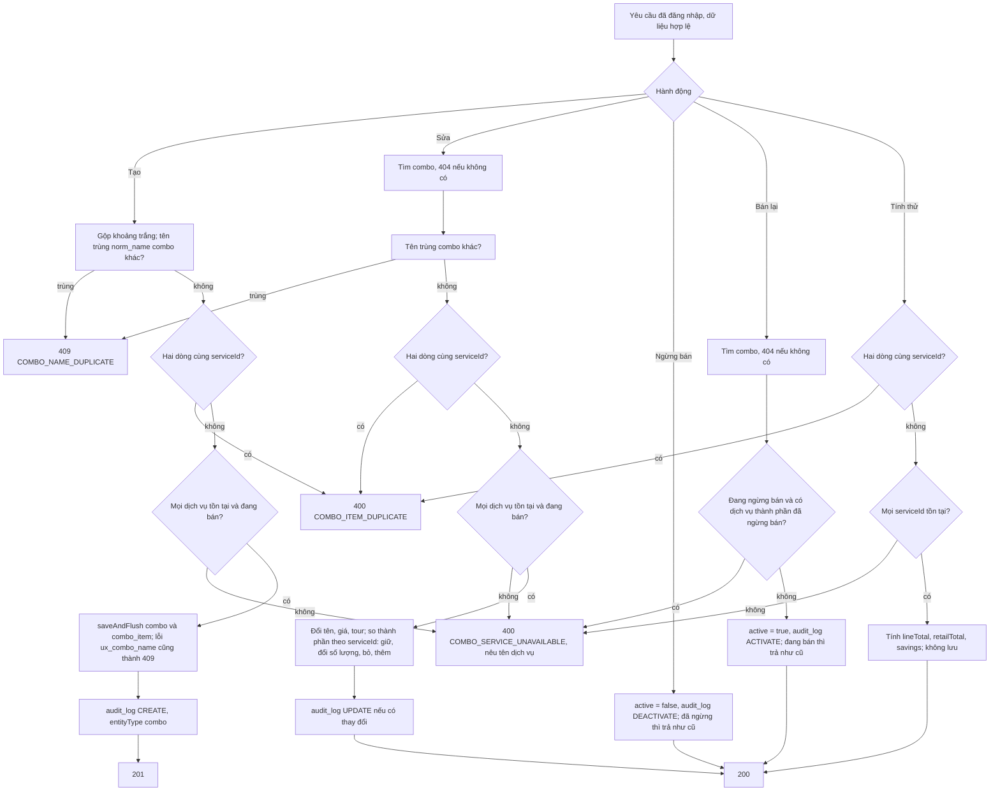
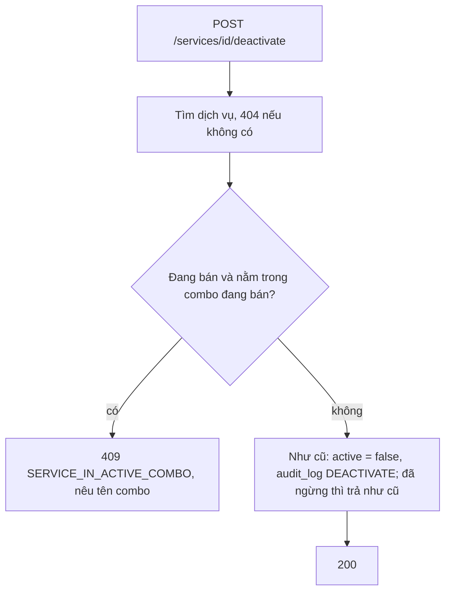

# Combo

Trạng thái: khớp code · Card: S2-07 (backend; giao diện ở S2-08) · Yêu cầu: FR-CMB-01 đến FR-CMB-05, BR-01, BR-03, BR-13, BR-18, BR-19, OQ-06, OQ-22

**Chia bốn phần** (mục cuối "Các phần"): mỗi lần `/implement docs/design/flows/catalog/combo.md phần <N>` làm một phần rồi dừng.

| Ngày       | Người         | Card / PR | Thay đổi                                                                                   |
| ---------- | ------------- | --------- | ------------------------------------------------------------------------------------------ |
| 25/10/2026 | Đình (Claude) | S2-07     | Thiết kế backend                                                                           |
| 25/10/2026 | Đình (Claude) | S2-07     | Đình duyệt: OQ-22 (chặn ngừng bán dịch vụ trong combo đang bán), có API tính thử, một card chia bốn phần |
| 25/10/2026 | Đình (Claude) | S2-07     | Tự soát phần 1: 2 vòng, sạch; Postman combo tự tạo dữ liệu |
| 25/10/2026 | Đình (Claude) | S2-07     | Tự soát phần 2: 2 vòng, sạch; test đọc lại combo từ DB sau khi sửa |
| 25/10/2026 | Đình (Claude) | S2-07     | Tự soát phần 3: 1 vòng, sạch; 2 điểm nên sửa làm cùng phần 4 |
| 25/10/2026 | Đình (Antigravity) | S2-07 | Phần 4 và 2 điểm nên sửa của phần 3; khớp code toàn bộ backend |

Phần chung của module (tên không trùng, không xóa cứng, nhật ký, OQ-21): `README.md` cùng thư mục.

## Mục tiêu

Chủ tiệm gom nhiều dịch vụ thành combo có giá riêng để bán nhanh: tạo, sửa, ngừng bán, bán lại; xem tổng giá lẻ của
các dịch vụ thành phần và mức tiết kiệm do **backend tính** (giao diện S2-08 chỉ hiển thị). Giao dịch đã ghi chụp tên,
giá và tiền tour của combo lúc bán (BR-03), nên sửa combo không làm đổi số liệu cũ.

## Điểm vào

Mới hoàn toàn, chưa có nơi gọi. Bảng `combo`, `combo_item` đã có từ V1, **không cần migration**.

| Loại | Điểm vào                                                                                       | Ghi chú                                                                          |
| ---- | ---------------------------------------------------------------------------------------------- | -------------------------------------------------------------------------------- |
| API  | `GET /api/catalog/combos?q=&active=&page=&size=` → `ComboController.search` → `ComboService.search` | trang từ 0, `size` mặc định 20, tối đa 100; xếp theo tên, rồi id; mỗi combo kèm thành phần và số tính sẵn |
| API  | `GET /api/catalog/combos/{id}` → `get`                                                          | 200                                                                              |
| API  | `POST /api/catalog/combos` → `create`                                                           | body `ComboRequest`, 201 kèm `Location`                                          |
| API  | `PUT /api/catalog/combos/{id}` → `update`                                                       | thay toàn bộ, kể cả danh sách thành phần, 200                                    |
| API  | `POST /api/catalog/combos/{id}/deactivate`, `/activate` → `deactivate`, `activate`              | 200                                                                              |
| API  | `POST /api/catalog/combos/quote` → `quote`                                                      | tính thử tổng giá lẻ, mức tiết kiệm cho form S2-08; không lưu, không audit, 200 |
| API  | `POST /api/catalog/services/{id}/deactivate` (đã có) → `ServiceItemService.deactivate`          | **đổi hành vi**: chặn khi dịch vụ nằm trong combo đang bán (xem "Quy tắc")       |

Không có `DELETE` (405, BR-19).

### Dữ liệu vào

`ComboRequest` (POST và PUT dùng chung):

| Trường    | Kiểu                     | Kiểm tra và thông báo                                                                                          |
| --------- | ------------------------ | -------------------------------------------------------------------------------------------------------------- |
| `name`    | chuỗi                    | `@NotBlank` "Tên combo không được để trống"; `@Size(max = 150)` "Tên combo tối đa 150 ký tự"                   |
| `price`   | `Long`                   | `@NotNull` "Vui lòng nhập giá combo"; `@PositiveOrZero` "Giá combo không được âm"; `@Max(1_000_000_000)` "Giá combo tối đa 1.000.000.000 đ" |
| `tourFee` | `Long`, tùy chọn         | trống là 0 (OQ-06); `@PositiveOrZero` "Tiền tour không được âm"; `@Max(1_000_000_000)` "Tiền tour tối đa 1.000.000.000 đ" |
| `items`   | `List<ComboItemRequest>` | `@NotEmpty` "Combo phải có ít nhất một dịch vụ"; `@Size(max = 20)` "Combo tối đa 20 dịch vụ"; `@Valid`        |

`ComboItemRequest`: `serviceId` (`@NotNull` "Vui lòng chọn dịch vụ"), `quantity` (`@NotNull` "Vui lòng nhập số
lượng", `@Min(1)` "Số lượng tối thiểu là 1", `@Max(99)` "Số lượng tối đa là 99"). Lỗi trả `fieldErrors` dạng
`items[0].quantity`.

`ComboQuoteRequest`: `price` (`Long`, **tùy chọn**, cùng giới hạn như trên), `items` (`@Size(max = 20)`, `@Valid`,
**được rỗng** vì form đang nhập dở). Giới hạn 20 dòng, số lượng 99 là giới hạn kỹ thuật chặn dữ liệu vô lý, đặt hằng
số `MAX_ITEMS`, `MAX_QUANTITY` trong DTO hoặc `ComboService`.

### Dữ liệu ra

`ComboResponse`: `id`, `name`, `price`, `tourFee`, `active`, `items` (`List<ComboItemResponse>`), `retailTotal`,
`savings`, `createdAt`, `updatedAt`.

`ComboItemResponse`: `serviceId`, `serviceName`, `serviceActive`, `listPrice` (giá niêm yết **hiện tại** của dịch vụ),
`quantity`, `lineTotal`.

`ComboQuoteResponse`: `items` (`List<ComboItemResponse>`), `retailTotal`, `savings` (`Long`, null khi chưa có `price`).

Công thức (FR-CMB-03), tính ở `ComboService`, không ở mapper (backend/AGENTS.md, mapper quy tắc 1):
`lineTotal = listPrice × quantity`, `retailTotal = Σ lineTotal`, `savings = retailTotal − price`. `savings` âm nghĩa
là giá combo cao hơn tổng giá lẻ: vẫn cho lưu, giao diện hiện cảnh báo. Dùng `Math.multiplyExact`, `Math.addExact`
(giới hạn trên đã chặn tràn, đây là rào chắn thêm). Thành phần xếp theo thứ tự thêm (`combo_item.id`).

`retailTotal`, `savings` **không lưu**, tính mỗi lần đọc theo giá hiện tại của dịch vụ: đổi giá dịch vụ thì mức tiết
kiệm của combo đổi theo, giá combo thì không.

## Luồng

Ngừng bán dịch vụ (đổi ở `ServiceItemService.deactivate`):

Mọi thao tác ghi chạy trong một `@Transactional` của service; audit ghi trong cùng transaction (BR-18).

## Quy tắc nghiệp vụ

- **Tên combo không trùng** giữa các combo theo `norm_name` (`ux_combo_name`), kiểm tra trước bằng
  `ComboRepository.existsByNormalizedName(name, excludeId)` rồi `saveAndFlush`, giống dịch vụ. Combo được trùng tên
  với một dịch vụ (hai bảng khác nhau; ô chọn ở S3-05 ghi rõ loại).
- **Thành phần** (FR-CMB-02): ít nhất một dòng; số lượng ≥ 1; một dịch vụ chỉ một dòng, lặp thì báo lỗi (không tự gộp,
  để chủ tiệm biết mình chọn trùng). Tạo và sửa **chỉ chọn được dịch vụ đang bán**.
- **Combo đang bán chỉ chứa dịch vụ đang bán** (OQ-22). Mọi chỗ đưa bản ghi vào hoặc ra khỏi trạng thái liên
  quan (AGENTS.md mục 7):
  | Method                          | Kiểm tra                                                                 |
  | ------------------------------- | ------------------------------------------------------------------------ |
  | `ComboService.create`           | mọi dịch vụ đang bán                                                     |
  | `ComboService.update`           | mọi dịch vụ đang bán (kể cả combo đang ngừng bán, giống OQ-21 với nhóm)   |
  | `ComboService.activate`         | combo đang ngừng bán: mọi dịch vụ thành phần đang bán                    |
  | `ComboService.deactivate`       | không cần                                                                |
  | `ServiceItemService.deactivate` | dịch vụ đang bán: không nằm trong combo đang bán nào                     |
  | `ServiceItemService.activate`   | không cần (bán lại dịch vụ không đổi combo)                              |
  | `ServiceGroupService.deactivate`| không cần: đã chặn khi nhóm còn dịch vụ đang bán (OQ-21)                  |
  Hệ quả: combo đã ngừng bán chứa dịch vụ đã ngừng bán chỉ sửa được khi bỏ hoặc thay dịch vụ đó; bán lại thì phải bán
  lại dịch vụ trước.
- **Sửa thành phần** (PUT thay toàn bộ): so theo `serviceId`, dòng có sẵn thì giữ `combo_item.id` và đổi số lượng,
  dòng mất thì bỏ (`orphanRemoval`), dòng mới thì thêm. Không xóa hết rồi thêm lại: Hibernate chạy INSERT trước DELETE
  nên bỏ rồi thêm lại cùng dịch vụ sẽ vướng `ux_combo_item`. Bỏ dòng `combo_item` không trái BR-19: giao dịch tham chiếu
  `combo_id` và chụp giá combo, không tham chiếu `combo_item`; thành phần cũ vẫn còn trong `before` của audit.
- **Sửa không đổi gì** (tên, giá, tour, thành phần, số lượng như cũ): không cập nhật `updated_at`, không ghi audit.
  Đổi riêng thành phần cũng cập nhật `combo.updated_at`.
- **Tiền tour của combo** (OQ-06, BR-13): một mức mặc định `combo.tour_fee`, trống là 0. Không chia theo dịch vụ thành
  phần (FR-CMB-06 để R2). S3-04 chụp mức này vào `tour_fee_snapshot`.
- **Ngừng bán, bán lại** (FR-CMB-05): `active = false/true`; gọi lại khi đã ở trạng thái đó thì trả như cũ, không ghi
  audit. Không xóa cứng (BR-19).
- **Audit** (BR-18): `entityType = combo`, `before`/`after` là `ComboResponse` (có danh sách thành phần), không truyền
  entity. Tính thử không ghi audit.
- **Danh sách**: tìm theo tên không phân biệt hoa thường, ký tự `%`, `_`, `\` là chữ thường (dùng lại
  `ServiceItemService.likePattern`, chuyển thành hàm dùng chung trong module nếu cần); không truyền `active` là tất
  cả. Lấy trang combo trước, rồi một truy vấn `JOIN FETCH` thành phần và dịch vụ theo các id của trang (giữ thứ tự
  trang), tránh N+1 và tránh phân trang trên `JOIN FETCH` tập con.
- Thời điểm `createdAt`, `updatedAt` truyền từ `Clock` (trigger `trg_combo_touch` vẫn đặt `updated_at` khi UPDATE, như
  dịch vụ). Tiền là `long` (BR-01).

### Cấu trúc code (theo khuôn `ServiceItem`)

| Tầng       | Thêm hoặc sửa                                                                                                                     |
| ---------- | --------------------------------------------------------------------------------------------------------------------------------- |
| entity     | `Combo` (bảng `combo`): `@OneToMany(mappedBy = "combo", cascade = ALL, orphanRemoval = true) @OrderBy("id") items`; method `updateDetails(name, price, tourFee, now)`, `replaceItems(Map<ServiceItem, Integer>, now)`, `deactivate(now)`, `activate(now)`, mỗi method trả `boolean` có đổi hay không. `ComboItem` (bảng `combo_item`): `combo`, `service` (`ServiceItem`, cùng module), `quantity`; method `changeQuantity` |
| repository | `ComboRepository`: `search(namePattern, active, pageable)`, `findAllWithItemsByIdIn(ids)` (`JOIN FETCH`), `findWithItemsById(id)`, `existsByNormalizedName(name, excludeId)` (native, `norm_name`). `ComboItemRepository`: `findActiveComboNamesByServiceId(serviceId)` |
| service    | `ComboService` (`search`, `get`, `create`, `update`, `deactivate`, `activate`, `quote`), `AUDIT_ENTITY = "combo"`, `saveChecked` bắt `ux_combo_name`. `ServiceItemService.deactivate` thêm kiểm tra combo |
| dto        | `ComboRequest`, `ComboItemRequest`, `ComboQuoteRequest`; `ComboResponse`, `ComboItemResponse`, `ComboQuoteResponse` (record)     |
| mapper     | `CatalogMapper`: `toItemResponse(ComboItem item, long lineTotal)`, `toResponse(Combo combo, List<ComboItemResponse> items, long retailTotal, long savings)`; chỉ chép, số đã tính truyền vào |
| controller | `ComboController` (`/api/catalog/combos`)                                                                                         |
| common     | `ErrorCode`: thêm 4 mã ở bảng lỗi                                                                                                 |

Khối lượng ước tính khoảng 550 đến 650 dòng code chính (nhiều phần là DTO, import, javadoc theo khuôn), vượt mức
khoảng 400 của AGENTS.md quy tắc 10. Đình chốt (25/10/2026): giữ một card, một PR, ghi rõ số dòng trong PR; code
theo bốn phần ở mục "Các phần".

## Lỗi trả về

| HTTP | `code`                      | Khi nào                                                                                      | Thông báo (`message`)                                                                                         |
| ---- | --------------------------- | -------------------------------------------------------------------------------------------- | ------------------------------------------------------------------------------------------------------------- |
| 400  | `VALIDATION_FAILED`         | vi phạm kiểm tra dữ liệu ở trên                                                              | chung; lỗi từng ô ở `fieldErrors` (`name`, `price`, `items`, `items[0].quantity`...)                           |
| 400  | `COMBO_ITEM_DUPLICATE`      | hai dòng cùng `serviceId` (tạo, sửa, tính thử)                                               | "Mỗi dịch vụ chỉ được có một dòng trong combo, hãy tăng số lượng."                                            |
| 400  | `COMBO_SERVICE_UNAVAILABLE` | dịch vụ không tồn tại hoặc đã ngừng bán (tạo, sửa, bán lại); không tồn tại (tính thử)         | mặc định "Dịch vụ không tồn tại hoặc đã ngừng bán."; biết tên thì "Dịch vụ đã ngừng bán: <tên>, <tên>."       |
| 401  | `UNAUTHORIZED`              | chưa đăng nhập                                                                               | chung                                                                                                         |
| 404  | `NOT_FOUND`                 | `id` combo không tồn tại                                                                     | "Không tìm thấy combo."                                                                                       |
| 405  | (không có body nghiệp vụ)   | gọi `DELETE`                                                                                 |                                                                                                               |
| 409  | `COMBO_NAME_DUPLICATE`      | trùng tên combo khác                                                                         | "Tên combo đã tồn tại."                                                                                       |
| 409  | `SERVICE_IN_ACTIVE_COMBO`   | ngừng bán dịch vụ đang nằm trong combo đang bán                                              | "Dịch vụ đang có trong combo đang bán: <tên>, <tên>. Hãy ngừng bán các combo này hoặc bỏ dịch vụ khỏi combo trước." Quá 3 combo thì ghi 3 tên đầu và "và N combo khác" |

Giao diện S2-08 gắn `COMBO_NAME_DUPLICATE` vào ô Tên, `COMBO_ITEM_DUPLICATE`, `COMBO_SERVICE_UNAVAILABLE` vào khu
thành phần; ngừng bán dịch vụ thì `ServiceListPage.toggleActive` đã hiện `message.error` với thông báo của backend.

## Ảnh hưởng

| Chỗ                                                        | Đổi gì                                                                                                                         |
| ---------------------------------------------------------- | ------------------------------------------------------------------------------------------------------------------------------ |
| `ServiceItemService.deactivate`                            | Chặn 409 `SERVICE_IN_ACTIVE_COMBO` (OQ-22). Chỉ còn nơi duy nhất đưa dịch vụ sang ngừng bán (PUT không đổi `active`)       |
| `ServiceItemControllerIT`                                  | Thêm `deactivatingServiceInActiveComboIsRejected`, `deactivatingServiceOnlyInInactiveComboIsAllowed`. Các test ngừng bán hiện có dùng dịch vụ không thuộc combo nên không đỏ |
| `frontend/src/features/catalog/pages/ServiceListPage.tsx`  | Không đổi code: `toggleActive` đã hiện `error.message` của `ApiError`. Grep `/api/catalog/services/.*deactivate` trong `frontend/src` chỉ có `useSetServiceActive`. Câu xác nhận ngừng bán dịch vụ nhắc combo để S2-08 |
| `docs/postman/xile-spa.postman_collection.json`            | Thư mục "6. Combo (S2-07)" sau "5. Nhóm dịch vụ" (phần 1), tự tạo dữ liệu, không dùng `{{serviceId}}` của thư mục 3; mỗi phần thêm request của mình theo mục "Thử tay" |
| `docs/design/flows/catalog/service.md`                     | "Quy tắc", "Lỗi trả về", "Ảnh hưởng", bảng test: thêm chặn ngừng bán khi nằm trong combo đang bán; dòng lịch sử                  |
| `docs/design/flows/catalog/README.md`                      | Thêm combo vào phần chung (FR-CMB, bảng `combo`, `combo_item`, quy tắc "combo đang bán chỉ chứa dịch vụ đang bán"); bảng tính năng đã có dòng `combo.md` |
| `docs/srs/07-open-questions.md`                            | Không cần sửa: OQ-22 đã ghi lúc duyệt thiết kế                                                                                 |
| `docs/backlog/sprint-2-3.md`                               | S2-07 "Đang làm" khi bắt đầu, "Xong" trong PR                                                                                  |
| S3-04 giao dịch (sau)                                      | Sẽ đọc combo qua `ComboService` (tên, giá, tour, đang bán) để chụp vào `visit_item`. **Không** thêm method cho S3-04 ở card này |
| ERD, migration, AGENTS                                     | Không đổi: bảng đã có ở V1, không đổi kiến trúc hay quy ước                                                                     |

Tham chiếu hai chiều đã xét: dịch vụ ngừng bán ↔ combo đang bán (bảng ở "Quy tắc"); nhóm ngừng dùng → dịch vụ → combo
(chuỗi đã đứng vì nhóm không ngừng dùng được khi còn dịch vụ đang bán); giao dịch → combo (chỉ `combo_id` và bản
chụp, sửa combo không ảnh hưởng).

## Hành vi và test

Tên test đề xuất; `/implement` thay bằng tên thật. Lớp: `ComboTest` (entity), `ComboServiceTest` (Mockito, mẫu
`StaffServiceTest`), `ComboControllerIT` (mẫu `StaffControllerIT`, tên có tiền tố ngẫu nhiên, audit lọc theo
`entityType = combo` và `entityId`, không đếm toàn bảng).

| Hành vi | Tầng | Chuẩn | Dữ liệu sai | Biên | Lỗi nghiệp vụ | Quyền | Không tác dụng phụ |
| ------- | ---- | ----- | ----------- | ---- | ------------- | ----- | ------------------ |
| Tính tổng giá lẻ, tiết kiệm | service | `quoteComputesLineTotalsRetailTotalAndSavings` (2 dịch vụ 150.000 × 2 và 200.000 × 1, giá 450.000 → 500.000, 50.000) | không áp dụng | `priceAboveRetailGivesNegativeSavings` (−50.000), `zeroPriceAndZeroListPrice`, `largestPriceAndQuantityDoNotOverflow` (1.000.000.000 × 99 × 20) | không áp dụng | không áp dụng | không áp dụng |
| Tính thử (`quote`) | service, IT | `quoteReturnsTotalsWithoutSaving` | `quoteWithInvalidItemReturnsFieldErrors` (số lượng 0, thiếu `serviceId`, 21 dòng) | `quoteWithEmptyItemsAndNoPrice` (0 và `savings` null), `quoteAllowsInactiveService` | `quoteWithDuplicateServiceIsRejected`, `quoteWithUnknownServiceIsRejected` | `requiresLogin` | `quoteReturnsTotalsWithoutSaving` (không có combo, không có audit) |
| Danh sách, tìm, lọc | IT | `searchFiltersByNameAndStatus`, `searchReturnsItemsAndTotals` | không áp dụng: tham số tùy chọn | `wildcardCharactersInSearchAreLiteral`, `emptyResultAndLastPage` | không áp dụng | `requiresLogin` | không áp dụng: chỉ đọc |
| Xem một combo | IT | `getReturnsComboWithItems` | không áp dụng | `getShowsCurrentServicePriceAfterPriceChange` (đổi giá dịch vụ thì `retailTotal` đổi, `price` giữ) | `getUnknownComboIs404` | `requiresLogin` | không áp dụng |
| Tạo combo | entity, service, IT | `newComboIsActiveWithItems`, `createTrimsSpacesAndRecordsAudit`, `createReturns201AndAuditLog` | `invalidInputReturnsFieldErrors` (tên trống, chỉ khoảng trắng, 151 ký tự, giá âm, giá trống, `items` rỗng, số lượng 0 và 100, thiếu `serviceId`) | `missingTourFeeIsZero`, `priceZeroIsAllowed`, `priceAboveRetailIsAllowed`, `namesDifferingOnlyByCaseOrSpacesAreDuplicates` | `createWithDuplicateNameIsRejected`, `createWithDuplicateServiceIsRejected`, `createWithInactiveServiceIsRejected`, `createWithUnknownServiceIsRejected` | `requiresLogin` | mỗi ca lỗi: `verify(comboRepository, never()).saveAndFlush(any())`, `verify(auditService, never())` |
| Sửa combo | entity, service, IT | `updateChangesDetailsAndItems` (đổi giá, số lượng, bỏ một dịch vụ, thêm một dịch vụ), `updateReturns200AndAuditLogWithBeforeAndAfterItems` | `updateInvalidInputReturnsFieldErrors` | `updateWithoutChangesWritesNoAudit`, `unchangedDetailsDoNotTouchUpdatedAt`, `removeAndReAddSameServiceKeepsItemRow`, `updateKeepsOwnNameWithoutDuplicateError`, `changingOnlyItemsTouchesUpdatedAt` | `updateWithDuplicateNameIsRejected`, `updateWithInactiveServiceIsRejected`, `updateUnknownComboIs404` | `requiresLogin` | `updateWithInactiveServiceIsRejected` (thành phần, giá trong DB như cũ, không có audit UPDATE) |
| Ngừng bán, bán lại combo | entity, service, IT | `deactivateThenActivateRecordsAudit` | không áp dụng: không có body | `deactivateAndActivateAreIdempotent` (không ghi audit lần hai) | `activatingComboWithInactiveServiceIsRejected`, `deactivateUnknownComboIs404` | `requiresLogin` | `activatingComboWithInactiveServiceIsRejected` (combo vẫn ngừng bán, không có audit ACTIVATE) |
| Ngừng bán dịch vụ nằm trong combo | service (`ServiceItemService`), IT (`ServiceItemControllerIT`) | `deactivatingServiceOnlyInInactiveComboIsAllowed` | không áp dụng | `messageListsAtMostThreeComboNames` | `deactivatingServiceInActiveComboIsRejected` | `requiresLogin` (đã có) | `deactivatingServiceInActiveComboIsRejected` (dịch vụ vẫn đang bán, không có audit DEACTIVATE) |
| Không xóa cứng | IT | không áp dụng | không áp dụng | không áp dụng | `deleteIsNotSupported` | `requiresLogin` | không áp dụng |

Ràng buộc DB (`ck_combo_price`, `ck_combo_item_qty`, `ux_combo_item`, `ux_combo_name`) đã có trong V1; không thêm vào
`schema_smoke_test.sql` trừ khi chưa có ca kiểm tra chúng.

Thử tay (Postman, thư mục "6. Combo (S2-07)"), theo phần. Thư mục **tự tạo dữ liệu của nó** (hai dịch vụ riêng, giá cố định), không dùng biến hay dữ liệu của thư mục khác, để sửa thư mục khác không làm đỏ combo:

- **Phần 1.** "Tạo dịch vụ 1 cho combo", "Tạo dịch vụ 2 cho combo": `POST /services` giá 100.000 và 120.000, tên có
  `{{runId}}` → 201, lưu `comboServiceId1`, `comboServiceId2`. "Tính thử giá combo": `POST /combos/quote` hai dịch vụ
  mỗi thứ 1, giá 160.000 → 200, `retailTotal = 220000`, `savings = 60000`. "Tạo combo" → 201, lưu `comboId`; kiểm
  `items.length = 2`, `retailTotal`, `savings`, `tourFee = 0` khi bỏ trống. "Xem một combo": `GET /combos/{{comboId}}`
  → 200. Thư mục lỗi: "Tạo combo trùng tên" 409 `COMBO_NAME_DUPLICATE`; "Tạo combo không có dịch vụ, giá âm" 400
  `fieldErrors` có `items`, `price`; "Tạo combo lặp dịch vụ" 400 `COMBO_ITEM_DUPLICATE`; "Combo không tồn tại"
  `GET /combos/999999` 404; "Xóa combo (không hỗ trợ)" 405; "Xem combo khi chưa đăng nhập" 401 (làm như "Xem dịch vụ
  khi chưa đăng nhập").
- **Phần 2.** "Sửa combo": đổi giá, số lượng, bỏ dịch vụ thứ hai → 200, `items.length = 1`. "Nhật ký của combo":
  `GET /audit-logs?entityType=combo&entityId={{comboId}}` → có CREATE, UPDATE.
- **Phần 3.** "Ngừng bán dịch vụ đang trong combo": `POST /services/{{comboServiceId1}}/deactivate` → 409
  `SERVICE_IN_ACTIVE_COMBO`. "Ngừng bán combo" → 200 `active = false`. "Bán lại combo" → 200 `active = true`.
- **Phần 4.** "Danh sách combo": `GET /combos?q=<tên>` → 200, có combo vừa tạo. "Lọc combo đang bán"
  `?active=true&q=<tên>` → có combo.

## Các phần

Một card, một nhánh, một PR; code và soát từng phần theo mục "Chia phần" của `docs/design/flows/README.md`. Thứ tự từ
nền và nặng tới nhẹ: phần 1 đặt khuôn cho cả tính năng, phần 2 có logic khó nhất, phần 3 chạm sang dịch vụ, phần 4 mỏng.

| Phần | Chức năng                                                   | Khoảng   | Trạng thái |
| ---- | ----------------------------------------------------------- | -------- | ---------- |
| 1    | Tạo và xem combo, tính thử giá                              | 330 dòng | đã soát    |
| 2    | Sửa combo                                                   | 110 dòng | đã soát    |
| 3    | Ngừng bán, bán lại combo; chặn ngừng bán dịch vụ (OQ-22)    | 120 dòng | đã soát    |
| 4    | Danh sách, tìm, lọc combo; hoàn tất card                    | 50 dòng  | đã code    |

### Phần 1. Tạo và xem combo, tính thử giá

Làm trước vì đặt khuôn mọi phần sau dùng lại: entity và quan hệ thành phần, sáu DTO, mapper, hàm tính tổng giá lẻ và
tiết kiệm, kiểm tra tên trùng, dịch vụ lặp, dịch vụ ngừng bán. Soát kỹ nhất.

| Tầng       | Làm                                                                                                                   |
| ---------- | --------------------------------------------------------------------------------------------------------------------- |
| backlog    | S2-07 sang "Đang làm"                                                                                                 |
| common     | `ErrorCode`: `COMBO_NAME_DUPLICATE`, `COMBO_ITEM_DUPLICATE`, `COMBO_SERVICE_UNAVAILABLE`                              |
| entity     | `Combo` (constructor tạo kèm thành phần, `items`), `ComboItem`                                                        |
| repository | `ComboRepository.existsByNormalizedName`, `findWithItemsById`                                                         |
| dto        | Cả sáu record ở mục "Dữ liệu vào", "Dữ liệu ra"                                                                       |
| mapper     | `toItemResponse`, `toResponse` của combo                                                                              |
| service    | `ComboService.create`, `get`, `quote`, hàm tính tiền dùng chung, `saveChecked`                                         |
| controller | `ComboController`: `POST /combos`, `GET /combos/{id}`, `POST /combos/quote`                                           |
| test       | Dòng "Tính tổng giá lẻ, tiết kiệm", "Tính thử", "Xem một combo", "Tạo combo", "Không xóa cứng"                        |
| Postman    | Thư mục "6. Combo (S2-07)", đổi số hai thư mục sau; request của phần 1 ở mục "Thử tay"                                |

### Phần 2. Sửa combo

Logic khó nhất của card: so thành phần theo `serviceId` (giữ, đổi số lượng, bỏ, thêm), không đổi gì thì không ghi
audit (mục "Quy tắc", ý "Sửa thành phần" và "Sửa không đổi gì").

| Tầng       | Làm                                                                     |
| ---------- | ----------------------------------------------------------------------- |
| entity     | `Combo.updateDetails`, `Combo.replaceItems`, `ComboItem.changeQuantity` |
| service    | `ComboService.update`                                                   |
| controller | `PUT /combos/{id}`                                                      |
| test       | Dòng "Sửa combo"                                                        |
| Postman    | Request của phần 2 ở mục "Thử tay"                                      |

### Phần 3. Ngừng bán, bán lại combo; chặn ngừng bán dịch vụ

Chạm sang `ServiceItemService` (đổi hành vi endpoint có sẵn), nên làm khi khuôn combo đã ổn.

| Tầng       | Làm                                                                                         |
| ---------- | ------------------------------------------------------------------------------------------- |
| common     | `ErrorCode.SERVICE_IN_ACTIVE_COMBO`                                                         |
| entity     | `Combo.deactivate`, `Combo.activate`                                                        |
| repository | `ComboItemRepository.findActiveComboNamesByServiceId`                                       |
| service    | `ComboService.deactivate`, `activate`; `ServiceItemService.deactivate` chặn theo OQ-22       |
| controller | `POST /combos/{id}/deactivate`, `/activate`                                                 |
| test       | Dòng "Ngừng bán, bán lại combo", "Ngừng bán dịch vụ nằm trong combo"                        |
| Postman    | Request của phần 3 ở mục "Thử tay"                                                          |

### Phần 4. Danh sách, tìm, lọc combo; hoàn tất card

Mỏng nhất, chỉ đọc; cần dữ liệu của các phần trước để thử.

| Tầng       | Làm                                                                                                                 |
| ---------- | ------------------------------------------------------------------------------------------------------------------- |
| repository | `ComboRepository.search`, `findAllWithItemsByIdIn`                                                                  |
| service    | `ComboService.search`                                                                                               |
| controller | `GET /combos`                                                                                                       |
| test       | Dòng "Danh sách, tìm, lọc"                                                                                          |
| Postman    | Request của phần 4 ở mục "Thử tay"                                                                                  |
| hoàn tất   | Các dòng "Ảnh hưởng" còn lại (`service.md`, `README.md` của module); bước 5 đến 9 của `/implement`: grep nơi gọi, file luồng `khớp code` với tên test thật, backlog "Xong" |
