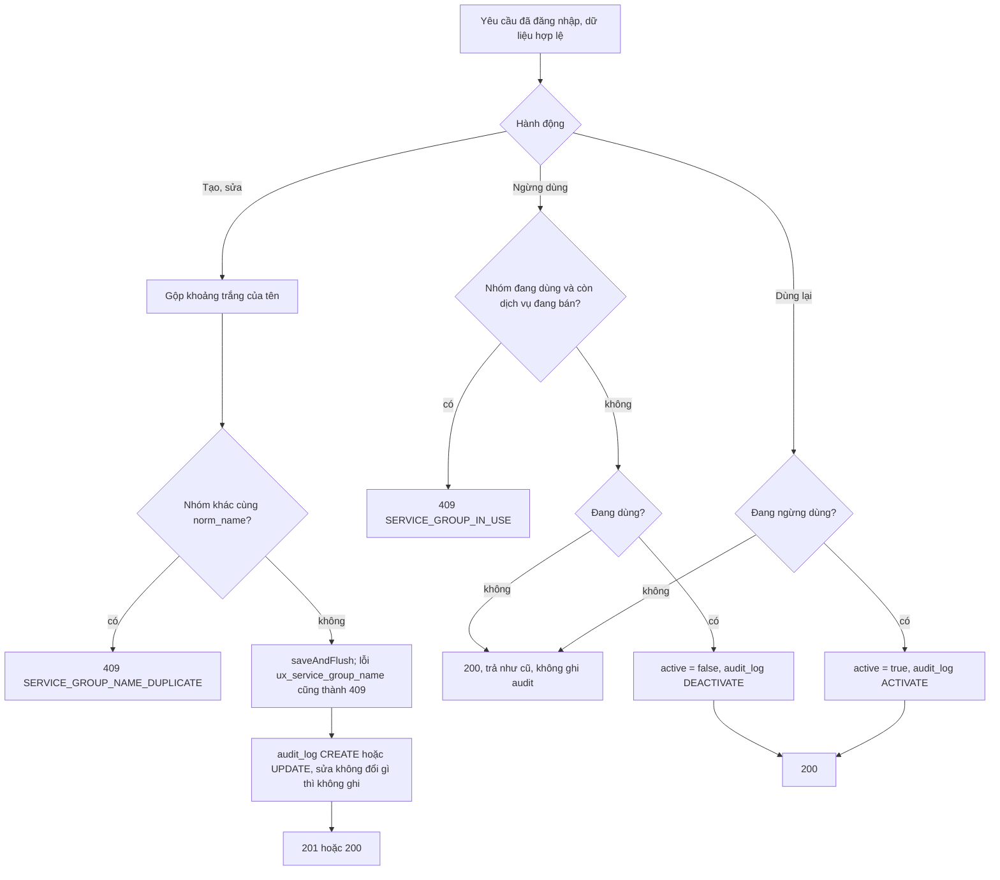

# Quản lý nhóm dịch vụ

Trạng thái: khớp code (backend, PR #41) · thiết kế (đã duyệt) (giao diện) · Card: S2-06 · Yêu cầu: FR-SVC-05,
BR-18, BR-19, OQ-21

| Ngày       | Người              | Card / PR            | Thay đổi                                                         |
| ---------- | ------------------ | -------------------- | ---------------------------------------------------------------- |
| 23/10/2026 | Đình (Antigravity) | S2-06, #41           | Backend: API thêm, sửa, ngừng dùng, dùng lại nhóm; OQ-21         |
| 23/10/2026 | Đình (Claude)      | chore/agent-workflow | Viết file theo code backend; thiết kế giao diện từ kế hoạch S2-06 |
| 23/10/2026 | Đình (Claude)      | chore/agent-workflow | Đình duyệt giao diện: drawer; ô lọc bảng giá hiện cả nhóm ngừng dùng |

Phần chung của module (tên không trùng, không xóa cứng, nhật ký, OQ-21): `README.md` cùng thư mục.

## Mục tiêu

Chủ tiệm tự thêm nhóm dịch vụ, đổi tên và thứ tự hiển thị, ngừng dùng nhóm không còn kinh doanh, thay cho bốn nhóm cố
định ở dữ liệu mẫu. Nhóm ngừng dùng không còn để chọn khi thêm, sửa dịch vụ; dịch vụ và giao dịch cũ giữ nguyên.

## Điểm vào

| Loại     | Điểm vào                                                                                                   | Ghi chú                                                        |
| -------- | ---------------------------------------------------------------------------------------------------------- | -------------------------------------------------------------- |
| API      | `GET /api/catalog/service-groups?active=` → `ServiceGroupController.list` → `ServiceGroupService.list`     | không truyền `active` là tất cả; xếp `sort_order`, rồi `name` |
| API      | `GET /api/catalog/service-groups/{id}` → `get`                                                             | 200                                                            |
| API      | `POST /api/catalog/service-groups` → `create`                                                              | body `{name, sortOrder}`, 201 kèm `Location`                  |
| API      | `PUT /api/catalog/service-groups/{id}` → `update`                                                          | thay toàn bộ `{name, sortOrder}`, 200                          |
| API      | `POST /api/catalog/service-groups/{id}/deactivate`, `/activate` → `deactivate`, `activate`                 | 200                                                            |
| Màn hình | Nút **"Nhóm dịch vụ"** ở đầu `ServiceListPage` (`/services`) mở `components/ServiceGroupDrawer` (thiết kế) | không thêm route, không thêm mục menu                         |

Kiểm tra dữ liệu (`ServiceGroupRequest`): `name` bắt buộc, tối đa 100 ký tự; `sortOrder` bắt buộc, số nguyên ≥ 0.

## Luồng

Backend (khớp code):



Mọi hành động có `id` mà không tìm thấy thì `404 NOT_FOUND` trước tiên.

Giao diện (thiết kế):

```mermaid
sequenceDiagram
    participant U as Chủ tiệm
    participant P as ServiceListPage
    participant D as ServiceGroupDrawer
    participant API as /api/catalog/service-groups
    U->>P: Bấm "Nhóm dịch vụ"
    P->>D: Mở drawer
    D->>API: GET (không lọc, lấy cả nhóm ngừng dùng)
    API-->>D: Danh sách nhóm
    U->>D: Thêm hoặc sửa: tên, thứ tự, bấm Lưu
    D->>API: POST hoặc PUT
    alt Thành công
        API-->>D: 201 hoặc 200
        D->>D: Làm mới mọi query nhóm; sửa thì làm mới cả danh sách dịch vụ
    else 409 trùng tên, 400 dữ liệu sai
        API-->>D: lỗi gắn vào ô Tên hoặc ô Thứ tự
    end
    U->>D: Ngừng dùng (xác nhận) hoặc Dùng lại
    D->>API: POST /{id}/deactivate hoặc /activate
    alt 409 SERVICE_GROUP_IN_USE
        API-->>D: message.error với thông báo của backend
    else Thành công
        D->>D: Làm mới mọi query nhóm
    end
```

## Quy tắc nghiệp vụ

- Tên không trùng theo `norm_name`; sửa giữ nguyên tên của chính nhóm đó không bị coi là trùng.
- Không xóa cứng; ngừng dùng là `active = false` (BR-19). Nhóm ngừng dùng vẫn giữ `group_id` của các dịch vụ cũ.
- Không ngừng dùng được nhóm còn dịch vụ đang bán; không bán lại được dịch vụ trong nhóm đã ngừng dùng (OQ-21).
- Mọi thay đổi ghi `audit_log` với `entityType = service_group` trong cùng transaction (BR-18).
- Giao diện: drawer rộng 480 px ở máy tính, toàn màn hình ở điện thoại (giống `ServiceFormDrawer`). Danh sách trong
  drawer là danh sách dòng (tên, thứ tự, tag "Đang dùng"/"Ngừng dùng", nút Sửa, Ngừng dùng/Dùng lại), dùng được ở
  cả hai cỡ màn hình. Form thêm, sửa nằm ở đầu drawer; đang sửa thì có nút Hủy để quay lại thêm mới.
- Ô lọc nhóm của bảng giá hiện **tất cả** nhóm, nhóm ngừng dùng ghi `<tên> (ngừng dùng)`, để tìm lại được dịch vụ cũ
  theo nhóm. Ô chọn nhóm trong form dịch vụ vẫn **chỉ** nhóm đang dùng.
- Xác nhận ngừng dùng: "Nhóm sẽ không còn để chọn khi thêm hoặc sửa dịch vụ. Nhóm còn dịch vụ đang bán thì phải
  ngừng bán hoặc chuyển dịch vụ sang nhóm khác trước." Dùng lại: "Nhóm sẽ xuất hiện lại trong ô chọn nhóm."

## Lỗi trả về

| HTTP | `code`                         | Khi nào                                                         | Giao diện hiển thị                         |
| ---- | ------------------------------ | --------------------------------------------------------------- | ------------------------------------------ |
| 400  | `VALIDATION_FAILED`            | tên trống, chỉ có khoảng trắng, quá 100 ký tự; thứ tự trống, âm | lỗi ở ô tương ứng (`fieldErrors`)          |
| 401  | `UNAUTHORIZED`                 | chưa đăng nhập                                                  | về trang đăng nhập                         |
| 404  | `NOT_FOUND`                    | `id` không tồn tại                                              | `message.error`, tải lại danh sách         |
| 405  | (không có body nghiệp vụ)      | gọi `DELETE`                                                    | không có nút xóa                           |
| 409  | `SERVICE_GROUP_NAME_DUPLICATE` | trùng tên nhóm khác                                             | lỗi ở ô Tên                                |
| 409  | `SERVICE_GROUP_IN_USE`         | ngừng dùng nhóm còn dịch vụ đang bán                            | `message.error` với thông báo của backend |

## Ảnh hưởng

Backend (đã làm ở PR #41): `GET` không tham số đổi từ "chỉ nhóm đang dùng" sang "tất cả nhóm"; ô chọn của form dịch vụ
gửi `active=true`; bỏ `ServiceItemService.listGroups()`; `ServiceItemService.activate` chặn nhóm đã ngừng dùng;
Postman request "Danh sách nhóm dịch vụ" của thư mục Dịch vụ gửi `?active=true`.

Giao diện (cần làm):

| Chỗ                                         | Đổi gì                                                                                                                                                                                                                 |
| ------------------------------------------- | ---------------------------------------------------------------------------------------------------------------------------------------------------------------------------------------------------------------------- |
| `features/catalog/types.ts`                 | `ServiceGroup` thêm `active: boolean`; thêm `ServiceGroupRequest`                                                                                                                                                       |
| `features/catalog/schemas.ts`               | `serviceGroupSchema` khớp `ServiceGroupRequest`: tên trim, 1 đến 100 ký tự; thứ tự số nguyên ≥ 0, bắt buộc                                                                                                             |
| `features/catalog/api.ts`                   | Giữ `useServiceGroups()` (chỉ nhóm đang dùng, key `[...groups, { active: true }]`); thêm `useAllServiceGroups()` (key `[...groups, {}]`), `useCreateServiceGroup`, `useUpdateServiceGroup`, `useSetServiceGroupActive`. Mọi mutation làm mới theo tiền tố `catalogKeys.groups`; sửa nhóm làm mới thêm `catalogKeys.services` vì danh sách dịch vụ hiển thị `groupName` |
| `ServiceListPage`                           | Thêm nút "Nhóm dịch vụ" cạnh "Thêm dịch vụ", mở `ServiceGroupDrawer`                                                                                                                                                    |
| `ServiceFormDrawer`                         | Sửa một dịch vụ đã ngừng bán thuộc nhóm đã ngừng dùng: ô chọn nhóm thêm một lựa chọn bị khóa `<tên nhóm> (ngừng dùng)` lấy từ `groupName` của dịch vụ, để không hiện số id. Lưu mà không đổi nhóm thì backend trả `SERVICE_GROUP_NOT_FOUND`, đã gắn vào ô Nhóm |
| Ô lọc nhóm của `ServiceListPage`            | Dùng `useAllServiceGroups()`, nhóm ngừng dùng có nhãn `<tên> (ngừng dùng)`. Sửa test `ô lọc nhóm chỉ lấy nhóm đang dùng` (`ServiceListPage.filters.test.tsx`) theo hành vi mới                                     |
| `docs/design/flows/catalog/service.md`      | Mục "Quy tắc nghiệp vụ": ô lọc nhóm lấy tất cả nhóm; thêm dòng lịch sử                                                                                                                                                 |

## Hành vi và test

Backend (tên test thật):

| Hành vi | Tầng | Chuẩn | Dữ liệu sai | Biên | Lỗi nghiệp vụ | Quyền | Không tác dụng phụ |
| ------- | ---- | ----- | ----------- | ---- | ------------- | ----- | ------------------ |
| Danh sách, lọc `active` | service, IT | `listReturnsAllGroupsWhenActiveIsNull`, `listReturnsActiveGroupsWhenActiveIsTrue`, `listReturnsInactiveGroupsWhenActiveIsFalse`, `listsGroupsInOrder`, `listsActiveOrInactiveGroups`, `listWithoutActiveFilterIncludesInactiveGroups`, `activeGroupsKeepSeedOrder` | không áp dụng: tham số tùy chọn | không áp dụng | không áp dụng | `requiresLogin` | không áp dụng: chỉ đọc |
| Xem một nhóm | service, IT | `getReturnsGroup`, `getReturnsGroupDetails` | không áp dụng | không áp dụng | `getWhenNotFoundThrowsNotFound`, `getUnknownGroupIs404` | `requiresLogin` | không áp dụng: chỉ đọc |
| Tạo nhóm | entity, service, IT | `newServiceGroupIsActive`, `createTrimsSpacesAndRecordsAudit`, `createReturns201AndAuditLog` | `validationFailsOnBlankOrInvalidData` (trống, chỉ khoảng trắng, 101 ký tự, thứ tự âm, thứ tự trống) | `namesDifferingOnlyByCaseOrSpacesAreDuplicates` | `createWithDuplicateNameThrowsDuplicate` | `requiresLogin` | `createWithDuplicateNameThrowsDuplicate` (không lưu, không audit) |
| Sửa nhóm | entity, service, IT | `updateChangesNameAndSortOrder`, `updateModifiesDetailsAndRecordsAudit`, `updateModifiesDetailsAndAuditLog` | `validationFailsOnBlankOrInvalidData` | `updateKeepsOwnNameWithoutDuplicateError`, `updateWithoutChangesWritesNoAudit` | `updateWithDuplicateNameThrowsDuplicate`, `updateWithDuplicateNameOfAnotherGroupIsConflict` | `requiresLogin` | `updateWithDuplicateNameThrowsDuplicate` |
| Ngừng dùng, dùng lại | entity, service, IT | `deactivateRecordsAudit`, `activateRecordsAudit`, `deactivateAndActivateChangesActiveAndRecordsAudit` | không áp dụng: không có body | `deactivateAndActivateAreIdempotent`, `deactivateAlreadyInactiveDoesNotRecordAudit`, `activateAlreadyActiveDoesNotRecordAudit` | `deactivateGroupWithActiveServicesIsRejected`, `deactivateGroupWithActiveServiceIsConflict` | `requiresLogin` | `deactivateGroupWithActiveServiceIsConflict` (nhóm vẫn đang dùng, chỉ có audit CREATE) |
| Bán lại dịch vụ trong nhóm đã ngừng dùng (OQ-21) | IT | không áp dụng | không áp dụng | không áp dụng | `activatingServiceInInactiveGroupIsRejected` | `requiresLogin` (dịch vụ) | `activatingServiceInInactiveGroupIsRejected` (dịch vụ vẫn ngừng bán) |
| Không xóa cứng | IT | không áp dụng | không áp dụng | không áp dụng | `deleteIsNotSupported` | `requiresLogin` | không áp dụng |

Giao diện (ca cần có, Vitest):

| Hành vi | Tầng | Chuẩn | Dữ liệu sai | Biên | Lỗi nghiệp vụ | Quyền | Không tác dụng phụ |
| ------- | ---- | ----- | ----------- | ---- | ------------- | ----- | ------------------ |
| `serviceGroupSchema` | `schemas.test.ts` | hợp lệ | tên trống, 101 ký tự, thứ tự âm, thứ tự trống | tên chỉ có khoảng trắng; thứ tự 0 | không áp dụng | không áp dụng | không áp dụng |
| Drawer: danh sách | `ServiceGroupDrawer.test.tsx` | hiện tên, thứ tự, tag trạng thái | không áp dụng | danh sách trống | lỗi tải có "Thử lại" | không áp dụng: route đã bảo vệ | không áp dụng |
| Drawer: thêm, sửa | `ServiceGroupDrawer.test.tsx` | thêm gọi POST đúng body; sửa nạp giá trị cũ, gọi PUT | lỗi Zod hiện dưới ô | Hủy sửa thì form về thêm mới | 409 trùng tên gắn vào ô Tên | không áp dụng | lỗi thì form giữ nguyên dữ liệu đã nhập |
| Drawer: ngừng dùng, dùng lại | `ServiceGroupDrawer.test.tsx` | xác nhận rồi gọi đúng `/deactivate`, `/activate` | không áp dụng | hủy xác nhận thì không gọi API | 409 `SERVICE_GROUP_IN_USE` hiện thông báo của backend | không áp dụng | lỗi thì tag giữ nguyên |
| Làm mới sau khi sửa | `ServiceListPage.test.tsx` | đổi tên nhóm thì danh sách dịch vụ hiện tên mới | không áp dụng | không áp dụng | không áp dụng | không áp dụng | không áp dụng |
| Ô lọc nhóm của bảng giá | `ServiceListPage.filters.test.tsx` | gọi danh sách nhóm không lọc; nhóm ngừng dùng có nhãn "(ngừng dùng)" | không áp dụng | lọc theo nhóm ngừng dùng ra đúng dịch vụ đã ngừng bán của nhóm đó | không áp dụng | không áp dụng | không áp dụng |
| Form dịch vụ, nhóm đã ngừng dùng | `ServiceListPage.test.tsx` | lựa chọn bị khóa `<tên> (ngừng dùng)` thay cho số id | không áp dụng | không áp dụng | lưu không đổi nhóm thì lỗi ở ô Nhóm | không áp dụng | không áp dụng |

Thử tay: mở `/services`, bấm "Nhóm dịch vụ"; thêm "Massage trị liệu" thứ tự 25, thấy trong danh sách và trong ô chọn
nhóm của form dịch vụ; sửa tên, danh sách dịch vụ hiện tên mới; ngừng dùng "Khác" khi còn dịch vụ đang bán thì báo
lỗi; ngừng bán hết dịch vụ của nhóm rồi ngừng dùng thì được, ô chọn nhóm trong form không còn nhóm đó, ô lọc nhóm
của bảng giá vẫn có với nhãn "(ngừng dùng)" và lọc ra các dịch vụ đã ngừng bán của nhóm; dùng lại thì hiện lại.
Kiểm tra cỡ máy tính và điện thoại.
