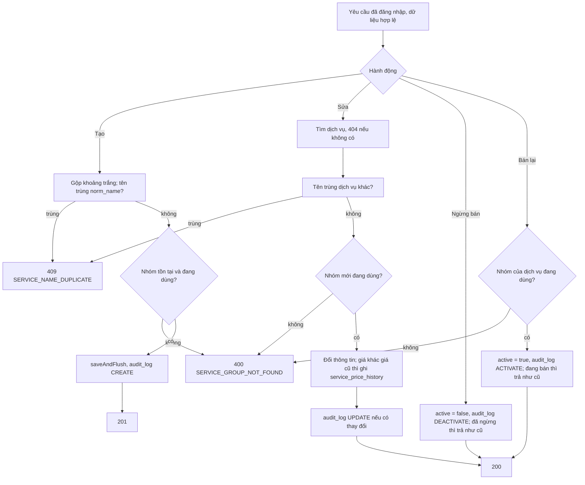

# Bảng giá dịch vụ

Trạng thái: khớp code · Card: S1-05, S1-06 · Yêu cầu: FR-SVC-01 đến FR-SVC-04, BR-01, BR-03, BR-18, BR-19, OQ-21

| Ngày       | Người         | Card / PR            | Thay đổi                                                                         |
| ---------- | ------------- | -------------------- | -------------------------------------------------------------------------------- |
| 23/10/2026 | Đình (Claude) | chore/agent-workflow | Viết bù theo code đang chạy (S1-05 04dd2f7, sửa 46ef8b0; OQ-21 ở S2-06, #41)     |

Phần chung của module (tên không trùng, không xóa cứng, nhật ký, OQ-21): `README.md` cùng thư mục.

## Mục tiêu

Chủ tiệm có bảng giá để chọn dịch vụ khi ghi giao dịch: tìm, lọc theo nhóm và trạng thái; thêm, sửa, đổi giá có lịch
sử; ngừng bán, bán lại. Giao dịch đã ghi giữ tên và giá tại thời điểm bán (BR-03), nên sửa bảng giá không làm đổi số
liệu cũ.

## Điểm vào

| Loại     | Điểm vào                                                                                                  | Ghi chú                                                                         |
| -------- | --------------------------------------------------------------------------------------------------------- | ------------------------------------------------------------------------------- |
| API      | `GET /api/catalog/services?q=&groupId=&active=&page=&size=` → `ServiceItemController.search` → `ServiceItemService.search` | trang từ 0, `size` mặc định 20, tối đa 100; xếp theo thứ tự nhóm, tên, id |
| API      | `GET /api/catalog/services/{id}` → `get`                                                                  | 200                                                                             |
| API      | `POST /api/catalog/services` → `create`                                                                   | body `ServiceItemRequest`, 201 kèm `Location`                                   |
| API      | `PUT /api/catalog/services/{id}` → `update`                                                               | thay toàn bộ, 200; đổi giá thì ghi `service_price_history`                      |
| API      | `POST /api/catalog/services/{id}/deactivate`, `/activate` → `deactivate`, `activate`                      | 200                                                                             |
| Màn hình | `features/catalog/pages/ServiceListPage` (route `/services`), `components/ServiceFormDrawer`              | bảng ở máy tính, thẻ ở điện thoại; ô tiền dùng `MoneyInput`                    |

Kiểm tra dữ liệu (`ServiceItemRequest`): `name` bắt buộc, tối đa 150 ký tự; `groupId` bắt buộc; `durationMinutes`
tùy chọn, 1 đến 1440; `listPrice` bắt buộc, 0 đến 1.000.000.000; `tourFee` tùy chọn (trống là 0), 0 đến 1.000.000.000.

## Luồng

## Quy tắc nghiệp vụ

- Tiền là `long` đồng (BR-01); có thể tạo dịch vụ giá 0 rồi cập nhật sau. Giao diện chỉ định dạng, không tính.
- Đổi giá ghi `service_price_history` (giá cũ, giá mới, thời điểm từ `Clock`, người đổi từ `CurrentUser`); giá không
  đổi thì không ghi. Sửa thông tin mà không đổi gì thì không cập nhật `updated_at`, không ghi audit.
- Tạo và sửa chỉ chọn được nhóm đang dùng. Hệ quả: dịch vụ đã ngừng bán thuộc nhóm đã ngừng dùng chỉ sửa được khi
  đổi sang nhóm đang dùng hoặc dùng lại nhóm (OQ-21).
- Bán lại dịch vụ trong nhóm đã ngừng dùng bị chặn (OQ-21).
- Tìm theo tên: không phân biệt hoa thường; ký tự `%`, `_`, `\` người dùng gõ được coi là chữ thường, không phải ký
  tự đại diện (`likePattern`). Từ khóa trống là lấy tất cả.
- Giao diện: mặc định lọc "Đang bán"; đang lọc thì có nút "Xóa bộ lọc"; danh sách trống nói rõ không có kết quả khớp
  bộ lọc; lỗi tải hiện `Alert` có "Thử lại". Ô chọn nhóm trong form và ô lọc nhóm chỉ lấy nhóm đang dùng.

## Lỗi trả về

| HTTP | `code`                    | Khi nào                                                        | Giao diện hiển thị                         |
| ---- | ------------------------- | -------------------------------------------------------------- | ------------------------------------------ |
| 400  | `VALIDATION_FAILED`       | vi phạm kiểm tra dữ liệu ở trên                                | lỗi ở ô tương ứng (`fieldErrors`)          |
| 400  | `SERVICE_GROUP_NOT_FOUND` | nhóm không tồn tại hoặc đã ngừng dùng (tạo, sửa, bán lại)      | lỗi ở ô Nhóm; bán lại thì `message.error` |
| 401  | `UNAUTHORIZED`            | chưa đăng nhập                                                 | về trang đăng nhập                         |
| 404  | `NOT_FOUND`               | `id` không tồn tại                                             | `message.error`                            |
| 405  | (không có body nghiệp vụ) | gọi `DELETE`                                                   | không có nút xóa                           |
| 409  | `SERVICE_NAME_DUPLICATE`  | trùng tên dịch vụ khác                                         | lỗi ở ô Tên                                |

## Ảnh hưởng

Không (file viết bù theo code đang chạy). Khi làm combo (S2-07): ngừng bán một dịch vụ đang nằm trong combo đang bán là
chỗ cần xét theo `AGENTS.md` mục 7 (tham chiếu hai chiều).

## Hành vi và test

Tên test thật. Module chưa có test đơn vị cho `ServiceItemService`; các nhánh nghiệp vụ được kiểm ở test tích hợp.

| Hành vi | Tầng | Chuẩn | Dữ liệu sai | Biên | Lỗi nghiệp vụ | Quyền | Không tác dụng phụ |
| ------- | ---- | ----- | ----------- | ---- | ------------- | ----- | ------------------ |
| Tìm, lọc, phân trang | IT, Vitest | `searchFiltersByNameGroupAndStatus`, `listWithoutSearchTermWorks`, `filtersWithoutSearchTermUseTheSameParamsAsTheUi`; `mặc định chỉ hiện dịch vụ đang bán, không gửi q và groupId`, `tổ hợp tìm + nhóm + trạng thái, rồi xóa lọc thì hiện lại đầy đủ` | không áp dụng: tham số tùy chọn | `wildcardCharactersInSearchAreLiteral`; `xóa chữ trong ô tìm thì bỏ hẳn tham số q` | không áp dụng | `requiresLogin` | không áp dụng: chỉ đọc; lỗi tải: `lỗi tải danh sách hiện thông báo rõ ràng và nút thử lại` |
| Xem một dịch vụ | IT | thiếu | không áp dụng | không áp dụng | `getUnknownServiceIs404` | `requiresLogin` | không áp dụng |
| Tạo dịch vụ | IT, Vitest | `createReturns201AndAuditLog`; `hiển thị dịch vụ với tiền đã định dạng, mặc định lọc đang bán` | `invalidInputReturnsFieldErrors`; `serviceFormSchema` `báo lỗi tiếng Việt theo từng ô` | `priceZeroAndMissingTourFeeAreAllowed`, `namesDifferingOnlyByCaseOrSpacesAreDuplicates`; `chấp nhận dữ liệu hợp lệ, giá 0 và tiền tour trống` | `unknownGroupIsRejected`; `lỗi trùng tên từ backend hiển thị ngay dưới ô tên` | `requiresLogin` | thiếu (chưa kiểm không lưu, không audit khi lỗi) |
| Sửa, đổi giá | entity, IT | `changingPriceCreatesHistoryWithOldAndNewPrice`, `updatingPriceWritesPriceHistory` | `invalidInputReturnsFieldErrors` | `samePriceCreatesNoHistory`, `unchangedDetailsDoNotTouchUpdatedAt`, `updateWithoutPriceChangeWritesNoHistory` | `renamingToAnotherServicesNameIsDuplicate` | `requiresLogin` | thiếu |
| Ngừng bán, bán lại | entity, IT | `deactivateThenActivate` | không áp dụng: không có body | `deactivateAndActivateAreIdempotent` | `activatingServiceInInactiveGroupIsRejected` (ở `ServiceGroupControllerIT`) | `requiresLogin` | `activatingServiceInInactiveGroupIsRejected` |
| Không xóa cứng | IT | không áp dụng | không áp dụng | không áp dụng | `deleteIsNotSupported` | `requiresLogin` | không áp dụng |

Ô "thiếu" là ca chưa có test; bổ sung khi card sau đụng vào module này (S2-07 combo).
