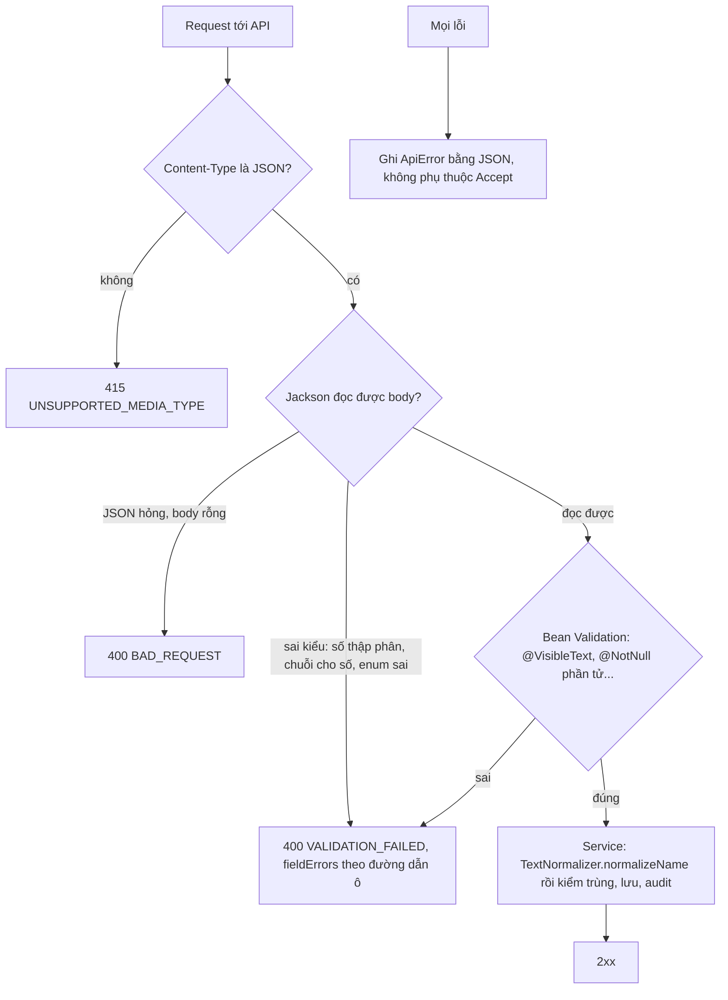

# Chặn đầu vào bất thường

Trạng thái: thiết kế (đã duyệt) · Card: S3-08 (sửa lỗi) · Yêu cầu: BR-01, BR-18, NFR-SEC, `AGENTS.md` mục 10

**Chia ba phần** (mục cuối "Các phần"): mỗi lần `/implement docs/design/flows/common/input-hardening.md phần <N>`.

| Ngày       | Người         | Card / PR | Thay đổi                                             |
| ---------- | ------------- | --------- | ---------------------------------------------------- |
| 25/10/2026 | Đình (Claude) | S3-08     | Thiết kế từ đợt dò ca biên trên `develop` (`1ddffcb`) |
| 25/10/2026 | Đình (Claude) | S3-08     | Đình chốt: ký tự vô hình trong tên bỏ lặng lẽ          |
| 25/10/2026 | Đình (Claude) | S3-08     | Đình duyệt; `q` chưa giới hạn độ dài                    |
| 25/10/2026 | Đình (Claude) | S3-08     | Tự soát phần 1 lần 1: test nạp `application.yml` thật (hồ sơ `test`); lỗi trả bằng `ResponseEntity` đặt sẵn JSON; thêm ca 406, id sai, số vượt `Long` |

Phần chung của module: `README.md` cùng thư mục.

## Mục tiêu

API từ chối rõ ràng mọi đầu vào bất thường thay vì lặng lẽ sửa dữ liệu hoặc trả 500. Đợt dò ngày 25/10/2026 (gửi đầu
vào thật vào API đang chạy) tìm ra:

| # | Lỗi hiện tại | Kết quả dò | Sau khi sửa |
| - | ------------ | ---------- | ----------- |
| 1 | Tiền, số lượng nhận số thập phân, chuỗi số | `listPrice: 1.7` lưu thành `1`; `quantity: 2.9` thành `2`; `"100"` thành `100` | 400 `VALIDATION_FAILED`, lỗi ở đúng ô |
| 2 | Tên chỉ có NBSP hoặc ký tự vô hình | 201, dịch vụ không có tên nhìn thấy | 400, lỗi ở ô tên |
| 3 | Tên trông giống hệt vẫn qua kiểm tra trùng | "A x" và "A x", "A x" thêm zero-width ở cuối đều tạo được | 409 trùng tên như hai tên giống nhau |
| 4 | `null` trong danh sách thành phần combo | 500 (NullPointerException) | 400, lỗi ở `items[0]` |
| 5 | Sai Content-Type; `Accept` không phải JSON | 500; lỗi 404 kèm `Accept: application/xml` làm exception lọt ra ngoài | 415; 406; lỗi luôn trả JSON |
| 6 | `page` cực lớn | 500 (tràn offset) | 200, trang rỗng |
| 7 | Enum sai (`role: "ADMIN"`) | 400 nhưng `fieldErrors` rỗng, giao diện không gắn được lỗi | 400 `VALIDATION_FAILED`, lỗi ở ô `role` |

Đã ổn, giữ nguyên (có test bảo vệ ở phần 1): JSON hỏng, body rỗng → 400; id không phải số hoặc quá lớn → 400; số vượt
`Long` → 400; trường lạ trong body (`id`, `active`) bị bỏ qua, không gán được.

## Điểm vào

Không thêm endpoint. Đổi hành vi của **mọi** API nhận body JSON hoặc có phân trang:

| Loại   | Chỗ đổi                                                                                       | Ghi chú                                     |
| ------ | --------------------------------------------------------------------------------------------- | ------------------------------------------- |
| Cấu hình | `application.yml`: `spring.jackson.deserialization.accept-float-as-int: false`, `spring.jackson.mapper.allow-coercion-of-scalars: false` | Test chỉ thấy cấu hình này sau khi đổi sang hồ sơ `test` (mục "Test chạy với cấu hình thật"); đã thử: 270 test xanh |
| common | `GlobalExceptionHandler`                                                                       | #5, #7 và câu lỗi theo ô cho #1              |
| common | `common/util/TextNormalizer.normalizeName(String)` (mới)                                       | #2, #3; thay 4 bản `normalizeSpaces`        |
| common | `common/validation/VisibleText` (annotation mới, kiểm bằng `TextNormalizer`)                   | #2; lỗi về `fieldErrors` như `@NotBlank`     |
| common | `common/response/PageRequests.of(page, size, maxSize, sort)` (mới)                             | #6; thay 4 chỗ tự dựng `PageRequest`        |
| dto    | `ComboRequest.items`, `ComboQuoteRequest.items`: `List<@NotNull @Valid ComboItemRequest>`      | #4                                           |

## Luồng

## Quy tắc

### Kiểu dữ liệu chặt (#1, #7)

- Tắt `ACCEPT_FLOAT_AS_INT` và `ALLOW_COERCION_OF_SCALARS` ở `application.yml` (một chỗ, mọi profile). Hệ quả: `1.7`,
  `1e5`, `"100"` cho trường số đều bị từ chối; số nguyên `100` vẫn nhận. Frontend luôn gửi số (`MoneyInput` trả
  `number`), Postman không gửi chuỗi số (đã grep).
- `HttpMessageNotReadableException` có nguyên nhân là lỗi sai kiểu của Jackson (`MismatchedInputException`, gồm enum
  sai) thì trả 400 `VALIDATION_FAILED` với một `fieldErrors`: `field` là đường dẫn ô dựng từ path của exception
  (`listPrice`, `items[0].quantity`, `role`), `message` theo kiểu đích: số → "Phải là số nguyên", enum → "Giá trị không
  hợp lệ", khác → "Sai kiểu dữ liệu". JSON hỏng hoặc rỗng vẫn là 400 `BAD_REQUEST` như cũ. Không đưa tên lớp, câu lỗi
  Jackson vào phản hồi (chỉ ghi log mức `DEBUG`).

### Chuẩn hóa tên (#2, #3)

`TextNormalizer.normalizeName`, theo thứ tự:

1. Chuẩn hóa Unicode về **NFC** (gõ tiếng Việt kiểu tổ hợp trên macOS cho "Gội" khác chuỗi với "Gội" dựng sẵn).
2. Bỏ **lặng lẽ** ký tự định dạng vô hình ở bất cứ đâu trong tên, không báo lỗi (Đình chốt 25/10/2026: người dùng
   không nhìn thấy chúng, thường do dán từ web, Zalo; báo lỗi thì không biết sửa ở đâu). Lớp Unicode `Cf`: zero-width U+200B đến U+200D, U+2060, BOM U+FEFF, ký tự điều khiển
   chiều chữ như U+202E dùng để giả mạo tên).
3. Đổi mọi khoảng trắng Unicode (lớp `Z` và `\s`: NBSP, khoảng trắng hẹp, khoảng trắng chữ Hán, tab, xuống dòng) thành
   một khoảng trắng thường; gộp liên tiếp; cắt đầu cuối.

Giữ nguyên dấu tiếng Việt (dấu tổ hợp thuộc lớp `Mn`, không phải `Cf`): test bắt buộc có ca này.

- Thay 4 bản `normalizeSpaces` riêng (`ServiceItemService`, `ServiceGroupService`, `StaffService`, `ComboService`)
  bằng `TextNormalizer.normalizeName`, xóa bản cũ (`AGENTS.md` mục 7: không để method cũ không ai gọi). `likePattern`
  (tìm kiếm) cũng chuẩn hóa từ khóa trước khi tạo mẫu LIKE.
- Từ khóa tìm kiếm `q` **chưa giới hạn độ dài** (Đình chốt 25/10/2026): 5.000 ký tự vẫn trả 200, truy vấn có tham
  số; gửi lặp chuỗi dài để rate limit ở Caddy (D-05) chặn.
- `@VisibleText(message = "...")` thay cho `@NotBlank` ở `ServiceItemRequest.name`, `ServiceGroupRequest.name`,
  `StaffRequest.fullName`, `ComboRequest.name` (giữ câu thông báo hiện có). Hợp lệ khi `normalizeName` cho chuỗi khác
  rỗng; `null` là sai. `@Size` giữ nguyên.
- Lưu tên đã chuẩn hóa, nên `norm_name` của DB và unique index thấy đúng tên sạch. **Không đổi `norm_name`, không
  migration**: dữ liệu production chưa có; dữ liệu dev lạ (nếu có) thì xóa database dev.

### Danh sách và phân trang (#4, #6)

- Phần tử danh sách `@NotNull(message = "Dòng dịch vụ không được để trống")`, lỗi ở `items[<i>]`.
- `PageRequests.of(page, size, maxSize, sort)`: `size` kẹp trong `[1, maxSize]`; `page` kẹp trong
  `[0, Integer.MAX_VALUE / size]` để `page × size` không tràn. Trang vượt dữ liệu trả trang rỗng (như trang cuối +1
  hiện nay). Dùng ở `ServiceItemService`, `ComboService`, `StaffService`, `AuditLogQueryService` (module `system`,
  của Huy).

### Lỗi luôn trả JSON (#5)

- `HttpMediaTypeNotSupportedException` → 415, mã mới `UNSUPPORTED_MEDIA_TYPE` ("Dữ liệu gửi lên phải ở dạng JSON.").
- `HttpMediaTypeNotAcceptableException` → 406, mã mới `NOT_ACCEPTABLE` ("Hệ thống chỉ trả dữ liệu dạng JSON.").
- `GlobalExceptionHandler` đặt rõ `Content-Type: application/json` cho mọi `ApiError` và không để việc chọn định dạng
  theo `Accept` làm hỏng phản hồi lỗi. Cách làm: hàm `respond` chung trả `ResponseEntity` có
  `contentType(MediaType.APPLICATION_JSON)` (Spring bỏ qua `Accept` khi Content-Type đã đặt sẵn; đã thử trên bản sao),
  không tự ghi vào `HttpServletResponse`. Kết quả: `GET /api/catalog/services/999999` kèm `Accept: application/xml`
  trả **404** `NOT_FOUND` bằng JSON; `GET /api/catalog/services` kèm `Accept: application/xml` trả **406**
  `NOT_ACCEPTABLE` bằng JSON; **không bao giờ** để exception lọt ra ngoài.

### Test chạy với cấu hình thật

Cấu hình Jackson của mục trên nằm ở `src/main/resources/application.yml`. Trước card này,
`src/test/resources/application.yml` trùng tên nên **che mất** file chính: test tích hợp chạy không có `ddl-auto:
validate`, `open-in-view`, cấu hình Jackson, `server.error` (tìm ra khi tự soát phần 1: xóa cấu hình Jackson khỏi file
chính mà test vẫn xanh). Sửa: đổi file test thành `application-test.yml` chỉ chứa giá trị riêng của test (`xile.*`),
`@IntegrationTest` thêm `@ActiveProfiles("test")`; không chép lại khóa `spring.*` của file chính. `SchemaSmokeIT` đếm
toàn bảng (V2 không có dịch vụ, tài khoản) nên chạy trên database mới
(`@DirtiesContext(classMode = BEFORE_CLASS)`), không phụ thuộc thứ tự lớp test.

## Lỗi trả về

| HTTP | `code` | Khi nào | Giao diện |
| ---- | ------ | ------- | --------- |
| 400 | `VALIDATION_FAILED` | sai kiểu (#1, #7), tên vô hình (#2), `null` trong danh sách (#4) | lỗi ở ô theo `fieldErrors` (đã có sẵn) |
| 400 | `BAD_REQUEST` | JSON hỏng, body rỗng (giữ nguyên) | `message.error` |
| 406 | `NOT_ACCEPTABLE` (mới) | `Accept` không nhận JSON | không xảy ra từ giao diện |
| 409 | `*_NAME_DUPLICATE` | tên khác nhau chỉ ở khoảng trắng lạ, ký tự vô hình, dạng Unicode | lỗi ở ô tên (đã có sẵn) |
| 415 | `UNSUPPORTED_MEDIA_TYPE` (mới) | body không phải JSON | không xảy ra từ giao diện |

## Ảnh hưởng

| Chỗ | Đổi gì |
| --- | ------ |
| Huy | Báo trước: đổi `GlobalExceptionHandler`, Jackson toàn cục, `AuditLogQueryService` (phân trang). Request của `auth` chỉ có chuỗi nên không bị chặt hơn. Cấu hình test chuyển sang `application-test.yml` (hồ sơ `test`): nhánh đang mở của Huy có sửa `src/test/resources/application.yml` thì chuyển sang file mới |
| `backend/AGENTS.md` mục Cấu hình, Dữ liệu mẫu | Test dùng hồ sơ `test` chồng lên `application.yml`; không tạo `src/test/resources/application.yml` (phần 1) |
| `frontend/src` | Không đổi code: mọi form gửi số; `fieldErrors` mới tự gắn vào ô qua cách xử lý lỗi đã có. Grep lại `String(` cho trường tiền khi làm phần 1 |
| `docs/postman` | Thêm vào thư mục lỗi: giá thập phân 400, tên chỉ NBSP 400, sai Content-Type 415, `items: [null]` 400 |
| `backend/AGENTS.md` | Mục Cấu trúc (`common/util`, `common/validation`): `TextNormalizer`, `@VisibleText`, `PageRequests`; mục Lỗi: hai mã mới; tên request dùng `@VisibleText` thay `@NotBlank` |
| `docs/design/flows/*` | `catalog/README.md`, `staff/README.md`: "Tên không trùng" trỏ về `TextNormalizer` |
| Module sau (customer S3-01) | Tên khách, ghi chú dùng `@VisibleText`, `normalizeName`, `PageRequests` ngay từ đầu |

## Bảo mật

- Tài sản: số liệu tiền (#1 cắt phần lẻ), danh mục (#2, #3 tên giả mạo trông giống tên thật).
- Bề mặt: không thêm endpoint; đổi cách đọc body của mọi API cần đăng nhập.
- Mối đe dọa: T-09 (đầu vào bất thường), T-14 (lộ chi tiết qua lỗi 500); card này đưa cả hai sang trạng thái "có" trong
  `docs/security/threat-model.md` (phần 3, hoàn tất card).
- Dữ liệu nhạy cảm: câu lỗi Jackson chỉ vào log mức `DEBUG`, không vào phản hồi.

## Hành vi và test

Ca dùng chung test một lần ở `common` (`AGENTS.md` mục 10); ca theo trường test ở controller có trường đó.

| Hành vi | Tầng | Chuẩn | Dữ liệu sai | Biên | Lỗi nghiệp vụ | Quyền, bảo mật | Không tác dụng phụ |
| ------- | ---- | ----- | ----------- | ---- | ------------- | -------------- | ------------------ |
| Kiểu chặt (#1, #7) | IT `common/exception/InputHandlingIT` | `integerPriceIsAccepted` | `decimalPriceIsRejectedOnPriceField`, `stringNumberIsRejected`, `exponentNumberIsRejected`, `unknownEnumIsRejectedOnRoleField` | `decimalQuantityInNestedListPointsToItemField` | không áp dụng: lỗi sai kiểu là lỗi validation 400 | `typeErrorDoesNotLeakJacksonDetails` | `decimalPriceCreatesNothing` |
| Body, định dạng (#5) | IT `InputHandlingIT` | không áp dụng: body rỗng hoặc sai Content-Type không có ca chuẩn | `malformedJsonIsBadRequest`, `emptyBodyIsBadRequest`, `nonNumericIdIsBadRequest`, `numberBeyondLongIsBadRequest` | `textPlainBodyIs415`, `missingContentTypeIs415`, `xmlAcceptOnMissingResourceNeverEscapes` (đúng 404), `xmlAcceptOnListIs406` | không áp dụng: lỗi định dạng do framework xử lý | `unknownFieldsCannotSetIdOrActive` | không áp dụng: từ chối ở tầng parser trước khi vào service |
| `TextNormalizer` (#2, #3) | unit `TextNormalizerTest` | `plainNameIsTrimmedAndCollapsed` | không áp dụng | `nbspAndThinSpacesBecomeSpace`, `zeroWidthAndBomAreRemoved`, `bidiControlIsRemoved`, `decomposedVietnameseBecomesComposed`, `vietnameseDiacriticsAreKept`, `onlyInvisibleCharactersBecomeEmpty`, `tabsAndNewlinesBecomeSpace` | không áp dụng | không áp dụng | không áp dụng |
| `@VisibleText` (#2) | unit `VisibleTextValidatorTest`; IT ở controller của dịch vụ, nhóm, nhân viên, combo | `normalNameIsValid` | `nameOfOnlyNbspIsRejected`, `nameOfOnlyZeroWidthIsRejected`, `nullIsRejected` | không áp dụng | không áp dụng | không áp dụng | `invisibleNameCreatesNothing` (ở `ServiceItemControllerIT`) |
| Trùng tên với ký tự lạ (#3) | IT ở 4 controller | không áp dụng | không áp dụng | `nameDifferingOnlyByNbspIsDuplicate`, `nameWithTrailingZeroWidthIsDuplicate`, `decomposedNameIsDuplicate` | `*_NAME_DUPLICATE` | không áp dụng | không ghi audit |
| `null` trong danh sách (#4) | IT `ComboControllerIT` | không áp dụng | `nullItemIsRejectedOnItemField` (tạo, tính thử) | không áp dụng | không áp dụng | không áp dụng | `nullItemCreatesNothing` |
| Phân trang (#6) | unit `PageRequestsTest`; IT `InputHandlingIT` | `normalPageIsKept` | `negativePageBecomesFirst`, `sizeIsClampedToMax` | `hugePageDoesNotOverflow`, `hugePageReturnsEmptyPage` | không áp dụng | không áp dụng | không áp dụng |

Thử tay: chạy lại `EdgeProbeIT` của đợt dò (Claude giữ ở thư mục tạm) sau phần 3, mọi dòng phải ra đúng cột "Sau khi
sửa" ở mục Mục tiêu.

Dữ liệu mẫu dev: không (tên mẫu đã là tên thường; `StaffDevData`, `CatalogDevData` vẫn chạy qua service).

## Các phần

| Phần | Chức năng | Khoảng | Trạng thái |
| ---- | --------- | ------ | ---------- |
| 1 | Kiểu dữ liệu chặt, lỗi đúng ô, lỗi luôn JSON (#1, #5, #7) | 100 dòng | đã code |
| 2 | Chuẩn hóa tên và `@VisibleText` ở 4 request (#2, #3) | 120 dòng | chưa làm |
| 3 | `null` trong danh sách, `PageRequests` ở 4 service; hoàn tất card (#4, #6) | 60 dòng | chưa làm |

### Phần 1. Kiểu dữ liệu chặt, lỗi đúng ô, lỗi luôn JSON

Nặng nhất vì đổi hành vi mọi API; làm trước để phần 2, 3 dùng chung cách trả `fieldErrors`. Tầng: cấu hình Jackson,
`ErrorCode` (2 mã), `GlobalExceptionHandler`; hồ sơ test (mục "Test chạy với cấu hình thật"); test `InputHandlingIT`
dòng "Kiểu chặt", "Body, định dạng"; Postman: giá thập phân, sai Content-Type. Backlog: S3-08 sang "Đang làm".

### Phần 2. Chuẩn hóa tên

`TextNormalizer`, `@VisibleText` và validator; thay 4 `normalizeSpaces`, `likePattern` dùng `normalizeName`; 4 request
dùng `@VisibleText`. Test: dòng `TextNormalizer`, `@VisibleText`, "Trùng tên với ký tự lạ". Postman: tên chỉ NBSP.

### Phần 3. Danh sách, phân trang; hoàn tất card

`@NotNull` phần tử ở hai request combo; `PageRequests` thay 4 chỗ. Test: dòng "`null` trong danh sách", "Phân trang".
Postman: `items: [null]`. Hoàn tất: các dòng "Ảnh hưởng" còn lại, file luồng `khớp code`, backlog "Xong".
