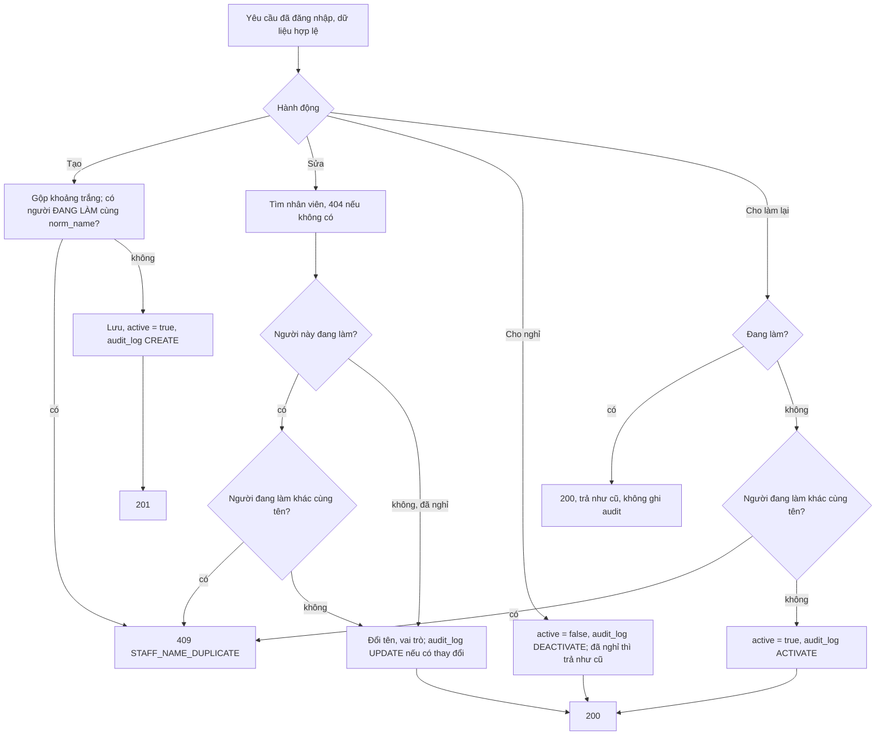

# Quản lý nhân viên

Trạng thái: khớp code · Card: S2-05 · Yêu cầu: FR-STF-01, BR-18

| Ngày       | Người         | Card / PR            | Thay đổi                                         |
| ---------- | ------------- | -------------------- | ------------------------------------------------ |
| 23/10/2026 | Đình (Claude) | chore/agent-workflow | Viết bù theo code đang chạy (S2-05, 1b9a9a9)     |

Phần chung của module (không xóa cứng, nhật ký, vai trò): `README.md` cùng thư mục.

## Mục tiêu

Chủ tiệm có danh sách nhân viên để chọn người làm khi ghi giao dịch (Sprint 3): thêm, sửa tên và vai trò, cho nghỉ,
cho làm lại. Hai người đang làm không trùng tên để không chọn nhầm.

## Điểm vào

| Loại     | Điểm vào                                                                                      | Ghi chú                                                                 |
| -------- | --------------------------------------------------------------------------------------------- | ----------------------------------------------------------------------- |
| API      | `GET /api/staff?q=&role=&active=&page=&size=` → `StaffController.search` → `StaffService.search` | trang từ 0, `size` mặc định 20, tối đa 100; người đang làm lên trước, rồi theo tên |
| API      | `GET /api/staff/{id}` → `get`                                                                 | 200                                                                     |
| API      | `POST /api/staff` → `create`                                                                  | body `{fullName, role}`, 201 kèm `Location`                             |
| API      | `PUT /api/staff/{id}` → `update`                                                              | thay toàn bộ, 200                                                       |
| API      | `POST /api/staff/{id}/deactivate`, `/activate` → `deactivate`, `activate`                     | cho nghỉ, cho làm lại; 200                                              |
| Màn hình | `features/staff/pages/StaffListPage` (route `/staff`), `components/StaffFormDrawer`           | bảng ở máy tính, thẻ ở điện thoại                                       |

Kiểm tra dữ liệu (`StaffRequest`): `fullName` bắt buộc, tối đa 100 ký tự; `role` bắt buộc, là `OWNER` hoặc
`THERAPIST` (giá trị khác là 400).

## Luồng

## Quy tắc nghiệp vụ

- Tên không trùng **chỉ giữa những người đang làm**, so bằng `norm_name` (không phân biệt hoa thường, khoảng trắng
  thừa); người đã nghỉ không chặn tên. Trùng thì thêm chữ để phân biệt, ví dụ "Lan A" (FR-STF-01).
- Kiểm tra trùng chỉ nằm ở service (`existsActiveByNormalizedName`); CSDL không có unique index cho tên nhân viên,
  nên hai request tạo cùng tên cùng lúc có thể cùng lọt. Tiệm có một người nhập nên chấp nhận.
- Sửa nhân viên đã nghỉ không kiểm tra trùng tên; trùng sẽ bị chặn khi cho làm lại.
- Chủ tiệm không tự động là nhân viên; có làm dịch vụ thì tự thêm mình với vai trò Chủ tiệm (FR-STF-01).
- Giao diện: mặc định lọc "Đang làm"; sửa người đã nghỉ thì form hiện cảnh báo "Nhân viên này đã nghỉ."; lỗi cho nghỉ,
  cho làm lại hiện `message.error` với thông báo của backend.

## Lỗi trả về

| HTTP | `code`                    | Khi nào                                                       | Giao diện hiển thị                         |
| ---- | ------------------------- | ------------------------------------------------------------- | ------------------------------------------ |
| 400  | `VALIDATION_FAILED`       | tên trống, quá 100 ký tự; thiếu vai trò, vai trò không hợp lệ | lỗi ở ô tương ứng (`fieldErrors`)          |
| 401  | `UNAUTHORIZED`            | chưa đăng nhập                                                | về trang đăng nhập                         |
| 404  | `NOT_FOUND`               | `id` không tồn tại                                            | `message.error`                            |
| 405  | (không có body nghiệp vụ) | gọi `DELETE`                                                  | không có nút xóa                           |
| 409  | `STAFF_NAME_DUPLICATE`    | tạo, sửa, cho làm lại trùng tên người đang làm                | lỗi ở ô Tên; cho làm lại thì `message.error` |

## Ảnh hưởng

Không (file viết bù theo code đang chạy). Khi làm giao dịch (Sprint 3): cho nghỉ một nhân viên đã có trong giao dịch
là chỗ cần xét theo `AGENTS.md` mục 7 (tham chiếu hai chiều); FR-STF-01 nói người nghỉ vẫn giữ trong lịch sử, chỉ
không hiện khi chọn người làm cho giao dịch mới.

## Hành vi và test

Tên test thật.

| Hành vi | Tầng | Chuẩn | Dữ liệu sai | Biên | Lỗi nghiệp vụ | Quyền | Không tác dụng phụ |
| ------- | ---- | ----- | ----------- | ---- | ------------- | ----- | ------------------ |
| Tìm, lọc | service, IT, Vitest | `searchFiltersByNameRoleAndStatus`, `listWithoutSearchTermWorks`; `hiển thị nhân viên với vai trò tiếng Việt, mặc định lọc đang làm` | không áp dụng: tham số tùy chọn | `likePatternEscapesWildcards` | không áp dụng | `requiresLogin` | không áp dụng: chỉ đọc |
| Xem một nhân viên | service, IT | thiếu | không áp dụng | không áp dụng | `getUnknownStaffIsNotFound`, `getUnknownStaffIs404` | `requiresLogin` | không áp dụng |
| Thêm | entity, service, IT, Vitest | `newStaffIsActive`, `createTrimsSpacesAndRecordsAudit`, `createReturns201AndAuditLog` | `invalidInputReturnsFieldErrors`, `unknownRoleIsBadRequest`; schema `báo lỗi tiếng Việt theo từng ô` | `activeNamesDifferingOnlyByCaseOrSpacesAreDuplicates`, `nameOfStaffWhoLeftCanBeReusedButNotReactivatedTwice`; schema `chấp nhận dữ liệu hợp lệ` | `createWithActiveDuplicateNameIsRejected`; `lỗi trùng tên từ backend hiển thị ngay dưới ô tên` | `requiresLogin` | `createWithActiveDuplicateNameIsRejected` |
| Sửa | entity, service, IT | `updateDetailsChangesNameAndRole`, `updateChangesNameAndRoleAndWritesAudit` | `invalidInputReturnsFieldErrors` | `unchangedDetailsDoNotTouchUpdatedAt`, `updateWithoutChangesWritesNoAudit` | `renamingToAnotherActiveStaffsNameIsDuplicate` | `requiresLogin` | `updateWithoutChangesWritesNoAudit` |
| Cho nghỉ, cho làm lại | entity, service, IT | `deactivateThenActivate` | không áp dụng: không có body | `deactivateAndActivateAreIdempotent`, `deactivateTwiceRecordsAuditOnce` | `reactivatingWhenAnotherActiveStaffHasSameNameIsRejected`, `nameOfStaffWhoLeftCanBeReusedButNotReactivatedTwice` | `requiresLogin` | `reactivatingWhenAnotherActiveStaffHasSameNameIsRejected` |
| Không xóa cứng | IT | không áp dụng | không áp dụng | không áp dụng | `deleteIsNotSupported` | `requiresLogin` | không áp dụng |

Ô "thiếu" là ca chưa có test; bổ sung khi card sau đụng vào module này.
