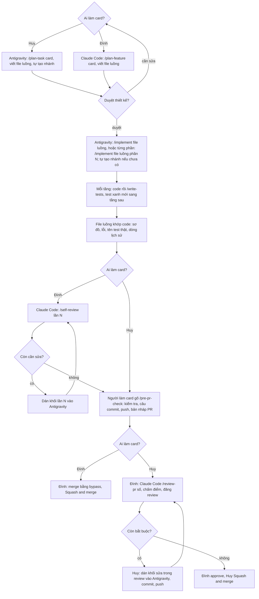
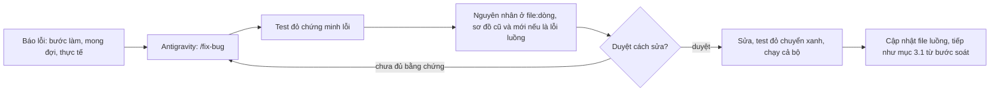

# Sổ tay dùng agent AI trong Xile Spa

Dành cho Đình và Huy. Quy tắc nằm ở `AGENTS.md` (mục 8 là vai trò từng agent); file này hướng dẫn **cách dùng**:
cài đặt, luồng làm việc, từng skill, hook.

## 1. Ai làm gì

| Agent                  | Người dùng | Việc                                                                     |
| ---------------------- | ---------- | ------------------------------------------------------------------------ |
| Antigravity            | Đình, Huy  | Thiết kế (Huy), code, test, tài liệu; tự tạo nhánh card; hướng dẫn git ở `/pre-pr-check` |
| Claude Code (máy Đình) | Đình       | Thiết kế cho Đình (`/plan-feature`), tự soát (`/self-review`), review PR của Huy (`/review-pr`) |
| Claude app (claude.ai) | Đình       | Cuối sprint: release, retro, lập kế hoạch và chia card sprint sau        |

Một nguồn quy tắc: nội dung chỉ viết ở `AGENTS.md`, `backend/AGENTS.md`, `frontend/AGENTS.md`. Mỗi agent có một lớp
trỏ mỏng để nạp đúng lúc:

| File quy tắc         | Antigravity nạp qua                | Claude Code nạp qua                |
| -------------------- | ---------------------------------- | ---------------------------------- |
| `AGENTS.md`          | tự đọc ở gốc                       | `CLAUDE.md` (`@AGENTS.md`)         |
| `backend/AGENTS.md`  | `.agents/rules/backend.md` (glob)  | `backend/CLAUDE.md` (`@AGENTS.md`) |
| `frontend/AGENTS.md` | `.agents/rules/frontend.md` (glob) | `frontend/CLAUDE.md`               |

Quy tắc là hướng dẫn, agent vẫn có thể làm sai; chỉ những gì hook chặn (mục 5) mới chắc chắn. Phần riêng của
Antigravity ở `.agents/`; phần riêng của Claude Code ở `.claude/` (chỉ ở máy Đình, không commit).

## 2. Cài đặt

### Antigravity (Đình và Huy, mỗi máy làm một lần)

1. Mở **thư mục gốc repo** làm workspace (không mở riêng `backend/` hay `frontend/`). Antigravity chạy lệnh hook
   từ thư mục `.agents/` (nơi có `hooks.json`), nên lệnh trong đó viết `node ../tools/agent-hooks/...`.
2. Cần Node 22+ (đã có cho frontend) và `npm ci` trong `frontend/` (hook format dùng Prettier của frontend).
3. Rules, skills, hooks tự nạp từ `.agents/`. Kiểm tra trong panel **Customizations**:
   - Rules: `writer-role` (luôn bật), `backend`, `frontend` (bật khi đụng thư mục đó), `migrations` (bật khi đụng
     thư mục migration).
   - Skills: `plan-task`, `fix-bug`, `implement`, `write-tests`, `new-migration`, `pre-pr-check`.
   - Hooks: `xile-guard`, `xile-format`, `xile-stop`.
4. **Thử rào chắn:** nhờ agent chạy `git push --dry-run`. Phải bị chặn kèm lời nhắc tiếng Việt. Nếu lệnh chạy được
   thì hook chưa nạp: kiểm tra bước 1 và báo trong nhóm.
5. **Quyền chạy lệnh** (Settings → Permission Settings) không lưu được trong repo, mỗi người tự đặt giống nhau:
   - Chế độ chạy lệnh terminal: **Request Review** (hỏi trước, trừ danh sách cho phép).
   - Cho phép tự chạy: `./gradlew test`, `./gradlew spotlessApply`, `./gradlew build`, `npm run format`,
     `npm run lint`, `npm run typecheck`, `npm test`, `npx vitest run`, `git status`, `git log`, `git diff`,
     `git show`, `git blame`, `git fetch origin`.
   - Không bao giờ tự chạy: `git push`, `git commit`, `git checkout`, `git reset`, `rm`, `docker compose down`.
     Hook vẫn chặn các lệnh nguy hiểm kể cả khi đặt sai ở đây.

Workflows (`.agents/workflows/`) của Antigravity đã ngừng chạy từ 19/10/2026; dự án chỉ dùng Skills.

### Claude Code (chỉ Đình)

Bộ `.claude/` (settings, skill `plan-feature`, `review-pr`, `self-review`) giữ riêng ở máy Đình, có README cài đặt đi kèm. Cần
GitHub CLI đã đăng nhập (`gh auth login`) để đọc PR và đăng review. Claude Code chạy bằng extension trong
Antigravity hoặc lệnh `claude` ở terminal, mở tại gốc repo.

## 3. Luồng làm việc

### 3.1 Một card, từ đầu đến merge

Ghi nhớ:

- Thiết kế trước, code sau: file luồng `docs/design/flows/<module>/<tính-năng>.md` là đầu vào của `/implement` và phải
  khớp code khi mở PR (`docs/design/flows/README.md`).
- Card lớn thì file luồng chia **phần**, mỗi phần một chức năng người dùng thấy, nền và nặng trước (thường là "Tạo").
  Mỗi phần đi một vòng `/implement ... phần N` → soát (Đình: `/self-review phần N`; Huy: đọc diff) rồi mới sang phần
  sau; hết phần cuối mới `/pre-pr-check`. Vẫn một nhánh một PR (`docs/design/flows/README.md` mục "Chia phần").
- Agent tự tạo nhánh card ở skill đầu tiên ghi file, chỉ khi đang ở `develop` hoặc `main`. Ngoài việc đó, AI không
  commit, không push, không đổi nhánh; người làm card chạy mọi lệnh git (CONTRIBUTING.md mục 8).
- Câu commit gợi ý có ở cuối mỗi lần `/implement`, `/fix-bug`, và khi `/self-review` thấy một phần sạch (theo
  CONTRIBUTING.md mục 3, chỉ câu); lệnh git (push, PR, squash) chỉ `/pre-pr-check` hướng dẫn, và chỉ khi người dùng gõ.
- Trong lúc Antigravity đang sửa file, không đổi nhánh.

### 3.2 Sửa lỗi

Không tái hiện được lỗi thì Antigravity dừng và hỏi thêm, không sửa "phòng hờ". Lỗi trên bản đã phát hành thì làm
nhánh `hotfix/*` theo CONTRIBUTING.md mục 6.

### 3.3 Cuối sprint (Claude app)

1. **Sprint review và retro:** Đình và Huy demo cho nhau. Kết quả retro (giữ, bỏ, thử) gửi vào dự án trên claude.ai.
2. **Release:** Claude app hướng dẫn theo CONTRIBUTING.md mục 6 (`release/vX.Y.0` → `main`, tag, merge ngược).
3. **Lập kế hoạch sprint sau:** Claude app tổng kết sprint vừa xong từ GitHub (PR đã merge, card còn dở, điểm đã
   làm), Đình chốt phạm vi; Claude viết `docs/backlog/sprint-*.md`, cập nhật `docs/roadmap.md`, chia card cho Đình
   và Huy, mở PR tài liệu vào `develop`. Đình dán card lên Trello.
4. Lỗi AI lặp lại trong sprint: thêm **một dòng** vào `AGENTS.md` (mục 4 hoặc 7) theo AGENTS.md mục 6.

## 4. Skill

### Antigravity (`.agents/skills/`)

Gõ `/<tên>` trong khung chat, hoặc nói việc cần làm; agent tự chọn skill theo mô tả. `/plan-task`, `/fix-bug`,
`/pre-pr-check` chỉ chạy khi người dùng gõ; trong `/implement` agent chỉ gọi `/write-tests`, `/new-migration`.

| Skill            | Khi nào                        | Kết quả                                                                                                                     |
| ---------------- | ------------------------------ | --------------------------------------------------------------------------------------------------------------------------- |
| `/plan-task`     | Bắt đầu card (Huy)             | Tạo nhánh; file luồng: điểm vào, sơ đồ Mermaid, quy tắc, lỗi, ảnh hưởng, bảng test; dừng chờ duyệt                          |
| `/fix-bug`       | Người dùng gõ, báo một lỗi     | Tạo nhánh `fix/`; test đỏ, nguyên nhân `file:dòng`, sơ đồ luồng cũ/mới, cách sửa; dừng chờ duyệt                            |
| `/implement`     | File luồng đã duyệt, khối sửa  | Tạo nhánh nếu chưa có; code theo file luồng, mỗi tầng có `/write-tests`; test đỏ ngoài dự kiến thì dừng và báo; báo cáo có "Skill đã gọi", "Khác thiết kế"; dừng |
| `/write-tests`   | Viết, bổ sung test             | Bảng ca test đủ sáu nhóm (AGENTS.md mục 10), test đã thử làm đỏ, kết quả chạy                                               |
| `/new-migration` | Đổi schema                     | `V{n}__...sql` mới, entity, ERD, test schema                                                                                |
| `/pre-pr-check`  | Chỉ khi người dùng gõ          | Kích thước PR, file code thiếu test; format, lint, test; checklist; câu commit, lệnh push, bản nháp PR, cách squash merge   |

Câu mẫu:

- `/plan-task S2-06` hoặc "Thiết kế card S2-06 quản lý nhóm dịch vụ".
- `/implement docs/design/flows/catalog/service-group.md`
- `/implement docs/design/flows/catalog/combo.md phần 1` (file chia phần, mỗi lần một phần)
- `/fix-bug docs/design/flows/auth/login.md Sai mật khẩu 5 lần liên tiếp nhưng tài khoản không bị khóa tạm.`
- `/pre-pr-check`

Sơ đồ trong file luồng là Mermaid, GitHub hiển thị thành hình khi xem file hoặc khi dán vào PR.

### Claude Code (máy Đình)

| Skill             | Khi nào                        | Kết quả                                                                                                                                      |
| ----------------- | ------------------------------ | -------------------------------------------------------------------------------------------------------------------------------------------- |
| `/plan-feature <card>` | Bắt đầu card của Đình     | File luồng của tính năng (soát chỗ bị ảnh hưởng, đánh giá nghiệp vụ, câu hỏi mở kèm đề xuất); dừng chờ duyệt                                |
| `/self-review`    | Code của Đình, trước khi mở PR | So code với file luồng, kiểm tra lại báo cáo của Antigravity, đánh giá nghiệp vụ; khối sửa "lần N" để dán vào Antigravity; không hướng dẫn git |
| `/review-pr <số>` | PR của Huy cần review          | Chạy test trên worktree riêng; soát code, thiết kế, nghiệp vụ; chấm điểm sáu nhóm; trả lời câu hỏi của Huy; khối sửa; Đình đồng ý thì đăng      |

Claude không approve và không merge; nhận xét đăng bằng tài khoản của Đình nên luôn có bước Đình đọc trước.

### Claude app

Skill `plan-sprint` trong tài khoản claude.ai của Đình: gọi khi bắt đầu lập kế hoạch sprint mới (mục 3.3).

## 5. Hook

Mã nguồn: `tools/agent-hooks/` (Node, không cần cài thêm). Test: `node --test tools/agent-hooks/hooks.test.mjs`.

| Hook         | Khi nào                       | Làm gì                                                                                                                                                                                                                                                    |
| ------------ | ----------------------------- | --------------------------------------------------------------------------------------------------------------------------------------------------------------------------------------------------------------------------------------------------------- |
| `guard.mjs`  | Trước mỗi lệnh, đọc, sửa file | Chặn git ngoài nhóm chỉ đọc (trừ Antigravity tạo nhánh card từ `develop`/`main`); `gh` làm đổi GitHub; xóa hàng loạt; `docker compose down -v`; đọc, sửa `.env`, khóa; sửa migration đã có trên `develop`; sửa file sinh tự động; sửa cấu hình hook                                                            |
| `format.mjs` | Sau khi Antigravity sửa file  | Chạy Prettier trên đúng file frontend vừa sửa                                                                                                                                                                                                             |
| `stop.mjs`   | Khi Antigravity kết thúc lượt | File Java đổi thì chạy `./gradlew spotlessApply` một lần; có code đổi thì nhắc tự soát test, Postman, backlog, báo cáo, kèm danh sách file code đổi mà chưa có test đổi theo (mỗi trạng thái nhắc một lần; không nhắc gì về git) |

Claude Code dùng chung `guard.mjs` (được thêm `git fetch`, `git worktree`, đăng review bằng `gh`; vẫn không
approve, merge, push).

**Khi bị chặn:** agent sẽ dừng và ghi lệnh cần chạy. Nếu đúng là việc của người thì tự chạy lệnh đó. Nếu thấy hook
chặn nhầm, sửa `tools/agent-hooks/` bằng tay, thêm test vào `hooks.test.mjs`, mở PR; đừng tắt hook. Agent không
được tự sửa thư mục này.

Sau khi agent ghi file, Prettier có thể đổi định dạng file đó; agent cần đọc lại file trước khi sửa tiếp (bình thường,
không phải lỗi).

## 6. Hỏi nhanh

- **Agent làm sai cùng một kiểu nhiều lần?** Thêm một dòng vào `AGENTS.md` mục 4 hoặc mục 7, trong PR của card đang làm.
- **Muốn đổi skill?** Sửa `.agents/skills/<tên>/SKILL.md` trong một PR riêng (`docs` hoặc `chore`), ghi lý do.
- **Antigravity hỏi có chạy lệnh git không?** Chỉ đồng ý với `status`, `log`, `diff`, `show`, `blame`, `branch`, và
  `git fetch origin` + `git switch -c <loại>/<mã-card>-<mô-tả> origin/develop` khi đang ở `develop` hoặc `main`.
- **Test backend đỏ hàng loạt vì không kết nối được database?** Mở Docker Desktop rồi chạy lại.
